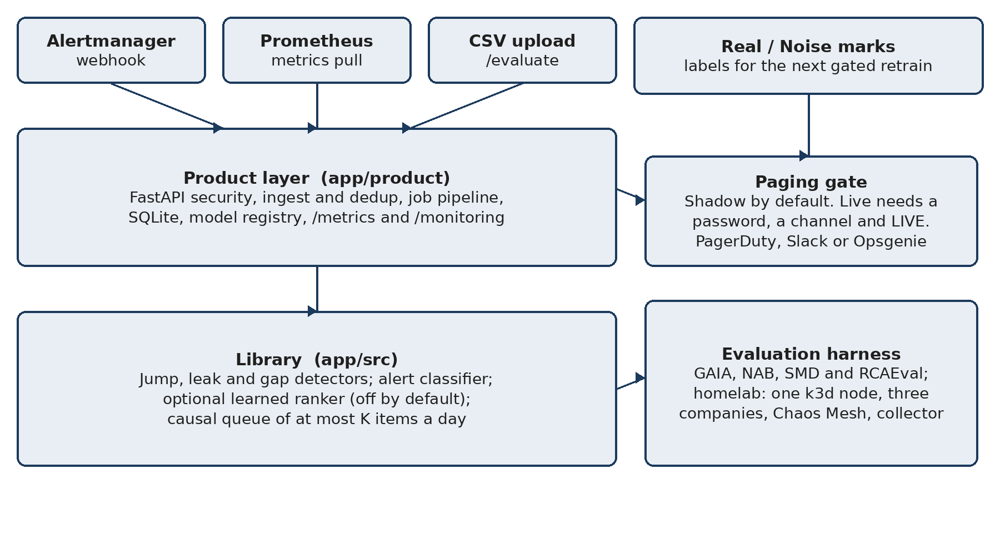
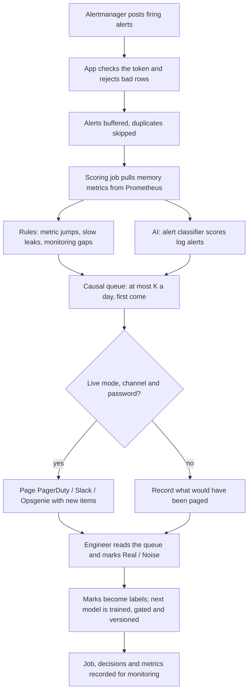

# AI-Assisted On-Call Queue: Budgeted Incident Detection for Cloud Microservices

Aishah Mohamed Alyammahi

## Abstract

On-call engineers can read only a few alerts a day. On the GAIA microservice benchmark, 82% of injected faults write no log line, so ranking alerts by log severity catches 0% of 1,223 test faults at a budget of K = 20. This project builds one causal queue of at most K items a day. Metric rules detect memory jumps, slow leaks and monitoring gaps. A cost-sensitive classifier ranks log alerts, and an optional learned ranker may choose among candidates. Shadow mode is the default: a job records what it would have paged, and Live paging needs a password, a channel and the typed word LIVE. At K = 20 the learned ranker catches 887 of 1,223 GAIA faults against a baseline of 851 (KEEP). On a three-company home lab it catches 68 of 559 pooled test faults against 51 for the same causal queue (KEEP). It does not win at K = 50, and it does not transfer to a company held out of training. The ranker flag stays off.

## 1. Motivation and objectives

An on-call engineer sees thousands of alerts and can check only a few. Faults are missed because attention runs out. The users are that engineer, the operator who connects Alertmanager and Prometheus, and a team scoring its own data. Alertmanager, PagerDuty Intelligent Alert Grouping and Opsgenie merge similar alerts. None of them chooses what fits a daily budget, and none treats a memory rise as an incident before an alert fires. The objectives are to beat those rules at a realistic K, to decide with no look-ahead, to ship authentication, safe paging, a model registry, monitoring and Docker, and to pass the test bar (at least 90% of tests, line coverage at least 85%, p95 under one second at 50 users).

## 2. Architecture and implementation

### 2.1 Architecture



Alerts arrive on POST /ingest/alertmanager. Metrics are pulled from Prometheus or uploaded as CSV on /evaluate. The product layer (app/product) is a FastAPI application: security middleware, an ingest buffer with deduplication, a job pipeline, SQLite, a model registry with a promotion gate and rollback, and /metrics and /monitoring. The library (app/src) holds the detectors, the alert classifier and the causal queue. An optional learned ranker stays off unless LEARNED_RANKER is set. Real or Noise marks become labels for the next gated retrain. The evaluation harness scores GAIA, NAB, SMD and RCAEval, and the home lab runs three simulated companies in shadow mode. Appendix H lists the HTTP routes and the library calls.

### 2.2 How the queue decides

A reading is hot when it is more than 0.5 GB above the 15-minute median. A second hot point within two minutes confirms a jump, shown only if the rise meets the week-1 threshold (0.62 GB on GAIA). Leaks use a three-hour median. A gap is ten minutes with no point. Items are first come, first served. Log alerts use at most a quarter of K, and an alert during an open jump on the same service rides on that jump. No decision uses a later point, the jump's end, or its peak (ADR 0001). Shadow is the default (ADR 0002). Storage is SQLite (ADR 0003). The classifier prices a miss as ten false alarms (ADR 0005). run_validate.py checks 195 of 195 numbers (ADR 0006). Dependencies are locked with uv (ADR 0007). A model is promoted only if it beats no-log-alerts and the fallback by one missed fault. LEARNED_RANKER, METRIC_MODEL and LLM_EXPLAIN stay off. A local LLM note cannot page.

### 2.3 Technologies and changes from the proposal

The stack is Python 3.10–3.12, FastAPI, scikit-learn, pandas, SQLite, Docker and GitHub Actions. XGBoost and PyTorch are optional. The home lab adds k3d, Helm, Chaos Mesh and Prometheus. The 95% target was dropped: about 22 faults a day makes 84.9% the ceiling at K = 20. The design became metric-first because 82% of faults leave no log. A causal threshold replaced ranking by a jump's final peak. The classifier is gated off on GAIA (848 caught with its alerts, 872 with none). The learned ranker and the three-company lab were added after the proposal review. The ranker stays off.

## 3. Testing, evaluation and results

### 3.1 Testing

Tests cover units, an integration stack with Prometheus and Alertmanager, security, performance and the AI path. On this commit, in app/, uv run pytest -q reported 450 passed and 10 skipped on CPython 3.12.3. uv run --with pyyaml pytest -q ../homelab/tests reported 62 passed. uv run ruff check . was clean. uv run python run_validate.py matched 195 checked numbers. An earlier draft of the expected product said 296 tests; that count is stale. A load test of 50 concurrent users recorded p95 0.32 s and no errors (Appendix C).

### 3.2 Method and success criteria

A fault is caught when a shown jump or leak on its service overlaps the injection window, or a shown alert carries its id. Gap items never count. Training uses the first week only. GAIA then has 55 test days and 1,223 faults. The home lab has 6 test days and 559 faults. Budgets are K = 5, 10, 20 and 50. A comparison is a KEEP only when the 95% paired bootstrap interval on the per-fault catch difference, 4,000 draws and seed 42, has a lower bound above zero. The success test is to beat the rules a team already runs, at K = 20, with fewer false items, and without look-ahead.

### 3.3 Results on GAIA

Table 1. GAIA test period, K = 20, 1,223 faults
| Queue | Caught | False/day | Note |
|---|---|---|---|
| Log severity | 0.0% | 0.8 | queue_eval_gaia.csv |
| Static p99 | 57.2% | 3.0 | same file |
| Prometheus rate rule | 68.9% | 2.1 | delta_5m |
| Causal queue (baseline) | 851 (69.6%) | 1.82 | proposed; precision 0.895 |
| Learned ranker | 887 (72.5%) | 1.0 | precision 0.9416; +0.0294 [0.0147, 0.0442]; KEEP |
| Best possible | 84.9% | — | 22 faults a day exceeds 20 slots |

The ranker row is docs/results/gaia_ranker_rerun/summary_by_k.csv (seed 42, 4,000 draws). Its baseline matches the proposed row. The same file's 887 on delta_5m_carryover in queue_eval_gaia.csv is a different queue. K = 5, 10 and 50 are DROP. Walk-forward pooled is KEEP, +0.0262 [0.0131, 0.0401]. The detector alone, jumps_tuned, is 72.6% with 1.0 false item a day and wins 8 of 8 weeks against the rate rule. That 72.6% is not the ranker's 72.5%. Median time to the confirming point is 0.72 minutes.

### 3.4 Results on the home lab

Table 2. Home lab day 12, pooled, 559 test faults; ranker caught 68 at K = 20
| Baseline | Caught | 95% CI | Decision |
|---|---|---|---|
| proposed | 51 | [0.0161, 0.0465] | KEEP |
| jumps_tuned | 54 | [0.0107, 0.0411] | KEEP |
| static_p99 | 15 | [0.0644, 0.1234] | KEEP |
| logs_severity | 0 | [0.0948, 0.1485] | KEEP |
| Alertmanager, severity-first | 21 | [0.0555, 0.1127] | KEEP |
| Alertmanager, first-come | 28 | [0.0429, 0.1002] | KEEP |
| proposed at K = 50 | 81 (ranker 75) | [−0.0215, −0.0018] | DROP |

At K = 20 the ranker precision is 0.6731 and false items a day are 5.67, against 0.4775 and 9.67 for proposed (pooled_bootstrap.csv, feedback_bootstrap.csv). The KEEP against proposed and static_p99 also holds at K = 5 and 10. Against tuned jumps it holds at K = 10 and 20 only; the K = 5 cell is DROP. Leave-one-company-out at K = 20 is DROP for acme (32 of 220), borealis (25 of 159) and cassini (21 of 180), each identical to its baseline. Alertmanager grouping merged none of the 762 routed episodes. On GAIA the learned hybrid at K = 20 catches 893 against the learned ranker's 887 (interval [0.0016, 0.0090], Appendix I), and the home-lab leave-one-company-out DROP still stands.

### 3.5 Interpretation

The system wins when attention is scarce, which is the alert-fatigue setting: pooled, in distribution, at K = 20. When a team can read every alert, at K = 50 or inside one company with a generous budget, the simpler queue or plain grouping catches more. The ranker does not transfer to an unseen company, so LEARNED_RANKER stays off.

## 4. Deliverables, setup and use

The repository is [https://github.com/amamsy90/alert-fatigue-reduction](https://github.com/amamsy90/alert-fatigue-reduction). Submitted commit: SUBMITTED_COMMIT_SHA (fill after merge). Version: 1.2.0. The delivery is the app, API and CLI, the Docker image, connectors, the home lab, the day-12 snapshot, experiment scripts and results, and seven ADRs. From `app/`: `docker compose up -d` serves http://127.0.0.1:8080 in shadow mode; `uv sync --group dev && uv run pytest -q && uv run python run_validate.py` runs the checks. `tools/fetch_*.py` downloads data and checks SHA-256 where a stable file exists. The workflow is webhook, scoring job, queue, Real or Noise mark, gated retrain, then optional Live paging. Commands, OS, Python, hardware and data access are in README.md. Assistants helped with review and drafting. The author owns the design, method and claims.

## 5. Conclusion

The queue is tested, deployable, and causal. At K = 20 the ranker beats the causal baseline on GAIA (887 against 851 of 1,223) and on the pooled home lab (68 against 51, 54, 15 and 0, and against 21 and 28 Alertmanager-style notifications, of 559). Severity catches nothing on either platform. The ranker loses at K = 50 (75 against 81) and in leave-one-company-out. GAIA uses one fault shape, and the classifier adds no catches there. Next is a shadow pilot, and a trace graph for network faults.

<!-- pagebreak -->

## Appendix A. Requirements, users and design detail

### 2. Problem definition

**What the problem is.** A cloud platform made of many small services raises thousands of alerts a day, but the engineer on call can read only a few. Real faults are missed because attention runs out, not because monitoring was silent.

**Who experiences it.** On-call engineers and small operations teams (primary), and the users of the platform when a fault is found late.

**Why it matters.** A fault that is noticed late lasts longer. Engineers who are paged for noise stop trusting the pager and start ignoring it ("alert fatigue").

**How it is handled today.** In a typical team, alerts come from two places. Log-based alerts are escalated when their severity label is high enough, for example "critical" or "error". Metric-based alerts are fixed rules written in Prometheus, such as "memory above a set level" or "memory rose by more than 0.5 GB in five minutes" (`delta(memory[5m]) > 0.5 GB`). Alertmanager then reduces repetition. It groups alerts that share chosen labels into one notification, mutes some alerts while related ones are firing, and routes each group to a receiver. Paging services add their own merging: Opsgenie merges alerts with the same alias, and PagerDuty's Intelligent Alert Grouping uses machine learning to merge similar alerts into one incident. All of these tools decide which alerts belong together. None of them decides which alerts are worth a person's limited time. Section B7 measures that difference on the homelab.

**Limits of the current approach.** Severity rules read only logs. On the public GAIA microservice benchmark, **82% of injected faults never write a log line**; they show up only as a jump in a metric such as memory, so a log-severity rule catches **0%** of them at 20 items a day (§B1). Fixed metric thresholds either miss faults or flood the queue, and none of these rules knows that a person can read only K items a day.

**How often.** GAIA injects about 22 faults a day on ten services, more than a 20-item budget on 34 of 55 days (§B1).

**If nothing changes.** Teams keep choosing between missed faults and ignored pagers. More monitoring makes it worse, because every new signal competes for the same attention.

**Why this is a software engineering project.** The answer is not one model. It is a system: ingest alerts and metrics from existing tools, decide under a budget in real time, page safely, learn from engineers' feedback, and be deployable, testable, monitored and reversible.

> **Problem statement.** On-call engineers can read only a few alerts a day, but the rules that choose those alerts read log severity, which most real faults never trigger, so faults are missed while noise still reaches the pager.

### 3. Objectives and expected outcomes

**Main objective.** Design, build and evaluate an AI-assisted on-call queue that shows each engineer at most K items a day, in real time, and catches more real faults with fewer false items than the rules teams already run.

**Specific objectives (measurable).**

| # | Objective | Target | Result |
|---|---|---|---|
| O1 | Beat the rules a team already runs at a realistic budget | More faults caught at K = 20 than log severity, a static threshold and a Prometheus rate rule, with fewer false items | Detector 72.6% vs 68.9% (rate rule), 1.0 vs 2.1 false items a day; wins 8/8 walk-forward weeks (§B1, §B2) |
| O2 | Decide in real time | No decision uses later data; confirmation within about a minute | Median 0.72 min; `tests/test_causality.py` (§B1) |
| O3 | Engineer it for production | Authentication, safe paging, versioned models with rollback, monitoring endpoints, Docker | Done (§7, §9, §10) |
| O4 | Test it properly | ≥ 90% of tests passing, coverage ≥ 85%, p95 ≤ 1 s at 50 users | 450 passed, 10 skipped, 86.19% line coverage (8,077 of 9,370 statements; criterion met), 0.32 s (§8) |
| O5 | Let another team check it on its own data before trusting it | Evaluate my data works end to end without code, against a chance line | Done; NAB, SMD and RCAEval results reported, including failures (§B5) |

**Expected final product.** A working web application and REST API (FastAPI) with a queue page, Connectors page and *Evaluate my data* page; a backend scoring service; an AI component (a cost-sensitive alert classifier with a model registry) next to rule-based metric detectors; a SQLite store; connectors for Alertmanager, Prometheus, PagerDuty, Slack and Opsgenie; a command-line tool; 450 passed and 10 skipped on Python 3.12.3 at the submission re-run (an earlier draft said 296 tests) and CI; a Docker deployment with per-environment settings; `/metrics` and `/monitoring`; technical documentation (`docs/`); and this report.

### 4. Target users and use case

**Primary users.** On-call engineers (site reliability or operations) on a team running microservices.

**Secondary users.** The team lead or operator, who installs the tool, decides when it may page and which model is active; platform owners who read the monitoring page; an evaluating team trying it on past data; examiners and researchers reproducing the results.

| User | Needs |
|---|---|
| On-call engineer | A short list, in order, that contains the real faults; a reason for each item; a way to say "this was noise" |
| Operator / team lead | Safe installation; nothing paged by accident; secrets kept safe; a way to undo a bad model; health at a glance |
| Evaluating team | Proof on its own data, with a fair baseline and a chance line, before trusting it |

**System usage.** Alertmanager posts alerts to the app all day; the app pulls memory metrics from Prometheus; a scoring job runs on each webhook batch (or on demand). The engineer opens the queue page during the shift and receives pages in Live mode. They provide nothing but marks: Real or Noise on items. The system produces the day's queue (metric jumps, slow leaks, monitoring gaps and escalated or "ask a person" alerts, at most K), each with a reason. After that, the engineer investigates the item; the mark becomes a label for the next model.

**Use-case flow.**



**UML use-case diagram.** Actors on the left are people; actors on the right are the systems the tool talks to. Scoring a batch always includes training and gating a model when labels exist, and paging (which sends only in Live mode); a Real / Noise mark extends training with a new label. The figure is drawn by `app/make_figures.py`.


### 5. Why use AI?

**What needs AI.** Deciding which *log alerts* are worth a slot. Their text, source, severity and timing interact in ways fixed rules do not capture, and the right answer differs per team. A classifier trained on the team's own labels (and later its own Real / Noise marks) learns that, with a miss weighted ten times a false alarm.

**What traditional software handles.** Everything else, deliberately: ingesting webhooks, the metric detectors (a rise above the recent median is a rule, chosen on week 1 only), monitoring-gap detection, the daily budget, paging, storage and security. On GAIA the rules do most of the work: where metric data exists, the jump rule overlaps 99.6% of faults (§B6).

**Why a rule-based approach alone is insufficient for alerts.** Severity is noisy: "high" alerts are often benign and "info" lines appear during real faults. A fixed severity rule cannot use message text or the fact that an alert arrived during a memory jump, and it cannot adapt when engineers mark items as noise.

**AI technology.** Supervised classification: logistic regression on TF-IDF text features, source, severity, recent alert counts and an inside-a-jump flag (scikit-learn). A second learned piece, the confirmation threshold, is a cost-minimising cut on the training window. Two different rankers need to be kept apart. The experimental jump ranker in §B4 replaces the rise threshold with a logistic regression on jump features. On GAIA at K = 20 it catches 69.7% against the full queue's 69.6%, which is no gain, and it stays an experiment. The later learned ranker (PR #26, commit `2b78bbb`, flag `LEARNED_RANKER`) chooses among the day's candidates. A re-run on 3 November 2026, `run_model_ablation.py --data gaia --device cuda --backend xgboost --epochs 8` (seed 42, 4,000 bootstrap draws), on master `20d5664`, is in `docs/results/gaia_ranker_rerun/`. At K = 20 it caught 887 of 1,223 faults against that run's baseline of 851. The baseline is the current causal queue and matches the `proposed` row of `app/results/queue_eval_gaia.csv` (851 of 1,223, precision 0.895, 1.82 false items a day). The per-fault catch difference is +0.0294, interval [0.0147, 0.0442], KEEP. Precision is 0.9416 against 0.895, and false items a day are 1.0 against 1.82. K = 5, 10 and 50 are DROP. Walk-forward pooled is KEEP, +0.0262 with interval [0.0131, 0.0401] (`walk_forward_pooled.json`). GAIA has no companies, so this is a time split, not leave-one-company-out. The 887 on the `delta_5m_carryover` row of `queue_eval_gaia.csv` is a different queue. `LEARNED_RANKER` stays off. The homelab measurement is §B7.

**Existing model or API.** An existing, well-understood model family (scikit-learn logistic regression) trained locally; no external AI API or LLM, so no data leaves the server and there is no per-call cost.

**What the classifier adds, measured.** An ablation on GAIA (`run_classifier_ablation.py`, §B4) keeps the whole queue and changes only how log alerts are chosen for their quarter of the slots. At K = 20 the queue with the classifier catches 69.6% with 1.8 false items a day; with log severity instead it catches 71.0% (1.4 false a day); with no log alerts at all, 71.2% (1.2 false a day). **On GAIA the classifier adds no catches; it costs about 1.6 points and 0.6 false items a day**, because 82% of GAIA faults write no log line and the alerts it escalates spend slots that jumps would have used. Its value is therefore not shown on this benchmark. It is kept for teams whose faults *do* log: it is the only part that learns from that team's Real / Noise marks (a Noise mark becomes a negative label at the next retrain), and alerts can never take more than a quarter of the budget. **It is not on by default.** A trained model is used only if, on the held-out part of its batch, it beats the same queue *without* log alerts and the queue it would fall back to by at least one missed fault's worth of cost (§9). The first model has to pass too. On GAIA it does not (848 vs 872 of 1,223 held-out faults caught, §B4), so the tool keeps it as a candidate and scores GAIA with rules only. **On a second dataset it does add catches where faults log.** On RCAEval RE2 Train Ticket the classifier lifts the queue from 60.0% to 73.3% of 45 test faults at K = 10: +13.3 points over no log alerts (95% interval +4.4 to +24.4), +2.2 over severity alerts (71.1%, one case). The gate promotes it there, by exactly its margin, but it was run on the same 45 cases that are scored, so that decision is not an independent test (§B5); on Online Boutique, Sock Shop and the RE3 code faults it adds no catch beyond one case, and the gate keeps it out (§B5).

**Limitations of AI here.** It needs labels of both classes, so a new team starts in rules-only mode; learned thresholds do not transfer between datasets (one learned on GAIA's 1 GB faults rejects 0.5 GB faults, §B3); and 82% of GAIA faults leave no log, which caps a log-only model near 18% (§B6).

### 6. AI component and technical approach

| Question | Answer |
|---|---|
| AI technology | Cost-sensitive logistic regression for log alerts; rule-based metric detectors beside it |
| Existing model or own? | An existing model family, trained on the team's own labelled data; not a new algorithm |
| Input | Each alert: time, source, severity, type, message; whether it fell inside a confirmed memory jump; recent counts from the same source |
| Output | P(alert is a real fault), turned into an action: escalate, ask a person, or hide, with a reason |
| Data needed | Past alerts with incident windows, or Real / Noise marks; memory series for the detectors |
| How the software talks to it | In-process: `pipeline.score_alerts` calls the classifier; models are loaded from the registry (`product/model_store.py`) |
| If it is wrong | The queue is capped at K; uncertain alerts go to a person; engineers mark Noise; a model is not promoted unless it beats the queue without log alerts and the queue it replaces by at least one missed fault's worth (and is no worse than the active model) on held-out data, and the operator can roll back |
| Main limitation | Label-hungry; helps only services that log |

**How the queue decides** (details in §B1 and `design_specification.md`). One queue, at most K items a day, first come, first served:

1. **Metric jumps.** For every new memory reading, the system compares the value with the median of the same service's readings over the previous **15 minutes**. If the reading is more than **0.5 GB** above that median, it is marked as hot. One hot reading could be noise, so a jump is confirmed only when a second hot reading follows within two minutes. At that moment the jump becomes a candidate for the queue. It is shown only if the rise measured at confirmation is at least as large as a threshold learned from the first week. On GAIA that threshold is **0.62 GB**: the size that, on week-1 data, gave the lowest combined cost of missed faults and false items.
2. **Slow leaks.** The same rule with a **3-hour** median and 10 minutes of hot points catches memory that climbs over hours. A leak is dropped only when a fast jump on the same series was already shown when the leak was confirmed.
3. **Monitoring gaps.** A service with no metric point for **10 minutes** is shown as a gap item ("we are blind here"), also while the feed is still dead.
4. **Log alerts** may use at most **a quarter** of the slots (5 of 20), first come. An alert on a service whose shown jump is still open rides on that jump and uses no slot.

Every decision uses only information that existed at the moment the decision was made. In particular, the queue never uses a reading from later in the day, never waits to see when a jump ends, and never uses how high a jump eventually peaks. All three would make the results look better than a live system could achieve. This rule is recorded as design decision ADR 0001 and checked by `tests/test_causality.py`. For metrics that are not bytes, a relative mode (a share of the median) and a unit-free robust mode exist.

**Training on GAIA.** GAIA MicroSS (CloudWise), July–August 2021: 34,863 log lines, 1,367 injected faults, each holding **1 GB of extra memory for 600 s** on one service. Train on the first 7 days; test on the next 55 days (**1,223 faults**); days are never shuffled.

| What is learned | How |
|---|---|
| Jump size 0.5 GB | Chosen on week 1 only (`run_memory.py --sweep`) |
| Jump confirmation threshold | Rise at confirmation with the lowest week-1 cost → **0.62 GB** |
| Alert classifier and its threshold | Logistic regression on week-1 alerts; threshold with the lowest week-1 cost (a miss = 10 false alarms) |
| Static-rule baseline | Week-1 99th percentile per service |

**Production design.** Two layers: a library that knows nothing about HTTP (`app/src/`) and a product layer (`app/product/`) with the web app (`product/web/`: security middleware, three route modules), the job pipeline (inputs, labels, paging), storage, connectors, the model registry and monitoring. Diagrams (context, components, ingest-to-page sequence, deployment, data model): `docs/architecture.md`. Decisions: `docs/adr/`. Threats and mitigations: `docs/threat_model.md`.

### 12. Project scope and limitations

**In scope (built):** the causal budgeted queue (jumps, leaks, gaps, alerts); the alert classifier with a model registry, promotion gate and rollback; the web app, API and CLI; Alertmanager, Prometheus, PagerDuty, Slack and Opsgenie connectors; *Evaluate my data*; shadow mode and marks; security hardening; monitoring endpoints; Docker and per-environment settings; CI; the GAIA, NAB, SMD and RCAEval evaluations.

**Out of scope (not built):** automatic remediation; multi-tenant hosting and user roles; LLM summaries of incidents; dedicated CPU, disk or network fault detectors inside microservices (the unit-free jump rule is measured on such faults on SMD servers and RCAEval RE2, §B5); a managed cloud deployment; browser UI tests; a live pilot with a real team (the next step).

**Limitations** (say these if asked):

1. **Every GAIA fault is the same 1 GB, 600 s memory program.** The robustness replay (§B3) tests other sizes and shapes. §B5 tests other domains (NAB, a shop, SMD servers) and, on three other microservice applications, the same memory injection and CPU, disk, network and code faults with logs (RCAEval), with small test sets and a chance line.
2. **The win over a plain Prometheus rate rule is modest** (+3.7 points for the detector, 8/8 weeks; +0.7 for the full queue, which ties it week by week). The larger gains are fewer false items, a real-time queue, and leak and gap coverage. Carry-over lifts both rules about equally.
3. **K = 20 is below the fault rate** (22 a day), so no method can exceed 84.9%.
4. **Learned thresholds do not transfer.** One learned on GAIA's 1 GB faults rejects 0.5 GB faults. Rules-only mode works without labels; the per-series confirm levels (§B4) are measured but not in the headline.
5. **The alert classifier adds no catches on GAIA.** With log alerts chosen by severity, or left out, the queue catches slightly more (71.0% and 71.2% vs 69.6% at K = 20) with fewer false items (§5, §B4). The later learned ranker is a separate model and is reported in §B7. The classifier is kept for teams whose faults log and who mark items: on RCAEval RE2 Train Ticket, where faults log on the broken service, it adds 13.3 points over no log alerts (95% interval +4.4 to +24.4) and 2.2 over severity alerts (one case), and the gate promotes it, by exactly its one-fault margin over severity alerts, judged on the same 45 cases that are scored (§B5); on the other five RCAEval application suites it adds at most one case, and the gate keeps it out (§B5). The promotion gate now checks this on every batch, and on GAIA it keeps the classifier out (§9, §B4).
6. The scripts in `app/experiments/legacy_alerts_only/` are alerts-only milestone experiments. Do not quote them as the system result.
7. **The homelab ranker does not transfer to a held-out company.** On the day-12 snapshot the pooled ranker is a KEEP against `proposed` and `static_p99` at K = 5, 10 and 20, and against tuned jumps at K = 10 and 20. K = 5 against tuned jumps is a DROP, because the interval includes zero. At K = 50 it is a DROP against the proposed queue, which catches more. Leave-one-company-out is a DROP for acme, borealis and cassini, with the same catches as the baseline (§B7). `LEARNED_RANKER` stays off.

**Future work.** Linking the homelab's Tempo spans to the trace-graph model, so network faults whose symptoms land on another service can be tied to a call graph rather than to co-firing alone (§B7.3). A gate window separate from the scored window on RCAEval (it needs more cases per application than the 45 used here), and a live, continuous log stream (RCAEval recordings are 24–30 minutes, replayed one a day) to confirm the RE2 result for the classifier; a pilot with one team in shadow mode, measuring precision from marks. R1 through R8 in `docs/threat_model.md` are closed and tested: the Prometheus fetch uses the address it checked, login locks out (behind a trusted proxy the client is read from the right of `X-Forwarded-For`, across every header line; a code review on 10 October found the leftmost, client-written value was used, which let a client dodge the lock, and that only the first header line was read; both are fixed with regression tests), paging is by item key, models load through skops, sign-in sets a session cookie, a viewer password cannot change settings, the audit log is also a file, and paging secrets stay out of `ops.json`.

## Appendix B. Deployment, MLOps, monitoring and privacy

### 7. Deployment strategy

One Docker container per team, on the team's own server or VM, behind a TLS reverse proxy; SQLite and the model registry on a Docker volume; the model runs in-process; alerts arrive from Alertmanager and metrics are pulled from Prometheus; pages go to PagerDuty, Slack or Opsgenie. The image is built from a hash-pinned lock file.

| | Development | Test | Production |
|---|---|---|---|
| Where | Laptop | GitHub Actions; a shadow instance next to production | Team server |
| Settings | `app/deploy/dev.env` | `app/deploy/test.env` | `app/deploy/prod.env` (from the example; not in git) |
| Paging | Never | Never (records *would have paged*) | Only after a shadow period and a deliberate Live switch |

Measured capacity: 50 concurrent users at 228 requests/s with p95 0.32 s; a 400-alert webhook batch scores in 0.2 s and the full GAIA month in about a minute (54.9 s, below; target ≤ 5 min). The design runs one worker per team; the scaling path is one container per team, or PostgreSQL with shared locks for a shared deployment (ADR 0003). Sign-in sessions, the login lock and the ingest rate counters are kept in `auth.db` (SQLite beside `ops.json`; session tokens stored as SHA-256), not in process memory, so a restart or redeploy no longer signs everyone out or clears a lock earned by guessing passwords (version 1.0.2; `test_auth_store.py` starts the app twice in separate processes). The job, evaluation and `ops.json` locks are still in-process, so the app stays one worker.

**Resources and operating cost (learning objective 11).** Measured with `app/perf/resources.py`, which runs the product's own scoring job on the GAIA month (34,863 alerts, 62 days, shadow mode) against a throw-away database on the author's Windows laptop (20 logical CPUs, Python 3.12; `results/resources_gaia.json`):

| Resource | Measured |
|---|---|
| Wall time for the whole month in one job (load, score, train and gate, store) | 54.9 s (median of 3 runs: 53.7, 54.9, 55.7 s) |
| Peak memory of the process | 505 MB (173 MB of it is Python and the libraries before the job) |
| Database growth | 13.0 MB for 62 days: about 215 KB per day at GAIA's alert volume |
| One saved model version | 0.02 MB |
| Calls to an external AI service | none, so $0 per call |

**One timing, one machine.** Earlier versions of this report gave two times for the GAIA month: 27 s (a manual timing from 28 September, with no record of the machine or code version) and 35.7 s (one run of `perf/resources.py` on 11 October). Both were re-measured on 11 October on the same laptop with the same code, three runs of `perf/resources.py`: 53.7, 54.9 and 55.7 s. The laptop was on battery power (Windows *Balanced* plan) with other programs open, which may explain why it was slower than the earlier run; the 27 s figure cannot be reproduced and is no longer used. Every document now gives this one measurement. Wall time depends on the machine; the target (≤ 5 min) holds either way.

The cost estimate below rests on **assumptions**, stated so they can be changed: one container per team, running all month (730 hours), on a 2 vCPU / 4 GiB cloud VM (the measured peak of 505 MB leaves room for the web app and the operating system), with a 20 GB disk. Prices are AWS list prices for US East (N. Virginia), Linux, read on 11 October 2026: t3.medium $0.0418 an hour on demand and $0.025 an hour with a 1-year reservation ([AWS T3 page](https://aws.amazon.com/ec2/instance-types/t3/)); gp3 disk at $0.08 per GB-month (the rate in [AWS's EBS pricing examples](https://aws.amazon.com/ebs/pricing/)). Other providers and regions differ; a team's own server costs only its share of an existing machine.

| Item | Per team per month |
|---|---|
| VM, on demand (0.0418 × 730) | $30.51 |
| VM, 1-year reservation (0.025 × 730) | $18.25 |
| Disk, 20 GB gp3 (one year of jobs at GAIA's volume is about 78 MB) | $1.60 |
| AI inference | $0 (in-process scikit-learn model) |
| **Total** | **about $20–32** |

Not priced: data transfer (pages are a few KB), backups (a copy of a 13 MB database), and the largest cost, people: the queue exists to spend on-call hours on at most K items a day.

**AI governance.** The operator is responsible for the AI. It may only order and select items in the queue (escalate, ask a person, hide with a reason); it never acts on infrastructure. Humans review everything in shadow mode, answer "ask a person" items, and mark Real / Noise. Every decision records its reason, score and the model version. New models pass a promotion gate and can be rolled back; the change is audited. No data is sent to an external AI service. Full answers: `docs/deployment.md`.

### 9. MLOps

- **Versioning.** Code in Git through pull requests; dependencies in `uv.lock` and a hash-pinned `requirements.lock`; configuration in `src/config.py` and per-environment files; data by fingerprint in the experiment log; **models as numbered versions with model cards** in `models/registry.json` (training time, data fingerprint, code version, held-out results, gate decision). No prompts (no LLM).
- **Reproducibility.** `uv sync --group dev`, `uv run pytest`, `uv run python run_validate.py`, `docker compose up`; every environment variable is documented; the public datasets are fetched by scripts (`tools/fetch_gaia.py`, `fetch_nab.py`, `fetch_smd.py`, `fetch_rcaeval_mem.py`, `fetch_rcaeval_re23.py`), and `fetch_gaia.py` and `fetch_rcaeval_re23.py` check the SHA-256 of every file used.
- **Model updates.** A new model is trained when a batch has labels of both classes, on the batch's first 7 days, and tested on the rest. It becomes active, and scores the batch, only if on that held-out window (1) it costs less than showing no log alerts (a miss = 10, a false alarm = 1); (2) the whole queue with its alerts costs less (a missed fault = 10, a false item = 1) than both the queue without log alerts and the queue the batch falls back to if the model is refused (the active model, or rules only = severity), by at least a margin of one missed fault (10; `PROMOTION_MIN_SAVING_MISSES`, default 1), so the model is tested against what would actually run and a saving that one held-out case could produce on its own does not promote it; and (3) it costs no more than the active model on the same held-out alerts. The first model is not promoted just because none is active. A model that fails stays a candidate, and the batch is scored by the active model, or by rules only. On GAIA the classifier passes (1) and fails (2) (§B4), so rules only stays. The operator can roll back to any version (`POST /models/{version}/activate`, hash-checked, audited). Precision from engineers' marks and alert-volume drift are monitored, and a retrain is suggested after 7 days or new Real marks.
- **Why the margin is one missed fault.** The held-out queue cost is counted in whole faults (10 each) and false items (1 each), so a single held-out case that flips moves it by 10. A saving smaller than that could come from one case alone, and the held-out windows are small (14–45 faults on RCAEval). Before the margin, the classifier was promoted on RCAEval RE2 Online Boutique for 3 false items fewer in 45 days (cost 283 against 286 by severity and 291 without log alerts); it is now kept as a candidate. The margin is a setting, not a fit: 0 restores the earlier rule (any strict saving), and a team that wants more evidence can raise it. It was, however, chosen after the RCAEval gate results were seen, so the RCAEval decisions in §B5 are not an independent test of it. The setting is named in missed faults (`PROMOTION_MIN_SAVING_MISSES`), but it is a cost: on RE2 Train Ticket the saving of 10 comes from 10 fewer false items (212 against 222 by severity), not from a missed fault saved; both queues catch 32 of 45. On RCAEval the gate was also run on the same cases that are scored (the later half of each application's recordings), so "promoted on Train Ticket" was decided on its own test set and says what the gate does for that half, not that the decision would hold on later cases (§B5 caveats).
- **Retrain and rollback triggers.** Numeric, from the signals the tool already records. *Automatic* rows are enforced by code; *operator* rows are the runbook (the tool shows the signal, a person acts; it never rolls back on its own).

| Trigger | Threshold | Action | Who |
|---|---|---|---|
| Model age | ≥ 7 days since training (`RETRAIN_AFTER_DAYS`) | `retrain_due` reminder on the Queue page: run a job with labels (every such job trains and gates a new model) | Automatic flag |
| New labels | ≥ 1 new Real mark since training | Same reminder | Automatic flag |
| Alert-volume drift | last batch ÷ median of earlier batches outside 0.5–2 | Retrain on the next batch; check the alert sources | Operator, from `/monitoring` |
| Precision from marks | < 0.70 with ≥ 20 marks | Retrain; if it stays < 0.70 for the next 20 marks, roll back | Operator, from `/monitoring` |
| Promotion gate | new model's held-out queue does not cost at least one missed fault (10) less than both the fallback queue and the no-log-alerts queue | Model is not activated (kept as a candidate) | Automatic |
| After an activation | precision from the first 20 marks < 0.70, or more than 0.10 below the previous version's | Roll back: `POST /models/{version}/activate` with the previous version | Operator |
| After an activation | escalated alerts per job more than twice the median of the 7 jobs before it, or a failed scoring job | Roll back as above, then investigate | Operator |

- **Testing before release.** CI for code; the promotion gate and shadow mode for models.
- **Experiment tracking.** Every experiment script appends to `app/results/experiments.jsonl`: commit, library versions, configuration, data fingerprint, output hashes, headline metrics and the reason for the run.

Details: `docs/mlops.md`.

### 10. Monitoring and evaluation

`GET /metrics` (Prometheus) and `GET /monitoring` (checked summary) cover:

| Area | Signals | Target |
|---|---|---|
| AI performance | Precision from Real / Noise marks; model used and version per job; promotion decisions | ≥ 0.70 with ≥ 20 marks |
| Software / system | Latency by route, 5xx rate, job duration and outcome, pages sent and failed, `/health` | p95 ≤ 1 s; 5xx ≤ 2%; 0 failed pages |
| Data | Alert-volume drift (last batch vs median), monitoring gaps, rejected and duplicate rows, buffer size | ratio 0.5–2; ≤ 3 gaps |
| AI / model | Output mix per job (escalated / asked / hidden), items by kind | Watch for sudden shifts |

Evaluation criteria with measured values, justification for each target and example alert rules: `docs/monitoring.md`. Offline evaluation is Part B.

### 11. Privacy and responsible AI

**Privacy.** Alert messages may contain host names or user IDs. All data stays on the team's server (SQLite and a volume), behind the login. Messages are cut to 300 characters, and IDs and numbers are normalised before learning. Jobs and evaluations are pruned; marks keep only service and time (retention table below). No data is sent to an external AI service; only paging summaries go to the team's own paging tools, in Live mode.

**Data retention.** Most limits are counts, set by environment variables; the period they give depends on how often jobs run. The periods below assume one scoring job an hour (Alertmanager batches) where a count is converted; rows marked *policy* are what the operator should enforce, because the code does not delete them.

| Data | Kept by the code | Period (assumption: one job an hour) | Policy |
|---|---|---|---|
| Ingest buffer (raw webhook rows) | until the next successful job | ≤ 1 hour | — |
| Duplicate fingerprints | `INGEST_DEDUP_HOURS` = 24 | 24 hours | — |
| Jobs: alerts, decisions, items | newest `JOB_RETENTION` = 200 jobs | about 8 days (200 days at one job a day) | — |
| *Evaluate my data* uploads | newest `EVAL_RETENTION` = 30 | depends on use | delete uploads after 30 days |
| Real / Noise marks (kind, service, time window; no message) | kept | — | 12 months, the training window a team needs |
| Model versions and model cards | every version that was ever active is kept; refused candidates keep their file only for the newest `MODEL_CANDIDATE_KEEP` = 20; every card is kept | size-bound for candidates | keep the active version and the last 5; delete older after 12 months |
| Audit log file | rotated at `AUDIT_LOG_MAX_BYTES` = 1 MB, one old file kept | size-bound | ship to the team's log store and keep 12 months |
| Backups (`product.backup`) | in a folder the operator owns | — | 30 days |

**Finding and deleting one person's data (a data-subject request).** People named in logs have no table of their own: their ID (user ID, e-mail, host name) can only appear in text the team sent. Everything is on the app's volume (`/app/product/data`). Stop the app (`docker compose stop`), open a shell on the same volume (`docker compose run --rm oncall-queue sh`, then `cd product/data`), and for an ID `X`:

- **queue.db** (`python -m sqlite3 queue.db`). Find it with `instr(column, 'X')` in `decisions.message`, `decisions.alert_id` and `decisions.source`; `jobs.meta_json` (the *would have paged* summaries carry up to 200 characters of a message); and `ingest_buffer.payload_json` (raw webhook rows not yet scored). Erase with `UPDATE decisions SET message = replace(message, 'X', '[erased]') WHERE instr(message, 'X');`, the same `replace` on `jobs.meta_json`, and `DELETE FROM ingest_buffer WHERE instr(payload_json, 'X');`. Redacting keeps the queue history and the item ids that Real / Noise marks point to. `jumps` and `feedback` hold no message text (kind, service and times only); `ingest_seen` holds SHA-256 fingerprints that expire after 24 hours.
- **auth.db** (operators, not people in the logs): `sessions.user` is the login name (`DELETE FROM sessions WHERE user = 'X';` signs them out); `events.client` and `locks.client` are client IP addresses.
- **Files.** `grep -rl 'X' audit.log* evals/` finds audit lines (`user=`, `client=`) and *Evaluate my data* uploads (`evals/<id>/*.csv`): delete that evaluation folder and edit the audit file. `model.pkl` and `models/*.pkl` hold a text vocabulary of at most 300 terms, learned after IDs and numbers are normalised, so an ID is normally not in it; if a name is, train a new version on the cleaned data, activate it and delete the old file.
- **Copies.** Backups from `product.backup` hold the same files (apply the same steps, or let them expire after 30 days); summaries already paged to PagerDuty, Slack or Opsgenie must be deleted there.

**Responsible AI.** Fairness between services: metric rules treat every service the same, and alerts are capped at a quarter of the budget, so services that log a lot cannot crowd out the rest. Every item carries a reason. Humans oversee through shadow mode, "ask a person" and marks. Hidden alerts stay visible. The system never acts on infrastructure. Queue data should not be used to rate engineers. Details: `docs/privacy_responsible_ai.md`.

## Appendix C. Testing detail and success criteria

### 8. Testing strategy

| Level | What | Examples |
|---|---|---|
| Unit | Detectors, queue, policy, scoring, settings | first come beats biggest first; a jump is confirmed at its second point |
| Integration | Frontend routes ↔ backend ↔ database, with outbound calls mocked | webhook → buffer → job → queue; Live fans out to every channel; model rollback through the API |
| System | The whole pipeline on GAIA, NAB, SMD and RCAEval; `experiment.py` on a synthetic run | walk-forward over 8 weeks; later data changes nothing |
| AI-specific | Wrong or poor outputs, unexpected input, edge cases | a malformed webhook row is rejected instead of blocking every later job; one-class labels fall back to rules; a worse model is not activated; hidden alerts stay visible |
| Security | Login, SSRF, CSRF, DNS rebinding, secrets, body limits | loopback tricks refused; forwarded requests need a password |
| Performance | Latency, concurrent users, throughput | `perf/load_test.py`: 20 and 50 users |

An optional local LLM can write a shadow note when `LLM_EXPLAIN` is set. That flag is off. The note is written after the page decision and is not sent to a channel. Prompt-injection cases for the note are tested (`test_llm.py`, `test_llm_lora.py`). With the flag off, untrusted webhook content cannot break or steer the queue, and wrong model outputs are bounded by the budget and the promotion gate.

| Criterion | Target | Result |
|---|---|---|
| Tests passing | 100% of tests that run | 421 passed, 0 failed, 10 skipped on Python 3.12 (21 October 2026). Nine skips need torch, xgboost or CUDA, which CPU CI does not install. One skip is the Compose integration job |
| Line coverage | ≥ 85% | 86.19% (8,077 of 9,370 statements; re-measured on this commit; criterion met) |
| Type errors | 0 | 0 |
| p95 latency at 50 users | ≤ 1 s | 0.32 s |
| Error rate under load | ≤ 1% | 0% |
| Report numbers match results | every checked number | 195 / 195 |

CI runs lint, type checks, the tests on two Python versions with coverage, `run_validate.py`, a dependency audit (`pip-audit` on the hash-pinned lock) and a Docker build with a health check on every push. The audit step was added on 7 October with an option `pip-audit` does not have, so that job failed on that commit; it was corrected on 10 October (a hand run of the corrected command found no known vulnerabilities). Details: `docs/test_plan.md`.

**A bug only a real-service test found (version 1.0.2).** Live Prometheus data could never confirm a jump. The ingest job fetched 14 days of memory in one query; to stay under Prometheus' point limit, that query used a 121 s step, and the jump rule links hot points at most 2 minutes apart, so no live jump was ever confirmed. The unit tests fed the detector data directly and missed it. A new integration test (`app/integration/docker-compose.yml`, `tests/integration/test_compose.py`) runs the app beside a real Prometheus and Alertmanager and checks webhook → ingest job with Prometheus series → nothing paged in shadow mode; it found the bug. The fetch now reads the window at 60 s in several non-overlapping queries (`test_a_14_day_fetch_keeps_one_minute_points_so_live_jumps_are_confirmed`), and CI runs the integration test in its own job. The GAIA, NAB, SMD and RCAEval results do not use the Prometheus fetch, so no published number changed.

### 13. Success criteria

| Criterion | Measured | Met? |
|---|---|---|
| The main workflow (webhook → queue → page → mark → retrain) completes | Integration tests and the demo | Yes |
| At least 90% of predefined test cases pass | 450 passed, 0 failed (10 skipped) | Yes |
| The system handles the agreed concurrent users | 50 users, 0 errors | Yes |
| Average response time below the threshold | p50 0.21 s, p95 0.32 s (target 1 s) | Yes |
| AI output meets the predefined quality criteria | Detector beats the rate rule in 8/8 weeks with fewer false items; the full queue ties it; the alert classifier adds no catches on GAIA (§B4 ablation), and the promotion gate keeps it out there; on RCAEval RE2 Train Ticket it adds +13.3 points over no log alerts, with an interval above zero (+2.2 over severity alerts), and the gate promotes it, at its margin, judged on the same 45 cases that are scored (§B5) | Partly: the detector, yes; the full queue, a tie; the classifier, on one of six RCAEval application suites, not on GAIA |
| No critical security vulnerabilities in testing | 0 critical. R1 through R8 are closed and tested | Yes |
| Deployable from documented instructions | `docker compose up`, `docs/deployment.md`, CI Docker job | Yes |
| Another person can reproduce the environment | `uv sync`, lock files, `run_validate.py` | Yes |
| The agreed functional requirements are met | 26 FR, each traced to tests (`docs/requirements.md`) | Yes |

---

## Appendix D. GAIA detailed results

### B1. Test-period results (K items a day, 55 days, 1,223 faults)

A fault counts as **caught** when the engineer would have seen evidence of it in the queue. There are two ways this can happen. A jump or leak item shown in the queue may be on the same service as the fault and overlap the time the fault was injected. Or a log alert shown in the queue may have been matched to that fault, meaning it came from the faulty service during the fault. Monitoring-gap items never count as catches, even when a fault happens during the gap. They tell the engineer that the system is blind, not that something is broken, and counting them would reward the queue for missing data.

**Baselines are the rules a team would already have**, all scored with the same causal queue:

| System (K = 20 items a day) | Caught | Share of best possible | Items / day | False / day | Precision |
|---|---|---|---|---|---|
| Log severity + exact duplicates | 0.0% | 0% | 0.8 | 0.8 | 0% |
| Static rule: memory > week-1 p99 | 57.2% | 67% | 16.0 | 3.0 | 81% |
| Rate rule: `delta(mem[5m]) > 0.5 GB` | 68.9% | 81% | 17.4 | 2.1 | 88% |
| Jump rule, first come | 67.8% | 80% | 17.5 | 2.4 | 86% |
| **Jump rule + learned threshold** (detector alone) | **72.6%** | **86%** | 17.1 | **1.0** | **94%** |
| **Full queue with the classifier** (jumps + leaks + gaps + classifier alerts; refused by the gate on GAIA) | **69.6%** | **82%** | 17.7 | 1.8 | 90% |
| **Shipped configuration** (the gate keeps the classifier out: jumps + leaks + gaps + log alerts by severity) | **71.0%** | **84%** | 17.6 | 1.4 | 92% |
| *Old headline: day's jumps ranked by final peak (not real time)* | *72.9%* | *86%* | *17.5* | *1.3* | *93%* |

**What the tool runs on GAIA is the shipped row.** The promotion gate refuses the classifier on GAIA (§B4), so the tool scores log alerts by severity; that row is the same queue with severity alerts (`run_classifier_ablation.py`, `severity`). The full-queue row is kept because every later comparison (walk-forward, options, ablation) was measured on it.

**Best possible at K = 20 is 84.9%**: GAIA injects 22 faults a day, more than 20 on 34 of 55 days.

At K = 5 / 10 / 50 the full queue catches 19.5% / 38.8% / 85.8% (rate rule: 19.3% / 38.6% / 86.0%). Its advantage is at the realistic budget K = 20, where slots are scarce, and in false items (1.0–1.8 a day vs 2.1).

**Removing the last look-ahead.** A code review found five places where the queue still used information from later in the day, although the text said it did not. The per-day alert filters kept each day's *most severe* (or highest-scoring) K alerts, which needs the whole day; an overlapping jump that arrived *after* a leak was confirmed could still remove that leak; the robust score used the spread of the whole series; and an alert "rode on" a jump using the jump's final end. All five now use only what is known at the moment of the decision: alerts spend the budget first come, first served; a leak is dropped only by a jump already shown; the robust spread uses earlier points only; and an alert rides on a jump only while the jump's last hot point is within its gap (`Spike.open_at`). `tests/test_causality.py` checks each one. The honest cost is small: the full queue drops from 70.2% to 69.6% at K = 20 and shows 1.8 false items a day instead of 1.6. The detector alone is unchanged (72.6%), because none of the five touched it.

**Why the full queue scores below the detector alone on GAIA.** Every GAIA fault is a 1 GB memory fault, so leak items (0.2 a day), gap items (0.4 a day) and log alerts spend slots that jumps would have used. On a platform with leaks, outages, and CPU, disk or code faults, those are the parts that catch them (§B3). Both rows are reported; the detector comparison is the first claim. The full queue is the published configuration with the classifier on; the tool's promotion gate turns the classifier off on GAIA (§B4).

The old ranking needed the whole day in advance. Replacing it with a learned confirmation threshold keeps the score (72.6% vs 72.9%), cuts false items (1.0 vs 1.3 a day), and makes the queue usable live.

**Time to confirm.** Median **0.72 minutes** from fault start to the confirming point (p90 0.93). Metrics are sampled every 30 seconds.

**Chance check.** If each service's jumps are shifted by a random 1–6 hours, only **2.6%** of faults still overlap one.


#### Where the misses come from

The full queue misses 372 of the 1,223 test faults at K = 20 (`results/miss_causes_gaia.csv`):

| Cause | Faults | Share of misses |
|---|---|---|
| No metric data during the fault (monitoring outage) | 166 | 45% |
| A qualifying jump existed, but the day's 20 slots were used | 198 | 53% |
| Metric data, but no jump overlapped | 4 | 1% |
| A jump overlapped, but below the confirmation threshold | 4 | 1% |

When a fault is missed, the table above shows why. In only 8 of 372 missed faults (2%) did the detector itself fail, either because no jump occurred or because the jump was too small to pass the threshold. The other misses had two causes outside the detector's control. In 166 cases, the service sent no metric data during the fault, and the queue reports such periods as monitoring-gap items. In 198 cases, a valid jump existed but the day's 20 places were already full. GAIA injects about 22 faults a day, so even a perfect detector would have to leave some out at K = 20.

---

### B2. Validation (walk-forward)

Before each later week, **everything learned is re-learned from the past only** — the classifier, its threshold, the jump ranker and the jump confirmation threshold (0.62–0.75 GB across folds). That week is then scored once. `run_walkforward.py`, K = 20.

| Fold | Test week | Faults | With metric data | Rate rule | Detector alone | Full queue |
|---|---|---|---|---|---|---|
| 1 | 8–15 Jul | 161 | 100% | 77.6% | 84.5% | 82.0% |
| 2 | 15–22 Jul | 134 | 91% | 73.9% | 81.3% | 74.6% |
| 3 | 22–29 Jul | 162 | 94% | 72.2% | 77.2% | 71.0% |
| 4 | 29 Jul–5 Aug | 163 | 82% | 67.5% | 69.3% | 67.5% |
| 5 | 5–12 Aug | 162 | 84% | 69.1% | 71.6% | 71.0% |
| 6 | 12–19 Aug | 139 | 92% | 75.5% | 79.1% | 74.1% |
| 7 | 19–26 Aug | 173 | **61%** | 51.4% | 52.0% | 50.9% |
| 8 | 26–31 Aug | 129 | 91% | 78.3% | 83.7% | 79.1% |
| **Mean** | | | | **70.7%** | **74.8%** | **71.3%** (95% CI 64.5–76.7%) |

- The **detector** (jump rule + learned threshold) beats the rate rule in **8/8** weeks (sign test p = 0.0039).
- The **full queue** does **not** beat the rate rule week by week: 4 wins, 3 losses, 1 tie (p = 0.5). Before the look-ahead fixes in §B1 it won 6 of 8; part of that margin came from choosing each day's alerts with hindsight. On GAIA its extra item types cost slots; see §B1.
- The comparison is against a real rule. The log-severity rule scores 0% every week, so a test against it would prove nothing.

**Fold 7** is weak because of a **monitoring outage**: every service's metrics stop from 20 Aug 13:18 UTC for 2 days 12 hours, so only 61% of that week's faults have any metric data. The full queue shows this outage as a gap item within 10 minutes. No metric-based method could catch those faults.


---

### B3. Robustness: does it only work because every fault is 1 GB?

`run_robustness.py` adds synthetic faults of other shapes to the **real** GAIA memory series (120 per shape, at least an hour from any real fault) and asks whether each detector fires, with no budget:

| Injected shape | Jump rule 0.5 GB | + learned threshold | Relative +30% | Rate rule | Jump + leak rule |
|---|---|---|---|---|---|
| Step +0.25 GB, 10 min | 1% | 0% | 8% | 1% | 1% |
| Step +0.5 GB, 10 min | 99% | **0%** | 58% | 99% | 99% |
| Step +1 GB, 10 min (GAIA shape) | 100% | 98% | 95% | 100% | 100% |
| Step +2 GB, 10 min | 100% | 100% | 100% | 100% | 100% |
| Spike +1 GB, 1 min | 98% | 98% | 92% | 100% | 98% |
| Ramp +1 GB over 30 min | 1% | 1% | 6% | 0% | **99%** |
| Leak +1 GB over 3 h | 12% | 3% | 6% | 8% | **73%** |
| Nothing injected (control) | 6% | 3% | 6% | 6% | 6% |

What this shows:

- **Faults smaller than the jump size are invisible** (0.25 GB). A team must set the size for its own services.
- **The learned threshold over-fits the benchmark**: trained on 1 GB faults, it rejects every 0.5 GB fault. The tool therefore uses **no** confirmation threshold unless it is trained on the team's own incidents.
- **Leaks and ramps defeat both the jump rule and the Prometheus rate rule.** The leak rule catches 99% of 30-minute ramps and 73% of 3-hour leaks, at a cost of 0.3 extra items a day on real GAIA data (none of them near a fault), and no extra hits on the control windows.

---

### B4. Queue options

| Option (K = 20) | Caught | Items / day | Walk-forward mean | Verdict |
|---|---|---|---|---|
| Full queue (reference) | 69.6% | 17.7 | 71.3% | — |
| **Learned jump ranker** instead of the rise threshold | 69.7% | 17.7 | 71.8% | No gain on this experiment: the rise threshold already gives 94% precision, so there is little left to learn from service, time of day or nearby logs. This row is `p3_ranker` in `queue_eval_gaia.csv`. It is not the later learned ranker (`LEARNED_RANKER`). That ranker, re-run in `docs/results/gaia_ranker_rerun/`, caught 887 against a baseline of 851 of 1,223 at K = 20, KEEP (§B7.2). The flag stays off |
| **Group** metric items within 2 min on other services into one slot | 70.7% | 17.6 | 72.6% | Small gain; one item may then name two services |
| **Confirm level per series** (learned on week 1; off in the headline) | 69.3% | 17.6 | 70.5% | Mixed: the detector alone keeps 72.6% with fewer false items (0.8 vs 1.0 a day), but the levels reject real faults — 26 misses below threshold instead of 4, and 84.1% vs 85.8% at K = 50. The web app uses it; the published tables use the single gate |
| **Carry over** up to 10 unused slots to the next day | **72.6%** | 18.6 | **74.8%** | Largest gain; the average stays under K. But the same carry-over lifts the rate rule to 72.5% (walk-forward 74.3%), and the full queue then wins only 3 of 6 decided weeks (p = 0.66). Before the look-ahead fixes this row read 74.4% and 8/8 weeks; that margin did not survive |

**Ablation: what the alert classifier adds** (`run_classifier_ablation.py`, `results/classifier_ablation_gaia.csv`). Same full queue, same week-1 training; only the choice of log alerts for their quarter of the slots changes. The classifier row reproduces the published full-queue numbers exactly.

| Log alerts in the queue (K = 20) | Caught | Items / day | False / day | Precision |
|---|---|---|---|---|
| Chosen by the classifier (the full queue) | 69.6% | 17.7 | 1.8 | 90% |
| Chosen by log severity + exact duplicates | 71.0% | 17.6 | 1.4 | 92% |
| None (metric items only) | 71.2% | 17.4 | 1.2 | 93% |

On GAIA the classifier does not earn its slots: on net, the alerts it escalates catch fewer faults than the metric items they push out of a full day. At K = 50, where slots are not scarce, all three catch 85.8%. This is why the detector alone is the first claim (§B1) and why the classifier is described as an option for teams whose faults log (§5).

Grouping lets two metric items that are confirmed within two minutes of each other, on different services, share one place in the queue. The idea is that one fault often disturbs a service and its neighbours at almost the same moment. On GAIA this lifts detection slightly, from 69.6% to 70.7% at K = 20, because the freed places go to other faults. The cost is that one queue item may now point to two services, so the engineer has to check both. Grouping is off by default, because it changes what "20 items a day" means for the team.

Carry-over and grouping are off by default (`CARRY_OVER_MAX`, `GROUP_MINUTES`): they change what "20 a day" means for the on-call team, so it is their choice. The learned ranker flag (`LEARNED_RANKER`) is also off. Its GAIA keep and the homelab measurement are in §B7, and turning the flag on is not part of this report.

---
**Why the severity row attaches no alerts.** An alert rides on a jump (no slot of its own) only if it arrives while a shown metric item on *its own service* is still open (`build_queue`). The classifier row attaches 280 alerts that way. The severity row attaches none, and the data explains why (`results/classifier_ablation_gaia.json`). The 507 test alerts that carry a fault are all `warning` (471) or `info` (36); no test alert is `critical` or `high`. So the severity rule never escalates a fault's alert. It escalates 44 `error` lines, with 14 more cut by its own 20-a-day limit. All 44 fall on 4 days, none carries a fault, and they are nightly jobs reporting that a log upload failed. None arrives while a shown metric item on its service is open: the nearest one on the same service is at least 199 minutes away (median 617). So 11 of them take a slot of their own, the rest find the day's alert share or budget used, and the row ends up close to "no log alerts".

**What the shipped gate does with this.** The tool trains the classifier on the first 7 days of a batch and tests it on the rest (§9). A model must cost less than showing no log alerts on the held-out alerts, and the whole held-out queue with its alerts must cost less than both the same queue without log alerts and the queue that runs if the model is refused (here rules only, log alerts by severity), by at least one missed fault (10). The first model is not promoted just because no model is active. On GAIA the classifier passes the first test: it finds 339 of the 507 fault-bearing held-out alerts. It fails the second: with its alerts the queue catches 848 of 1,223 held-out faults with 95 false items, against 871 with 70 false items with severity alerts and 872 with 58 false items without log alerts. So it is registered as a candidate, and GAIA is scored by rules only (log alerts by severity, as in the second row). The gate's queue is the tool's, not this table's (it uses the tool's own confirm settings), so its counts differ a little from the rows above; the direction is the same. `run_classifier_ablation.py` records the decision in the same JSON file.


### B6. What "success" means on this data

`run_stats.py` splits the 1,223 test faults by the signal they left:

| Signal | Count | Share | What can catch it |
|---|---|---|---|
| Jump, no log | 868 | **71.0%** | Metric rule only |
| Log and jump | 185 | 15.1% | Either path |
| Log, no jump | 34 | 2.8% | Alerts only |
| No log, no metric data (monitoring gap) | 132 | 10.8% | Nothing — shown as a gap item |
| No log, data but no jump | 4 | 0.3% | Nothing |

- **Where metric data exists, the jump rule overlaps 99.6% of faults** (1,053 / 1,057).
- 170 test faults start inside a monitoring gap. At K = 20 the gap items shown cover 159 of them (all 170 at K = 50).
- **False jumps are not mislabelled faults.** 24.6% of the 256 false jumps start within 10 minutes of a fault on another service; random times do so 27.2% of the time. There is no sign that GAIA logged faults under the wrong service.
- A log-only classifier is capped near **17.9%** (the faults that leave any log). That is why the early 95% target was wrong.

| Early target | Measured | Verdict |
|---|---|---|
| 95% detection at K=20 | 69.6–72.6% (ceiling 84.9%) | Not possible at K=20: more faults per day than slots. 82–86% of the ceiling |
| Beat the usual rule | Detector +3.7 points over a rate rule, 8/8 weeks; full queue +0.7 points, 4 of 8 weeks; log severity 0% | Met by the detector, against a fair rule; the full queue ties it |
| Fewer false items | 1.0–1.8 vs 2.1 a day (rate rule) | Met |
| Works on every service | Jump overlap 81–91% on all ten | Met |
| Walk-forward not lucky | Means 71.3–74.8%, CI 64.5–76.7% | Met |
| Real-time | Confirmed in 0.72 min; no look-ahead, checked by `tests/test_causality.py` | Met |
| Works beyond 1 GB faults | 0.5–2 GB steps and spikes ≥ 98%; leaks 73–99% with the leak rule; 0.25 GB not | Partly — stated |

Per service (test period):

| Service | Faults | With a log | With a jump |
|---|---|---|---|
| dbservice1 | 129 | 0.8% | 91.5% |
| dbservice2 | 148 | 2.0% | 81.1% |
| logservice1 | 126 | 2.4% | 87.3% |
| logservice2 | 108 | 1.8% | 87.0% |
| mobservice1 | 124 | 84.7% | 83.9% |
| mobservice2 | 116 | 87.1% | 87.1% |
| redisservice1 | 111 | 2.7% | 82.0% |
| redisservice2 | 114 | 0.0% | 86.0% |
| webservice1 | 122 | 0.8% | 85.2% |
| webservice2 | 125 | 0.0% | 90.4% |

---

## Appendix E. Home-lab day-12 detail

### B7. Homelab: proposal feedback and the day-12 run

This section answers the four points raised on the proposal, using the frozen day-12 snapshot `day12-rebuilt-20261103T150116Z`. The files are in `docs/results/homelab_day12/`. The snapshot holds 1,184 rebuilt alert episodes (`rebuild_summary.json`), of which 1,182 fall inside the metric window and are evaluated (`topology_stats.json`), plus 1,205 closed faults. The model trains on the first 7 days. `summary.json` records `train_end` `2026-10-28T19:15:11Z` and `test_end` `2026-11-02T19:15:03Z`: 6 on-call days and 559 test faults. A comparison is a KEEP only when the 95% paired bootstrap interval on the per-fault catch difference, 4,000 draws and seed 42, has a lower bound above zero. That is the same rule as the rest of this report. Intervals below are rounded to four decimal places from the CSV. Product flags stay off: `summary.json` records `LEARNED_RANKER`, `METRIC_MODEL` and `LLM_EXPLAIN` as off, and `flags_changed` false. Nothing in this evaluation pages. Three clocks are not the same instant. `summary.json` records `test_end` 2026-11-02T19:15:03Z. The snapshot cutoff described with the run is 2026-11-02T19:15:11Z. `rebuild_summary.json` records `end` 2026-11-02T19:15:00Z.

#### B7.1 What this adds over existing tools

Prometheus Alertmanager, PagerDuty and Opsgenie reduce noise by merging alerts that look alike. None of them decides which alerts a person should read when there are more alerts than that person can handle.

Alertmanager "takes care of deduplicating, grouping, and routing" alerts. Grouping "categorizes alerts of similar nature into a single notification". Inhibition mutes some alerts while another alert is firing, and silences mute alerts for a set time ([Alertmanager concepts](https://prometheus.io/docs/alerting/latest/alertmanager/)). How often it sends is set by `group_wait`, `group_interval` and `repeat_interval`. Alerts that miss the first `group_wait` are "sent at the next group_interval instead" ([Alertmanager configuration](https://prometheus.io/docs/alerting/latest/configuration/)).

PagerDuty Intelligent Alert Grouping "automatically consolidates related alerts into a single, actionable incident, using machine learning". It groups an alert into an open incident when the alert arrives within a time window, the incident is under 24 hours old, and the algorithm finds the alerts similar. It learns from responders merging and moving alerts by hand. By default it looks at one service at a time, and it is part of a paid AIOps add-on ([PagerDuty docs](https://support.pagerduty.com/main/docs/intelligent-alert-grouping)).

Opsgenie deduplicates on a user-defined alias: "There can be at most one open alert with the same alias at any time", and a repeat raises the open alert's count instead of creating a new alert ([Opsgenie de-duplication](https://support.atlassian.com/opsgenie/docs/what-is-alert-de-duplication/)).

| Capability | Alertmanager (homelab config) | PagerDuty Intelligent Alert Grouping | Opsgenie alias dedup | This system |
|---|---|---|---|---|
| Merge repeats of one alert | Yes, by group labels | Yes, similarity plus a time window | Yes, the same alias while the alert is open | Yes: an episode ends after a gap of more than 120 seconds, and an alert can ride on an open jump |
| Learn which signals matter from past incidents | No | Learns how to group, from manual merges | No | Learns how to rank: the classifier and the ranker are trained on labelled past faults |
| Respect a daily reading budget K | No: every group flush is sent | No | No | Yes: at most K items a day, and log alerts use at most a quarter of K |
| Use metric behaviour, not only fired alerts | No: it only receives alerts | No: it only receives alerts and events | No | Yes: memory jumps, leaks and monitoring gaps are queue items |
| Confidence and abstention | No | No | No | Yes: each alert gets a probability; uncertain ones go to a person; a model that does not beat the fallback on held-out data is not promoted |
| Shadow mode: decide and record, and do not page | No | No | No | Yes, and it is the default. Live paging needs a password, a channel and the typed word LIVE |

The homelab's Alertmanager route is in `homelab/config/kps-values.yaml`: group by `alertname`, `company` and `service`; `group_wait` 10 seconds; `group_interval` 2 minutes; `repeat_interval` 1 hour; Watchdog and InfoInhibitor go to the null receiver.

The published queues did not include an Alertmanager baseline. `feedback_analysis.py` replays that route on the rebuilt episodes. Watchdog and InfoInhibitor are dropped. The remaining episodes are grouped by alert name, company and service. A group's first notification goes out 10 seconds after its first episode. Later episodes join a notification that has not been sent yet, or they trigger the next notification at least 2 minutes after the previous one. Each notification is one queue item. It counts as a catch if any episode in it is aligned to a fault by the evaluator's own rule: the same service, and a start inside the fault window. To give Alertmanager the same daily budget K, notifications are cut in two ways. Severity-first sorts each day by the severity label, critical before warning, and then by time. That sort needs the whole day in advance, so it is generous to the baseline. First-come takes them in time order, which is what a live system could do.

The rebuilt episodes record only start times, so `repeat_interval` (re-sending a group every hour while it still fires) cannot be replayed. The notification counts below are therefore a lower bound on what Alertmanager would send.

Volume on the pooled test window, from `feedback_bootstrap.json` key `alertmanager_unbounded`:

| | Count |
|---|---|
| Alert episodes in the test window | 547 |
| After the null route | 362 |
| Alertmanager groups | 31 |
| Notifications (lower bound) | 362, which is 60.33 a day (331 warning, 31 critical) |
| Faults with any aligned routed episode | 90 of 559 |
| Notifications that caught a fault, with no budget | precision 0.2486; 45.33 false notifications a day |
| This system's ranker queue (`p3_ranker`) at K = 20 | 17.3 items a day, precision 0.673, 5.67 false a day, 68 faults caught |

Grouping merged nothing here: the 362 notifications equal the 362 routed episodes. Every episode already ends after a gap of more than 120 seconds, and `group_interval` is 2 minutes, so no two episodes of one group land in the same flush. Even on the most favourable reading, an alert-only tool can catch at most 90 of 559 test faults (16.1%), because only those faults have an aligned alert at all.

Paired bootstrap of the ranker against the Alertmanager-style queues (`feedback_bootstrap.csv`). AM is the baseline. Column heads are kept short so they stay on one line: Set is the population, CI is the 95% interval, Keep is the decision, and the two AM columns are severity-first and first-come.

| Set | K | Ranker | AM severity | CI | Keep | AM time order | CI | Keep |
|---|---|---|---|---|---|---|---|---|
| Pooled | 5 | 18 | 0 | [0.0179, 0.0483] | KEEP | 4 | [0.0107, 0.0411] | KEEP |
| Pooled | 10 | 38 | 2 | [0.0447, 0.0859] | KEEP | 13 | [0.0233, 0.0662] | KEEP |
| Pooled | 20 | 68 | 21 | [0.0555, 0.1127] | KEEP | 28 | [0.0429, 0.1002] | KEEP |
| Pooled | 50 | 75 | 69 | [−0.0197, 0.0411] | DROP | 73 | [−0.0268, 0.0340] | DROP |
| acme | 5 | 19 | 3 | [0.0364, 0.1136] | KEEP | 13 | [−0.0136, 0.0636] | DROP |
| acme | 10 | 28 | 16 | [0.0045, 0.1045] | KEEP | 23 | [−0.0273, 0.0773] | DROP |
| acme | 20 | 29 | 36 | [−0.0864, 0.0227] | DROP | 38 | [−0.0955, 0.0136] | DROP |
| acme | 50 | 29 | 49 | [−0.1500, −0.0318] | DROP (AM better) | 49 | [−0.1500, −0.0318] | DROP (AM better) |
| cassini | 5 | 19 | 2 | [0.0556, 0.1444] | KEEP | 2 | [0.0556, 0.1444] | KEEP |
| cassini | 10 | 24 | 8 | [0.0389, 0.1444] | KEEP | 8 | [0.0389, 0.1444] | KEEP |
| cassini | 20 | 24 | 26 | [−0.0611, 0.0444] | DROP | 26 | [−0.0611, 0.0444] | DROP |
| cassini | 50 | 24 | 39 | [−0.1389, −0.0333] | DROP (AM better) | 39 | [−0.1389, −0.0333] | DROP (AM better) |

Borealis could not be scored on its own. Its training week has no alert that overlaps a fault (`summary.json`: "Training data needs both fault and noise alerts").

When the budget is tight, the learned queue is clearly better than Alertmanager grouping. With all three companies sharing 20 slots a day, it catches 68 faults against 21 or 28, at roughly three to four times the precision (0.6731 against 0.175 and 0.2333) and about a third of the false items (5.67 against 16.5 for severity-first and 15.33 for first-come). The advantage disappears once the budget is about as large as the alert stream. A single company sends 23.0 (acme) or 35.33 (cassini) notifications a day. At K = 20 to 50, Alertmanager can therefore show almost all of them, and at K = 50 the interval lies entirely below zero for both companies, so grouping catches more faults than the ranker. The ranker does not fill its budget: acme uses 6.5 items a day out of 20 (1.5 false a day), against Alertmanager severity-first at 17.33 items a day (11.33 false a day). The ranker gives up some catches to keep the queue short. The claim that the files support is this: the system wins when attention is scarce, which is the alert-fatigue setting. When a team can read every alert, plain grouping catches more.

#### B7.2 Beating severity ranking

The examiner asked whether the trained model beats simply ranking log alerts by severity. The project's severity baseline, `logs_severity`, escalates `critical`, `error` or `high` alerts, suppresses exact repeats, and fills the day first come. It is run inside the same queue and scored the same way.

Paired bootstrap of `p3_ranker` against `logs_severity` (`feedback_bootstrap.csv`; 559 pooled test faults, 220 acme, 180 cassini). Set is the population, CI is the 95% interval, Keep is the decision, and P / false is precision and false items a day.

| Set | K | Ranker | Severity | CI | Keep | Ranker P / false | Severity P / false |
|---|---|---|---|---|---|---|---|
| Pooled | 5 | 18 | 0 | [0.0179, 0.0483] | KEEP | 0.600 / 2.00 | 0.000 / 0.33 |
| Pooled | 10 | 38 | 0 | [0.0465, 0.0894] | KEEP | 0.672 / 3.17 | 0.000 / 0.33 |
| Pooled | 20 | 68 | 0 | [0.0948, 0.1485] | KEEP | 0.673 / 5.67 | 0.000 / 0.33 |
| Pooled | 50 | 75 | 0 | [0.1055, 0.1610] | KEEP | 0.675 / 6.17 | 0.000 / 0.33 |
| acme | 5 | 19 | 0 | [0.0500, 0.1228] | KEEP | 0.704 / 1.33 | 0.000 / 0.17 |
| acme | 10 | 28 | 0 | [0.0864, 0.1773] | KEEP | 0.763 / 1.50 | 0.000 / 0.17 |
| acme | 20 | 29 | 0 | [0.0909, 0.1818] | KEEP | 0.769 / 1.50 | 0.000 / 0.17 |
| acme | 50 | 29 | 0 | [0.0909, 0.1818] | KEEP | 0.769 / 1.50 | 0.000 / 0.17 |
| cassini | 5 | 19 | 0 | [0.0611, 0.1556] | KEEP | 0.679 / 1.50 | none shown |
| cassini | 10 | 24 | 0 | [0.0833, 0.1833] | KEEP | 0.615 / 2.50 | none shown |
| cassini | 20 | 24 | 0 | [0.0833, 0.1833] | KEEP | 0.615 / 2.50 | none shown |
| cassini | 50 | 24 | 0 | [0.0833, 0.1833] | KEEP | 0.615 / 2.50 | none shown |

The ranker is a KEEP over severity in all 12 comparisons. Severity catches nothing here because of what the lab actually emits (`topology_stats.json`). The only critical alert is `HomelabErrorRateHigh` (75 episodes), and none of those episodes is aligned to a fault. All 215 alert episodes that are aligned to a fault are warnings (214 `HomelabCpuHigh`, 1 `HomelabMemoryHigh`). Cassini (Sock Shop) emits no traces, so its trace-based error-rate rule never fires and it has no critical alerts at all. A severity rule therefore never escalates an alert that belongs to a fault. This repeats the GAIA finding, where log severity also caught 0% at K = 20 (§B1).

Beating a rule that shows almost nothing is a weak test, so the Alertmanager severity-first queue in §B7.1 was also run. It ranks every routed alert by severity and then by time, and it fills the whole budget. Pooled, the ranker still wins at K = 20 (68 against 21, interval [0.0555, 0.1127]). Within a single company it loses at generous budgets, as §B7.1 says.

On GAIA, the learned ranker added in PR #26 was re-run on 3 November 2026 (`docs/results/gaia_ranker_rerun/summary_by_k.csv`, time split, seed 42, 4,000 draws). At K = 20 it caught 887 of 1,223 faults against the baseline variant's 851, a difference of +0.0294 with interval [0.0147, 0.0442], KEEP. Precision is 0.9416 against 0.895, and false items a day are 1.0 against 1.82. That baseline equals the `proposed` row in `app/results/queue_eval_gaia.csv`. K = 5, 10 and 50 are DROP. Walk-forward pooled is KEEP, +0.0262 with interval [0.0131, 0.0401]. GAIA has no companies, so this is not leave-one-company-out. `queue_eval_gaia.csv` also has 887 catches at K = 20 on the row `delta_5m_carryover`. That is a different queue, the rate rule with unused slots carried over, and it is not this ranker. `LEARNED_RANKER` stays off.

#### B7.3 Fault topology and deduplication

Prometheus re-evaluates a firing alert every scrape, and the original collector wrote a new row on every pass while an alert stayed firing. By 31 October the live `alerts.csv` held 87,501 rows and only 979 distinct firing episodes. That pair was reported with the collector fix. The text file named in the analysis notes was not in the day-12 archive, so it is not among the files in `docs/results/homelab_day12/`. The fix, and the rebuild from Prometheus `ALERTS{alertstate="firing"}` history, apply one rule. An episode is one continuous firing of one alert series. A gap of more than 120 seconds with no firing sample ends it, and the next firing sample starts a new episode with a new id. An episode that is still firing keeps its id across collector passes, because it is tracked in `.alerts.episodes.json`. The day-12 snapshot rebuilt this way holds 1,184 episodes from 44 alert series (`rebuild_summary.json`).

The 1,182 evaluated episodes, from `topology_stats.json`, break down as follows.

| Category | Alert name(s) | Episodes | Severity |
|---|---|---|---|
| CPU | HomelabCpuHigh | 444 | warning |
| Meta, routed to null | InfoInhibitor | 420 | none |
| Memory | HomelabMemoryHigh | 159 | warning |
| Latency | HomelabLatencyP95High | 76 | warning |
| Error rate | HomelabErrorRateHigh | 75 | critical |
| Pod restart | HomelabRestarted (2), KubePodCrashLooping (1) | 3 | warning |
| Cluster or node | NodeMemoryMajorPagesFaults (3), KubePodNotReady (1), KubeDeploymentRolloutStuck (1) | 5 | warning |

| Company (application, rule profile) | Episodes | Mix |
|---|---|---|
| cassini (Sock Shop, noisy) | 619 | CPU 285, meta 202, memory 132 |
| acme (Online Boutique, noisy) | 523 | meta 218, CPU 159, latency 76, error rate 42, memory 27, restart 1 |
| borealis (OpenTelemetry Demo, strict) | 34 | error rate 33, restart 1 |
| cluster | 6 | node 3, Kubernetes 2, restart 1 |

The alert stream is shaped by the rule profile, not only by the faults. The strict profile (borealis) has no CPU or memory rules and needs a longer breach before it fires. It produced 34 episodes for 308 injected faults. The noisy profiles fire on smaller moves. The busiest sources are `acme/unknown` (218) and `cassini/unknown` (202), which are InfoInhibitor, followed by `acme/otel-collector` (118), `cassini/front-end` (107) and `cassini/loadgenerator` (91). None of these five is a service that faults were injected into.

The evaluator's strict rule, same service and episode start inside the fault window, links only 215 of 1,182 episodes to a fault, covering 214 of 1,205 faults. To study topology, a looser window was used: any routed episode in the same company that starts between the fault's start and 10 minutes after its end (`fault_fanout.csv`). Because faults are frequent, a chance line was also computed by shifting every fault window by a random 1 to 6 hours, 20 repeats, seed 42 (`fanout_chance.json`).

| | Real windows | Shifted windows (mean, min–max) |
|---|---|---|
| Faults with at least one episode in the window | 512 | 239.2 (220–256) |
| Faults with an episode on the faulted service itself | 369 | 17.4 (10–21) |
| Faults with episodes on two or more services | 26 | 9.7 (5–16) |
| Faults with episodes only on other services | 143 | — |

| Fault type | Faults | Any episode | On the faulted service | Only elsewhere | Two or more services |
|---|---|---|---|---|---|
| cpu-stress | 284 | 284 | 284 | 0 | 17 |
| pod-kill | 292 | 102 | 84 | 18 | 8 |
| network-delay | 321 | 117 | 1 | 116 | 1 |
| memory-stress (borealis only) | 128 | 3 | 0 | 3 | 0 |
| network-loss (borealis only) | 125 | 5 | 0 | 5 | 0 |
| http-abort (borealis only) | 55 | 1 | 0 | 1 | 0 |

Alerts land on the faulted service far above chance (369 against a shifted mean of 17.4). Every CPU-stress fault (284 of 284) produced an episode on its own service. Network faults appear somewhere else. A network-delay fault fires an alert on its own service only once in 321 faults, while 116 alert on other services. The most common pairs are infrastructure, not business call edges: `acme/cartservice` to `acme/otel-collector` (27) and `acme/frontend` to `acme/otel-collector` (21), and cassini services to `cassini/loadgenerator` or `cassini/front-end`. In acme, the shared OpenTelemetry collector is a hub that many faults show up on. Real multi-service fan-out is rare. Only 26 faults, all in cassini, light up two or more services, against a shifted mean of 9.7. Most faults that alert at all produce one episode (1.14 on average when any episode is present).

No dependency graph is available to the evaluation. Neither the homelab manifests nor `companies.yaml` encode service dependencies. The three applications have public call graphs, but those graphs are not in this repository. The trace-graph model (`src/trace_graph.py`) builds call graphs from spans, and it was evaluated on RCAEval, not on the homelab. The pairs above are observed co-firing only. They are not proven dependencies.

How the same episodes fold down (`topology_stats.json`, `fold_down`; all 1,182 evaluated episodes):

| Step | Items | Reduction |
|---|---|---|
| Live collector rows before the fix (to 31 October) | 87,501 | — |
| Firing episodes (120-second gap rule) | 1,182 | the main deduplication step |
| After Alertmanager's null route | 762 | 420 InfoInhibitor episodes removed |
| Alertmanager groups (alert name, company, service) | 41 groups | — |
| Alertmanager notifications (lower bound, no repeats) | 762 | none: `group_interval` merges nothing once episodes exist |
| Same-company bursts (episodes chained within 2 minutes, any service) | 713 | 49 fewer (6.4%) |

Inside the queue, `p3_grouped` attaches a metric item that is confirmed within 2 minutes of a shown metric item on another service, so the two share one slot. Pooled at K = 20, `topology_stats.json` records 11 attached alerts for `p3_grouped` against 5 for `proposed`, 53 faults caught against 51, and 9.83 against 9.67 false items a day. `p3_carryover` catches 54. Neither change is tested for significance here. Both stay off by default, as on GAIA (§B4).

In this lab, deduplication is mostly a matter of time, one episode per continuous firing, not of topology. Cross-service grouping saves about 6% of episodes. The faults that most need topology are the network faults, because their symptoms appear on a different service from the cause. Those symptoms land on shared infrastructure, the telemetry collector and the load generator, rather than along a call graph. Linking the homelab's Tempo spans to the trace-graph model is the clear next step. That link is not built here.

#### B7.4 Homelab final evaluation (day 12)

Three simulated companies run in one k3d cluster in shadow mode, with Chaos Mesh injecting faults. Acme runs Online Boutique, with steady load and noisy rules. Borealis runs the OpenTelemetry demo, with a daily load and strict rules. Cassini runs Sock Shop, with bursty load and noisy rules. Nothing is paged. The learned ranker is trained on the first 7 days and scored on the next 6. Alerts are the 1,184 episodes rebuilt from Prometheus, which is why this run is called rebuilt.

Two data bugs were found and fixed before the final run, in draft PR #30, with tests. The evaluator could read `metrics.csv` while the collector was still writing it, and then saw metrics that stopped before the alerts, so two runs on the same data disagreed. Tables are now written to a temporary file and renamed into place, and the evaluator refuses to run if the metrics end more than 30 minutes before the alerts. Evaluations run on a frozen snapshot. Separately, the collector wrote one row per pass for each alert that was still firing. It now tracks open episodes, and the day-12 alerts were rebuilt from Prometheus history with the same 120-second rule.

Pooled result, all three companies in one queue (`pooled_bootstrap.csv`). The ranker is the candidate. Each block is caught faults, the 95% interval, and the keep decision, against proposed, tuned jumps, and static p99.

| K | Ranker | Proposed | CI | Keep | Tuned jumps | CI | Keep | Static p99 | CI | Keep |
|---|---|---|---|---|---|---|---|---|---|---|
| 5 | 18 | 12 | [0.0036, 0.0197] | KEEP | 14 | [−0.0018, 0.0179] | DROP | 2 | [0.0143, 0.0447] | KEEP |
| 10 | 38 | 31 | [0.0018, 0.0250] | KEEP | 28 | [0.0054, 0.0322] | KEEP | 12 | [0.0233, 0.0698] | KEEP |
| 20 | 68 | 51 | [0.0161, 0.0465] | KEEP | 54 | [0.0107, 0.0411] | KEEP | 15 | [0.0644, 0.1234] | KEEP |
| 50 | 75 | 81 | [−0.0215, −0.0018] | DROP (proposed better) | 70 | [−0.0054, 0.0250] | DROP | 27 | [0.0555, 0.1181] | KEEP |

At K = 20 the ranker shows 17.3 items a day with precision 0.6731 and 5.67 false items a day. The proposed queue has precision 0.4775 and 9.67 false items a day (`pooled_bootstrap.csv`). At K = 50 the proposed queue catches 6 more faults, and the interval excludes zero. The ranker stops near 19 items a day, so it gives up catches for precision. Against `logs_severity` the same ranker is a KEEP at K = 5, 10, 20 and 50 (§B7.2). The K = 5 comparison with tuned jumps is the exception inside the tight budgets: 18 against 14, with an interval that includes zero, so that one cell is a DROP.

Within each company, trained and tested on its own data (`pooled_bootstrap.csv`), the ranker ties or slightly trails `proposed` at acme at every K. At K = 20 it catches 29 against 31, and the decision is DROP. At cassini it is a KEEP against `proposed` at K = 5 and 10, and at K = 20 and 50 both catch 24, so the decision is DROP. Against tuned jumps, cassini is a KEEP at every listed K, including K = 20 (24 against 20).

The strict test is leave-one-company-out: train the ranker on the other two companies and test it on the held-out company, at K = 20 (`ranker/leave_one_company_out.json`).

| Company | Baseline | Ranker | CI | Keep |
|---|---|---|---|---|
| acme | 32 of 220 | 32 | [0.0, 0.0] | DROP |
| borealis | 25 of 159 | 25 | [0.0, 0.0] | DROP |
| cassini | 21 of 180 | 21 | [0.0, 0.0] | DROP |

What this run shows, and what it does not show, follows from those files.

The pooled KEEP is in distribution. The ranker was trained on the same three companies, in an earlier week. At K = 5, 10 and 20 it catches more than `proposed` and `static_p99`, and at K = 10 and 20 it also catches more than tuned jumps, with the K = 5 tuned-jump cell a DROP as above. It also beats severity ranking at every listed K. It shows that the learned queue is cleaner, and catches more, than those rule queues at a scarce budget on a platform it has already seen.

It does not transfer to a company it has never seen. Leave-one-company-out is a DROP for all three companies, with exactly the same catches as the baseline.

When the budget is generous (K = 50), the simpler `proposed` queue catches more, and Alertmanager-style grouping wins inside a single company (§B7.1).

Detection is low overall: 68 of 559 test faults at K = 20, about 12%. Many faults leave no alert, and the strict profile hides most of borealis.

On GAIA the same ranker caught 887 against 851 of 1,223 at K = 20 and was a KEEP (§B7.2, `docs/results/gaia_ranker_rerun/`). The homelab therefore supports that keep inside one platform it has already seen. It does not yet show that the ranker generalises to a company that was held out of training. GAIA itself has no companies, so its split is by time, not leave-one-company-out.

#### B7.5 One alert through the pipeline

This example is taken from `worked_example.json` (pooled run, K = 20). Times are UTC.

At 23:32:49 on 28 October, Chaos Mesh starts a CPU-stress experiment on the `catalogue` service of cassini. It ends at 23:36:49. The fault id is `cassini-20261028T233249Z-cpu-stress-catalogue`. It falls in the test window, so no model has seen it.

The collector reads `catalogue`'s memory working set. The jump rule, relative mode at 30% above the recent median, marks a jump starting at 23:32:53, four seconds after the fault began. The jump is shown in the queue at 23:33:15. Its rise at confirmation is 3,436,544 bytes. The learned ranker keeps it, so it takes one of the day's 20 places. `worked_example.json` records `ranker_metric_items_catching` as 62. This jump's fault list contains this fault.

Prometheus's `HomelabCpuHigh` rule starts firing at 23:36:00. The collector turns that firing into one episode, id `96e96f9c0538ee2a`, source `cassini/catalogue`, severity warning. Later samples of the same firing extend this episode rather than adding rows, because a new episode starts only after a gap of more than 120 seconds.

For evaluation only, the alert started on the faulted service inside the fault window, so the evaluator links it to the fault. The model does not see that label for test alerts.

The alert classifier, trained on the first 7 days, gives this alert a probability of 0.9890 (file value 0.988979). The file's `alert_threshold` is 0.6658. The decision is escalate, with reason "policy top-k". One input is that the alert arrived while a memory jump on the same service was open (`during_memory_spike` is 1).

The jump on `cassini/catalogue` is still open at 23:36:00, and `attached_to_jump` is true. The alert is attached to the jump rather than given its own place. The engineer sees one incident, and it uses one place out of 20.

The severity rule suppresses the same alert, with the reason "severity 'warning' below threshold". An Alertmanager-style group for this alert name, company and service would send its first notification 10 seconds after the episode start, at 23:36:10, because `group_wait` is 10 seconds. That is later than the jump the queue had already shown. Across the test window that grouping sends 60.33 notifications a day, so this one would compete with the rest of them.

The learned queue surfaced the fault from a metric, before this alert had fired. When the alert arrived, the queue merged it into the same incident. The severity rule ignored the alert. Plain grouping would have delivered it later, as one notification among many.

---


## Appendix F. Generality beyond GAIA

### B5. Beyond microservices: any metric, any team

The engine is not tied to GAIA. `src/generic.py` takes any **metrics** table (time, value, optional series; long or wide; column names detected), optional **events** (alerts, tickets, notifications) and optional **past problems** (start, end, series). For each series it tunes on the first part and scores the rest once, and every system — static threshold, rate rule, a unit-free robust jump rule, the user's own alerts — is tuned with the same cost and scored through the same causal queue. The detector with the lowest training cost becomes the user's queue. A **chance line** (the same items at random times) is reported so wide labels cannot flatter the result.

This runs from the web app (**Evaluate my data**: upload or pick a dataset → read the report → *Use these settings for my live queue* → *Show this data in the queue*) and from the CLI (`evaluate`, `tune`). The guide for end users is `USE_YOUR_DATA.md`.

Results on data that is not microservices (tuned on the first half of each series, K = 2 items a day; `run_nab.py`, `results/nab_eval.csv`):

| Dataset | Domain | Test problems | Queue caught | Chance | Items / day |
|---|---|---|---|---|---|
| Online shop (synthetic; K = 5, 30% tuning) | e-commerce orders + notifications | 11 | 91% | 1% | 1.3 |
| NAB realAWSCloudwatch | cloud servers | 17 | 71% | 58% | 0.3 |
| NAB realAdExchange | online advertising | 6 | 83% | 58% | 1.4 |
| NAB realKnownCause | machine temperature, taxi demand, CPU | 13 | 38% (static rule 54%) | 15% | 0.04 |
| NAB realTraffic | road traffic sensors | 11 | 36% (rate rule 45%) | 12% | 0.3 |
| NAB realTweets | Twitter mention volume | 11 | 36% | 36% | 1.7 |

On the shop data the monitoring view catches 10 of 11 problems where the notification stream by severity catches 3. On NAB the queue is clearly above chance on traffic and machine data, modestly on cloud servers and ads (NAB's anomaly windows are wide, so chance is high), and **no better than chance on Twitter volume**. The test sets are small (6–17 problems), and on one dataset the detector chosen on the tuning part was not the best on the test part. These are exactly the facts a new user needs before relying on it, which is why the app shows them.

**Other fault types: the Server Machine Dataset (SMD).** GAIA has one fault type. SMD (OmniAnomaly, KDD 2019) has 28 real servers, five weeks of one-minute samples, 38 metrics each — CPU, memory, disk, network, TCP — and 196 labelled test incidents, each with the metrics that moved. Each machine is one dataset: tuned on the first half of every series, scored on the second half, K items a day per machine (`run_smd.py`, `results/smd_eval.csv`):

| Budget K per machine | Incidents caught (196) | Metric movements shown (1,536) | Items / day | False / day | Chance (per movement) |
|---|---|---|---|---|---|
| 5 | 60 (30.6%) | 10.1% | 4.2 | 3.5 | 12.4% |
| 10 | 83 (42.3%) | 19.3% | 7.9 | 6.5 | 12.4% |
| 20 | 108 (55.1%) | 33.9% | 13.8 | 11.0 | 12.4% |

An incident counts once and is caught if any metric that moved was shown while it lasted; the movement column counts every flagged metric on its own. Half of the incidents are found at 20 items a day per machine on real mixed-metric faults, well above the 12.4% chance line, but with low precision: SMD labels only some of the 38 metrics per incident, so a correlated movement on an unlabelled metric counts as false. Where a series had three or more tuning incidents the jump rule learned its own size (Section 4 of `USE_YOUR_DATA.md`). This is a harder benchmark than GAIA and it is reported as it is.

**Same memory fault, three applications (RCAEval RE1).** RE1 injects one memory fault, five times on each of five services, into Online Boutique, Sock Shop and Train Ticket (75 recordings; [RCAEval](https://huggingface.co/datasets/phamquiluan/RCAEval)). Each recording is scored on its own. The first 12 recordings of an application tune the queue; the later 13 are scored once. Those later recordings are then laid end to end, about one day, and the daily cap is applied. Thresholds come from that application's own training recordings (`run_rcaeval.py`, `results/rcaeval_mem.csv`).

The labelled service's memory series does move: median rise 0.51 GB, 0.30 GB and 0.33 GB. With the cap off, the jump rule overlaps 100%, 92.3% and 61.5% of the later injections, each above that rule's chance line (28.5%, 47.1%, 40.9%).

| Application | Memory series | Median rise | Jump episodes on the test recordings | Jump, no cap | Chance | Queue at K = 5 |
|---|---|---|---|---|---|---|
| Online Boutique | 12 | 0.51 GB | 744 | 100% | 28.5% | 0% |
| Sock Shop | 15 | 0.30 GB | 235 | 92.3% | 47.1% | 0% |
| Train Ticket | 64 | 0.33 GB | 1,512 | 61.5% | 40.9% | 0% |

The queue that would page someone catches 0 of 13 faults on every application at K = 2, 5 and 10. On the training recordings the jump rule caught all 12 faults and also raised 679, 220 and 1,323 other episodes. At the usual cost (a miss counts 10, a false episode counts 1) that is more expensive than a rate rule which raises nothing, so the tuner keeps the rate rule. Under the same cap the jump rule still misses: the test day contains hundreds of episodes and five slots, and the slots go to episodes that miss the injection. The fault is visible on all three applications. This budget and this cost leave it off the page.


**Second dataset for the AI component: RCAEval RE2 and RE3 (logs and metrics).** On GAIA the alert classifier adds no catches (§B4), so it is tested again on the 360 RCAEval cases that have logs: RE2 (cpu, memory, disk, delay, packet loss and socket faults; 90 cases per application) and RE3 (code-level faults F1–F5; 30 per application), in Online Boutique, Sock Shop and Train Ticket ([RCAEval](https://huggingface.co/datasets/phamquiluan/RCAEval), MIT licence). `tools/fetch_rcaeval_re23.py` downloads the logs and metrics (about 570 MB; traces are not used) and checks the SHA-256 of all 720 files; `run_rcaeval_logs.py` scores them (`results/rcaeval_logs.csv`, `results/rcaeval_logs.json`).

How the recordings were used (a documented subset, fixed before scoring): cases in start order, the first half trains (classifier, its threshold and the jump confirm gates) and the later half is scored once (the promotion gate is run on that same later half, see the caveats); each recording is laid on its own on-call day, so K is per case; the fault is the root-cause service from the injection to the end of the recording. Metrics: the product's unit-free jump rule (robust mode) on each service's cpu, memory, disk I/O, socket, p90 latency and error series; leaks and gaps are off, and jumps that start in the first 5 minutes of a recording (a short rolling baseline that live data never has: 43% of all jumps) are dropped. Logs: a line is an alert only at warning or error level (from its level token, or error words when it has none); identical lines from one service within 60 s are one alert. **An alert counts as a catch only if it comes from the root-cause service after the injection**, the same rule as GAIA; on Online Boutique many faults log at the caller (`frontend`) as well as, or instead of, the broken service, so this rule is strict. Every variant shares the same metric items; only the log alerts change, as in §B4. Daily budget K = 10 (2 alert slots; K = 5 and 20 are in the CSV). Rates have 95% Wilson intervals; the difference to "no log alerts" has a 95% bootstrap interval over test cases. The *placebo* column scores the same no-log-alerts queue against a fake fault on the root-cause service in the quiet part of each recording (7 minutes; 10 on RE3 Train Ticket): metric catches by chance are rare.

| Suite | Application | Test cases | No log alerts | Severity | Classifier (95% CI) | Classifier − no log alerts, points (95% CI) | False items / day: none / severity / classifier | Placebo catches | Gate |
|---|---|---|---|---|---|---|---|---|---|
| RE2 | Online Boutique | 45 | 44.4% | 46.7% | 46.7% (32.9%–60.9%) | +2.2 pts (+0.0 to +6.7) | 0.42 / 0.53 / 0.47 | 0 / 45 | refused: saves 3, margin 10 |
| RE2 | Sock Shop | 45 | 84.4% | 84.4% | 86.7% (73.8%–93.7%) | +2.2 pts (+0.0 to +6.7) | 1.42 / 3.38 / 3.13 | 2 / 45 | refused (rules only) |
| RE2 | Train Ticket | 45 | 60.0% | 71.1% | 73.3% (59.0%–84.0%) | +13.3 pts (+4.4 to +24.4) | 3.27 / 3.87 / 3.56 | 2 / 45 | **promoted**: saves 10, margin 10 |
| RE3 | Online Boutique | 15 | 100.0% | 100.0% | 100.0% (79.6%–100.0%) | +0.0 pts (+0.0 to +0.0) | 0.53 / 1.60 / 0.53 | 0 / 15 | refused (rules only) |
| RE3 | Sock Shop | 15 | 93.3% | 93.3% | 93.3% (70.2%–98.8%) | +0.0 pts (+0.0 to +0.0) | 4.07 / 5.40 / 4.67 | 1 / 15 | refused (rules only) |
| RE3 | Train Ticket | 15 | 100.0% | 100.0% | 100.0% (79.6%–100.0%) | +0.0 pts (+0.0 to +0.0) | 1.93 / 3.67 / 1.93 | 0 / 15 | refused (rules only) |

What this shows, with only 45 (RE2) or 15 (RE3) test cases per application:

- **The classifier does add catches on one application.** On RE2 Train Ticket, where faults leave error logs on the broken service, it catches 6 faults the metric items miss and loses none: +13.3 points, interval +4.4 to +24.4. Severity alerts gain 5 cases, with more false items a day (3.87 against 3.56). On RE2 Online Boutique and Sock Shop it adds one case each (interval includes 0).
- **On RE3 the metric items already catch 93–100%** of the code faults at K = 10, so log alerts cannot add catches there; the classifier keeps the false items at the metric-only level on two applications, where severity adds 1.1–1.7 a day.
- **Sock Shop logs are noisy:** both alert variants add 1.7–2.0 false items a day on RE2 (the classifier 1.71, severity 1.96).
- **The promotion gate decides per application, as designed.** With the margin of one missed fault (10, §9) it promotes the classifier only on RE2 Train Ticket. There the queue with its alerts catches 32 of 45 held-out faults with 212 false items, against 32 with 222 by severity and 28 with 198 without log alerts: cost 342 against 352 and 368, a saving of 10, **exactly the margin**. So against what would run instead (severity alerts) the classifier buys no extra catch on the gate's window, only 10 fewer false items in 45 days; the +13.3 points in the table are against no log alerts. A margin above one missed fault would refuse it too. On RE2 Online Boutique, which the gate promoted before the margin, the queue with its alerts costs 283 against 286 by severity and 291 without log alerts (18 of 44 held-out faults with 23 false items; 18 with 26; 17 with 21): a saving of 3, below the margin, so it is kept as a candidate. The gate refuses it on RE2 Sock Shop (more false items than it buys) and on all of RE3 (no catch to buy). The gate splits at the first alert's time of day, so on RE2 Online Boutique and RE3 Online Boutique and Train Ticket its held-out window starts after one test case's injection (one held-out fault fewer); its queue check also keeps the early-recording jumps, which cost all three of its queues the same slots.

Caveats: small test sets (the 95% intervals are 20–30 points wide); one train/test split per application; recordings are short (24–30 minutes) and replayed one per day, which is not a live stream; labels are the dataset's root-cause service, so a caller's error log counts as noise; the level rule for logs without a level token is a keyword list. The classifier's value is therefore **shown on one of six application suites, with a confidence interval that excludes zero** against no log alerts, and the gate keeps it out where it does not pay; against severity alerts its gain there is small (no extra catch on the gate's window). **The gate's window is the scored window.** `run_rcaeval_logs.py` runs the product's gate (`product_gate()`) with its split set to the same case boundary as the ablation, so the gate's held-out window is the set of test cases that is scored (45 of 45 on RE2 Train Ticket; 44 of 45 on RE2 Online Boutique, whose gate window starts after one test case's injection) and the model it tests is trained on the same first half. "Promoted on RE2 Train Ticket" was therefore decided on its own test set: it says what the gate does for this half of the recordings, not that the same decision would hold on later cases, and the table's +13.3 points were measured on the same cases. In the product the gate's window is the tail of a batch and later batches are scored, so the live design does not overlap; only this evaluation does. It was left as it is because the test sets are small (a further split of 45 cases would leave about 22 on each side, too few to decide anything) and a separate gate window would change every gate result in this section; it is listed under future work.

---

## Appendix G. Reproduction and checked numbers

### C1. How to reproduce

```bash
python tools/fetch_gaia.py
cd app
uv sync --group dev
uv run pytest -q
uv run python run_memory.py --metrics data/gaia_metrics --gaia-run data/gaia_raw/run/run --sweep
uv run python run_queue_eval.py
uv run python run_classifier_ablation.py
uv run python run_walkforward.py
uv run python run_stats.py
uv run python run_robustness.py
uv run python ../tools/fetch_nab.py
uv run python run_nab.py
uv run python ../tools/fetch_smd.py
uv run python run_smd.py
uv run python ../tools/fetch_rcaeval_mem.py
uv run python run_rcaeval.py
uv run python ../tools/fetch_rcaeval_re23.py
uv run python run_rcaeval_logs.py
uv run python perf/resources.py
uv run python make_figures.py
uv run python run_validate.py
```

On PowerShell, set `$env:PYTHONPATH` to the `app` directory and call `python` instead of `uv run python`. The GAIA ranker re-run is `docs/results/gaia_ranker_rerun/commands.sh`. The day-12 snapshot is `homelab/snapshots/day12/day12-rebuilt-20261103T150116Z.tar.xz` (xz SHA-256 `378dc71f3ef4143662acc1d0a3dda8c5e32f7752f3ceb77efe9b88bf0985c56e`; the original gzip SHA-256 is `968940267defb49a6f92c93824369560c417fa8df4546d85c3009938cf9da782`). Reproduce Table 2 with `./homelab/scripts/reproduce_day12.sh`.

Needs the GAIA files at `app/data/gaia_raw/run/run` and `app/data/gaia_metrics` (not in git; they are large). `python tools/fetch_gaia.py` (from the repository root) downloads them from the GAIA MicroSS dataset (https://github.com/CloudWise-OpenSource/GAIA-DataSet, `MicroSS/run/run.zip` and the split archive `MicroSS/metric/metric_split.*`, about 1.8 GB), extracts the two run tables and the 37 `docker_memory_usage_total` series into that layout, and checks each file's SHA-256 against the copy used for these results (`--check` verifies files already in place). Without GAIA: `python examples/make_example.py`, then `python -m product.cli score --alerts examples/alerts.csv --metrics examples/metrics.csv`.

A faster check without GAIA: `cd app && uv sync --group dev && uv run pytest -q && uv run python run_validate.py` (the result files are in git). Every experiment run is logged in `app/results/experiments.jsonl` (`docs/mlops.md`).

### C1a. Use of AI tools

AI coding assistants were used while building this project: for code review, refactoring, test writing and drafting documentation (visible in the repository history as the `claude/*` branches merged through pull requests #2 to #5, and in `AGENTS.md`). The runtime system uses no generative AI or external AI service. Every number in this report comes from the scripts in `app/` and is checked against `app/results/` by `run_validate.py`; the test suite, lint, type checks and the dependency audit run in CI. Design decisions, the evaluation method and the claims made here are the author's responsibility.

---

### C2. Deliverables

| Item | Where |
|---|---|
| Design | `design_specification.md` |
| Requirements and traceability | `docs/requirements.md` |
| Architecture diagrams | `docs/architecture.md` |
| Design decisions | `docs/adr/` |
| Threat model | `docs/threat_model.md` |
| Test plan and CI gates | `docs/test_plan.md`, `.github/workflows/ci.yml` |
| Deployment, environments, AI governance | `docs/deployment.md`, `app/deploy/*.env` |
| MLOps: versioning, updates, experiment tracking | `docs/mlops.md`, `app/results/experiments.jsonl` |
| Monitoring and evaluation | `docs/monitoring.md`, `/metrics`, `/monitoring` |
| Privacy and responsible AI | `docs/privacy_responsible_ai.md` |
| Performance results | `app/perf/load_test.py`, `app/results/perf/` |
| Retrospective | `docs/retrospective.md` |
| Change history | `CHANGELOG.md` |
| Plan / roadmap | `project_plan.md`, `ROADMAP.md` |
| Validation record | `VALIDATION.md` |
| Review of the earlier version | `CODE_REVIEW.md` |
| This report | `FINAL_REPORT.md` |
| Code + tests | `app/` |
| Result tables | `app/results/` |
| Figures | `figures/detection_vs_k.svg`, `figures/walkforward.svg`, `figures/use_cases.svg` (UML use cases) |
| Tool | Web app `docker compose up` (http://127.0.0.1:8080/, **/evaluate** for your own data), CLI `python -m product.cli` |
| End-user guide | `USE_YOUR_DATA.md` |

---

## Checked numbers

`python run_validate.py` (in `app/`) recomputes every value below from `app/results/` and fails if one no longer rounds to what is printed here, if a key is missing, or if a sentence it guards (for example "the detector wins 8/8 weeks") stops being true. Rates are shares of test faults; `false` is false items a day.

| Key | Value | Where in this report |
|---|---|---|
| `queue.K20.logs_severity` | 0.0% | §B1 table |
| `queue.K20.static_p99` | 57.2% | §B1 table |
| `queue.K20.delta_5m` | 68.9% | §B1 table |
| `queue.K20.jumps_online` | 67.8% | §B1 table |
| `queue.K20.jumps_tuned` | 72.6% | §B1 table |
| `queue.K20.proposed` | 69.6% | §B1 table |
| `queue.K20.jumps_hindsight` | 72.9% | §B1 table |
| `queue.K50.proposed` | 85.8% | §B1 text |
| `false.K20.delta_5m` | 2.1 | §B1 table |
| `false.K20.jumps_tuned` | 1.0 | §B1 table |
| `false.K20.proposed` | 1.8 | §B1 table |
| `ceiling.K20` | 84.9% | §B1 |
| `misses.K20.no_metric_data` | 166 | §B1 misses |
| `misses.K20.budget_full` | 198 | §B1 misses |
| `misses.K20.no_jump` | 4 | §B1 misses |
| `misses.K20.below_threshold` | 4 | §B1 misses |
| `walkforward.proposed.mean` | 71.3% | §B2 |
| `walkforward.proposed.ci_low` | 64.5% | §B2 |
| `walkforward.proposed.ci_high` | 76.7% | §B2 |
| `walkforward.proposed.wins` | 4 | §B2 |
| `walkforward.jumps_tuned.mean` | 74.8% | §B2 |
| `walkforward.jumps_tuned.wins` | 8 | §B2 |
| `walkforward.delta_5m.mean` | 70.7% | §B2 |
| `robustness.step_1g.jump_0.5g` | 100% | §B3 |
| `robustness.step_0.25g.jump_0.5g` | 1% | §B3 |
| `robustness.ramp_1g.jump+leak_3h` | 99% | §B3 |
| `robustness.step_0.5g.jump_0.5g+threshold` | 0% | §B3 |
| `ablation.K20.classifier` | 69.6% | §5, §B4 |
| `ablation.K20.severity` | 71.0% | §5, §B4 |
| `ablation.K20.no_alerts` | 71.2% | §5, §B4 |
| `ablation.false.K20.classifier` | 1.8 | §5, §B4 |
| `ablation.false.K20.severity` | 1.4 | §5, §B4 |
| `ablation.false.K20.no_alerts` | 1.2 | §5, §B4 |
| `queue.K20.p3_ranker` | 69.7% | §B4 |
| `queue.K20.p3_grouped` | 70.7% | §B4 |
| `queue.K20.p3_per_series` | 69.3% | §B4 |
| `ablation.attached.K20.classifier` | 280 | §B4 |
| `severity.K20.fault_alerts` | 507 | §B4 |
| `severity.K20.fault_alerts_warning` | 471 | §B4 |
| `severity.K20.fault_alerts_info` | 36 | §B4 |
| `severity.K20.escalated` | 44 | §B4 |
| `severity.K20.escalated_with_fault` | 0 | §B4 |
| `severity.K20.escalated_days` | 4 | §B4 |
| `severity.K20.cut_by_daily_budget` | 14 | §B4 |
| `severity.K20.escalated_while_shown_jump_open` | 0 | §B4 |
| `severity.K20.minutes_to_shown_metric_min` | 199 | §B4 |
| `severity.K20.minutes_to_shown_metric_median` | 617 | §B4 |
| `severity.K20.alerts_shown` | 11 | §B4 |
| `gate.held_out.fault_alerts_found` | 339 | §B4 |
| `gate.queue.faults` | 1223 | §5, §B4 |
| `gate.queue.caught_with_model` | 848 | §5, §B4 |
| `gate.queue.caught_no_log_alerts` | 872 | §5, §B4 |
| `gate.queue.false_with_model` | 95 | §B4 |
| `gate.queue.false_no_log_alerts` | 58 | §B4 |
| `gate.queue.caught_fallback` | 871 | §B4 |
| `gate.queue.false_fallback` | 70 | §B4 |
| `gate.margin` | 10 | §9, §B4 |
| `ablation.K20.shipped` | 71.0% | §B1 table |
| `ablation.false.K20.shipped` | 1.4 | §B1 table |
| `queue.K50.p3_per_series` | 84.1% | §B4 |
| `false.K20.p3_per_series_jumps` | 0.8 | §B4 |
| `queue.K20.p3_carryover` | 72.6% | §B4 |
| `queue.K20.delta_5m_carryover` | 72.5% | §B4 |
| `walkforward.carryover.mean` | 74.8% | §B4 |
| `walkforward.delta_carryover.mean` | 74.3% | §B4 |
| `nab.realAWSCloudwatch` | 71% | §B5 |
| `nab.realAdExchange` | 83% | §B5 |
| `nab.realKnownCause` | 38% | §B5 |
| `nab.realTraffic` | 36% | §B5 |
| `nab.realTweets` | 36% | §B5 |
| `smd.K5.incidents` | 30.6% | §B5 |
| `smd.K10.incidents` | 42.3% | §B5 |
| `smd.K20.incidents` | 55.1% | §B5 |
| `smd.K5.movements` | 10.1% | §B5 |
| `smd.K10.movements` | 19.3% | §B5 |
| `smd.K20.movements` | 33.9% | §B5 |
| `rcaeval.online-boutique.rise_gb` | 0.51 | §B5 |
| `rcaeval.online-boutique.jump_spikes` | 744 | §B5 |
| `rcaeval.online-boutique.jump_open` | 100% | §B5 |
| `rcaeval.online-boutique.jump_chance` | 28.5% | §B5 |
| `rcaeval.online-boutique.jump_train_false` | 679 | §B5 |
| `rcaeval.online-boutique.K5` | 0% | §B5 |
| `rcaeval.sock-shop.rise_gb` | 0.30 | §B5 |
| `rcaeval.sock-shop.jump_spikes` | 235 | §B5 |
| `rcaeval.sock-shop.jump_open` | 92.3% | §B5 |
| `rcaeval.sock-shop.jump_chance` | 47.1% | §B5 |
| `rcaeval.sock-shop.jump_train_false` | 220 | §B5 |
| `rcaeval.sock-shop.K5` | 0% | §B5 |
| `rcaeval.train-ticket.rise_gb` | 0.33 | §B5 |
| `rcaeval.train-ticket.jump_spikes` | 1512 | §B5 |
| `rcaeval.train-ticket.jump_open` | 61.5% | §B5 |
| `rcaeval.train-ticket.jump_chance` | 40.9% | §B5 |
| `rcaeval.train-ticket.jump_train_false` | 1323 | §B5 |
| `rcaeval.train-ticket.K5` | 0% | §B5 |
| `stats.jump_rate_with_data` | 99.6% | §B6 |
| `stats.chance_overlap` | 2.6% | §B1 |
| `stats.confirm_minutes_median` | 0.72 | §B1 |
| `stats.false_jumps_near_fault` | 24.6% | §B6 |
| `resources.wall_seconds` | 54.9 | §7 resources |
| `resources.peak_rss_mb` | 505 | §7 resources |
| `resources.peak_rss_mb_before_job` | 173 | §7 resources |
| `resources.db_mb` | 13.0 | §7 resources |
| `resources.db_kb_per_day` | 215 | §7 resources |
| `rcalogs.RE2.ob.classifier` | 46.7% | §B5 RCAEval RE2/RE3 |
| `rcalogs.RE2.ob.classifier.ci_high` | 60.9% | §B5 RCAEval RE2/RE3 |
| `rcalogs.RE2.ob.classifier.ci_low` | 32.9% | §B5 RCAEval RE2/RE3 |
| `rcalogs.RE2.ob.diff.ci_high` | 6.7% | §B5 RCAEval RE2/RE3 |
| `rcalogs.RE2.ob.diff.ci_low` | 0.0% | §B5 RCAEval RE2/RE3 |
| `rcalogs.RE2.ob.false.classifier` | 0.47 | §B5 RCAEval RE2/RE3 |
| `rcalogs.RE2.ob.false.none` | 0.42 | §B5 RCAEval RE2/RE3 |
| `rcalogs.RE2.ob.false.severity` | 0.53 | §B5 RCAEval RE2/RE3 |
| `rcalogs.RE2.ob.gate.caught_fallback` | 18 | §B5 RCAEval RE2/RE3 |
| `rcalogs.RE2.ob.gate.caught_no_log_alerts` | 17 | §B5 RCAEval RE2/RE3 |
| `rcalogs.RE2.ob.gate.caught_with_model` | 18 | §B5 RCAEval RE2/RE3 |
| `rcalogs.RE2.ob.gate.false_items_fallback` | 26 | §B5 RCAEval RE2/RE3 |
| `rcalogs.RE2.ob.gate.false_items_no_log_alerts` | 21 | §B5 RCAEval RE2/RE3 |
| `rcalogs.RE2.ob.gate.false_items_with_model` | 23 | §B5 RCAEval RE2/RE3 |
| `rcalogs.RE2.ob.gate.faults` | 44 | §B5 RCAEval RE2/RE3 |
| `rcalogs.RE2.ob.gate.saving` | 3 | §9, §B5 RCAEval RE2/RE3 |
| `rcalogs.RE2.ob.none` | 44.4% | §B5 RCAEval RE2/RE3 |
| `rcalogs.RE2.ob.placebo` | 0 | §B5 RCAEval RE2/RE3 |
| `rcalogs.RE2.ob.severity` | 46.7% | §B5 RCAEval RE2/RE3 |
| `rcalogs.RE2.ob.test_cases` | 45 | §B5 RCAEval RE2/RE3 |
| `rcalogs.RE2.ss.classifier` | 86.7% | §B5 RCAEval RE2/RE3 |
| `rcalogs.RE2.ss.classifier.ci_high` | 93.7% | §B5 RCAEval RE2/RE3 |
| `rcalogs.RE2.ss.classifier.ci_low` | 73.8% | §B5 RCAEval RE2/RE3 |
| `rcalogs.RE2.ss.diff.ci_high` | 6.7% | §B5 RCAEval RE2/RE3 |
| `rcalogs.RE2.ss.diff.ci_low` | 0.0% | §B5 RCAEval RE2/RE3 |
| `rcalogs.RE2.ss.false.classifier` | 3.13 | §B5 RCAEval RE2/RE3 |
| `rcalogs.RE2.ss.false.none` | 1.42 | §B5 RCAEval RE2/RE3 |
| `rcalogs.RE2.ss.false.severity` | 3.38 | §B5 RCAEval RE2/RE3 |
| `rcalogs.RE2.ss.none` | 84.4% | §B5 RCAEval RE2/RE3 |
| `rcalogs.RE2.ss.placebo` | 2 | §B5 RCAEval RE2/RE3 |
| `rcalogs.RE2.ss.severity` | 84.4% | §B5 RCAEval RE2/RE3 |
| `rcalogs.RE2.ss.test_cases` | 45 | §B5 RCAEval RE2/RE3 |
| `rcalogs.RE2.tt.classifier` | 73.3% | §B5 RCAEval RE2/RE3 |
| `rcalogs.RE2.tt.classifier.ci_high` | 84.0% | §B5 RCAEval RE2/RE3 |
| `rcalogs.RE2.tt.classifier.ci_low` | 59.0% | §B5 RCAEval RE2/RE3 |
| `rcalogs.RE2.tt.diff.ci_high` | 24.4% | §B5 RCAEval RE2/RE3 |
| `rcalogs.RE2.tt.diff.ci_low` | 4.4% | §B5 RCAEval RE2/RE3 |
| `rcalogs.RE2.tt.false.classifier` | 3.56 | §B5 RCAEval RE2/RE3 |
| `rcalogs.RE2.tt.false.none` | 3.27 | §B5 RCAEval RE2/RE3 |
| `rcalogs.RE2.tt.false.severity` | 3.87 | §B5 RCAEval RE2/RE3 |
| `rcalogs.RE2.tt.gain_vs_none` | 13.3% | §5, §12, §13, §B5 |
| `rcalogs.RE2.tt.gain_vs_severity` | 2.2% | §5, §12, §13 |
| `rcalogs.RE2.tt.gate.caught_fallback` | 32 | §B5 RCAEval RE2/RE3 |
| `rcalogs.RE2.tt.gate.caught_no_log_alerts` | 28 | §B5 RCAEval RE2/RE3 |
| `rcalogs.RE2.tt.gate.caught_with_model` | 32 | §B5 RCAEval RE2/RE3 |
| `rcalogs.RE2.tt.gate.false_items_fallback` | 222 | §B5 RCAEval RE2/RE3 |
| `rcalogs.RE2.tt.gate.false_items_no_log_alerts` | 198 | §B5 RCAEval RE2/RE3 |
| `rcalogs.RE2.tt.gate.false_items_with_model` | 212 | §B5 RCAEval RE2/RE3 |
| `rcalogs.RE2.tt.gate.faults` | 45 | §B5 RCAEval RE2/RE3 |
| `rcalogs.RE2.tt.gate.saving` | 10 | §B5 RCAEval RE2/RE3 |
| `rcalogs.RE2.tt.none` | 60.0% | §B5 RCAEval RE2/RE3 |
| `rcalogs.RE2.tt.placebo` | 2 | §B5 RCAEval RE2/RE3 |
| `rcalogs.RE2.tt.severity` | 71.1% | §B5 RCAEval RE2/RE3 |
| `rcalogs.RE2.tt.test_cases` | 45 | §B5 RCAEval RE2/RE3 |
| `rcalogs.RE3.ob.classifier` | 100.0% | §B5 RCAEval RE2/RE3 |
| `rcalogs.RE3.ob.classifier.ci_high` | 100.0% | §B5 RCAEval RE2/RE3 |
| `rcalogs.RE3.ob.classifier.ci_low` | 79.6% | §B5 RCAEval RE2/RE3 |
| `rcalogs.RE3.ob.diff.ci_high` | 0.0% | §B5 RCAEval RE2/RE3 |
| `rcalogs.RE3.ob.diff.ci_low` | 0.0% | §B5 RCAEval RE2/RE3 |
| `rcalogs.RE3.ob.false.classifier` | 0.53 | §B5 RCAEval RE2/RE3 |
| `rcalogs.RE3.ob.false.none` | 0.53 | §B5 RCAEval RE2/RE3 |
| `rcalogs.RE3.ob.false.severity` | 1.60 | §B5 RCAEval RE2/RE3 |
| `rcalogs.RE3.ob.none` | 100.0% | §B5 RCAEval RE2/RE3 |
| `rcalogs.RE3.ob.placebo` | 0 | §B5 RCAEval RE2/RE3 |
| `rcalogs.RE3.ob.severity` | 100.0% | §B5 RCAEval RE2/RE3 |
| `rcalogs.RE3.ob.test_cases` | 15 | §B5 RCAEval RE2/RE3 |
| `rcalogs.RE3.ss.classifier` | 93.3% | §B5 RCAEval RE2/RE3 |
| `rcalogs.RE3.ss.classifier.ci_high` | 98.8% | §B5 RCAEval RE2/RE3 |
| `rcalogs.RE3.ss.classifier.ci_low` | 70.2% | §B5 RCAEval RE2/RE3 |
| `rcalogs.RE3.ss.diff.ci_high` | 0.0% | §B5 RCAEval RE2/RE3 |
| `rcalogs.RE3.ss.diff.ci_low` | 0.0% | §B5 RCAEval RE2/RE3 |
| `rcalogs.RE3.ss.false.classifier` | 4.67 | §B5 RCAEval RE2/RE3 |
| `rcalogs.RE3.ss.false.none` | 4.07 | §B5 RCAEval RE2/RE3 |
| `rcalogs.RE3.ss.false.severity` | 5.40 | §B5 RCAEval RE2/RE3 |
| `rcalogs.RE3.ss.none` | 93.3% | §B5 RCAEval RE2/RE3 |
| `rcalogs.RE3.ss.placebo` | 1 | §B5 RCAEval RE2/RE3 |
| `rcalogs.RE3.ss.severity` | 93.3% | §B5 RCAEval RE2/RE3 |
| `rcalogs.RE3.ss.test_cases` | 15 | §B5 RCAEval RE2/RE3 |
| `rcalogs.RE3.tt.classifier` | 100.0% | §B5 RCAEval RE2/RE3 |
| `rcalogs.RE3.tt.classifier.ci_high` | 100.0% | §B5 RCAEval RE2/RE3 |
| `rcalogs.RE3.tt.classifier.ci_low` | 79.6% | §B5 RCAEval RE2/RE3 |
| `rcalogs.RE3.tt.diff.ci_high` | 0.0% | §B5 RCAEval RE2/RE3 |
| `rcalogs.RE3.tt.diff.ci_low` | 0.0% | §B5 RCAEval RE2/RE3 |
| `rcalogs.RE3.tt.false.classifier` | 1.93 | §B5 RCAEval RE2/RE3 |
| `rcalogs.RE3.tt.false.none` | 1.93 | §B5 RCAEval RE2/RE3 |
| `rcalogs.RE3.tt.false.severity` | 3.67 | §B5 RCAEval RE2/RE3 |
| `rcalogs.RE3.tt.none` | 100.0% | §B5 RCAEval RE2/RE3 |
| `rcalogs.RE3.tt.placebo` | 0 | §B5 RCAEval RE2/RE3 |
| `rcalogs.RE3.tt.severity` | 100.0% | §B5 RCAEval RE2/RE3 |
| `rcalogs.RE3.tt.test_cases` | 15 | §B5 RCAEval RE2/RE3 |
| `rcalogs.early_jump_share` | 43% | §B5 RCAEval RE2/RE3 |
| `rcalogs.gate.margin` | 10 | §9, §B5 RCAEval RE2/RE3 |

## Appendix H. Interfaces

Taken from `app/product/web/` and `app/src/experiment.py`. When `APP_PASSWORD` is unset, routes other than `/health` accept only a private or loopback client. When it is set, those routes need a session or HTTP basic login. Ingest accepts `Authorization: Bearer` matching `INGEST_TOKEN` when that variable is set.

Table H1. Main HTTP endpoints

| Method | Path | Auth | Input | Output |
|---|---|---|---|---|
| GET | /health | open | none | JSON status |
| POST | /login | none | password | session cookie |
| POST | /logout | session | none | cookie cleared |
| POST | /ingest/alertmanager | ingest token or private client | Alertmanager webhook | firing alerts buffered |
| POST | /ingest/alerts | ingest token or private client | `{alerts:[{timestamp,source,severity,message}]}` | same |
| POST | /jobs/run | session or private client | `{mode,budget_k,shadow_mode}` | queue result; pages only if Live rules hold |
| GET | /queue | session or private client | none | current queue |
| POST | /feedback | operator if a password is set | Real or Noise mark | label stored |
| GET | /metrics | session or private client | none | Prometheus text |
| GET | /monitoring | session or private client | none | monitoring JSON |
| POST | /evaluate | session or private client | alerts, metrics, faults CSV | evaluation report |

Table H2. Library interfaces

| Caller | Callee | Role |
|---|---|---|
| `product.pipeline` | `src.classifier.AlertClassifier` | fit and score log alerts |
| `product.pipeline` | `src.queue.build_queue` | causal queue for the product gate |
| `src.experiment.run_window` | `src.queue.build_queue` | each named queue, including `proposed` and `p3_ranker` |
| `src.experiment.run_window` | `src.classifier.AlertClassifier` | log alerts inside the window |
| `homelab.evaluate` | `src.experiment.run_window` | day-12 plain and learned-ranker scores |
| `homelab.evaluate` | `src.ranker.fit_ranker` | only when `--learned-ranker` is passed; does not set `LEARNED_RANKER` |

## Appendix I. Optional queue checks

The four checks live in `src/enhancements.py`. Each stays off unless its flag is `1`, `true`, `yes` or `on`. This run set the three flags in the scoring process only. `LEARNED_RANKER`, `METRIC_MODEL` and `LLM_EXPLAIN` stayed unset, and nothing was paged. The keep rule is the same paired bootstrap as Table 2: 4,000 draws, seed 42, KEEP only when the interval's lower bound is above 0. The home-lab input is the committed day-12 snapshot. The GAIA rows use the published alert window: 1,223 test faults, and at K = 20 proposed catches 851 and the learned ranker 887, the same baseline as Table 1. E1 is not scored because GAIA is one tenant. Flags stayed off in the product. The run is `docs/results/enhancements/gaia-20261104T194507Z/`.

When M equals K, a hybrid queue is the ranker it starts from, so those rows repeat a ranker-versus-proposed result. The new question is a smaller M filled out by proposed.

Table I1. Catch comparisons on the home lab. Counts are faults caught. The interval is the per-fault difference.

| Check | Comparison | Caught | 95% CI | Decision |
|---|---|---|---|---|
| E1 acme, N = 3, threshold retune, K = 10 | vs unadapted ranker | 44 vs 38 of 397 | [0.0025, 0.0302] | KEEP |
| E1 acme, N = 3, threshold retune, K = 10 | vs proposed | 44 vs 47 of 397 | [−0.0202, 0.0050] | DROP |
| E1, every company, N = 1, 2, 3, K = 20 | vs unadapted and vs proposed | see the CSV | includes 0, or no calibration items for acme N = 1 | DROP |
| E2 learned hybrid, pooled, M = 20, K = 20 | vs proposed | 63 vs 51 of 559 | [0.0107, 0.0340] | KEEP |
| E2 jump hybrid, pooled, M = 20, K = 20 | vs proposed | 68 vs 51 of 559 | [0.0161, 0.0465] | KEEP |
| E2 jump hybrid, pooled, M = 20, K = 50 | vs proposed | 82 vs 81 of 559 | [0.0000, 0.0054] | DROP |
| E2 jump hybrid, pooled, M = 10, K = 50 | vs p3 ranker | 81 vs 75 of 559 | [0.0018, 0.0215] | KEEP |
| E2 jump hybrid, pooled, M = 10, K = 50 | vs proposed | 81 vs 81 of 559 | [0.0000, 0.0000] | DROP |
| E3 topology, pooled, K = 20 | vs proposed | 60 vs 51 of 559 | [0.0072, 0.0268] | KEEP |
| E3 topology, pooled, K = 20 | vs learned ranker | 60 vs 63 of 559 | [−0.0125, 0.0000] | DROP |
| E3 topology, leave-one-company-out, K = 20 | vs unadapted | acme 32/220, borealis 25/159, cassini 21/180 | [0.0000, 0.0000] | DROP |

E1 uses only the held-out company's labels before origin plus N days, then scores faults that start after that boundary, so the fault count is not the day-7 test count. Acme's first day produced no calibration items, so N = 1 is not scored. The K = 10 KEEP does not hold at K = 20 (54 vs 57 unadapted, DROP). Borealis and cassini match the unadapted ranker at every N and K. The M = 20 jump hybrid at K = 20 is the published ranker (68 vs 51). Training data chose M = 10 for the learned hybrid at K = 50; that queue ties proposed at 81. Topology features are the public demo call graph (neighbour alerts in 15 minutes, an open jump on the same service, fan-out). They do not move leave-one-company-out.

Table I2. Minutes from fault start to the first catching item, pooled. The interval is the median difference versus proposed on faults both caught.

| Queue | K | Caught | Median | p90 | Median minus proposed | 95% CI |
|---|---|---|---|---|---|---|
| proposed | 20 | 51 | 0.78 | 2.92 | 0.00 | [0.00, 0.00] |
| p3 ranker | 20 | 68 | 0.78 | 2.82 | 0.00 | [0.00, 0.00] |
| learned ranker | 20 | 63 | 0.78 | 2.89 | 0.00 | [0.00, 0.00] |
| topology | 20 | 60 | 0.80 | 2.95 | 0.00 | [0.00, 0.00] |
| jumps tuned | 20 | 54 | 0.78 | 1.14 | 0.00 | [0.00, 0.00] |
| static p99 | 20 | 15 | −351.93 | 0.75 | −40.73 | [−81.47, 0.00] |
| severity | 20 | 0 | none | none | none | none |
| Alertmanager, first-come | 20 | 28 | 3.53 | 4.08 | 2.57 | [0.17, 2.92] |
| Alertmanager, severity-first | 20 | 21 | 3.58 | 4.13 | 2.60 | [0.17, 3.10] |
| proposed | 50 | 81 | 0.80 | 3.25 | 0.00 | [0.00, 0.00] |
| jump hybrid, M = 20 | 50 | 82 | 0.80 | 3.24 | 0.00 | [0.00, 0.00] |

On faults both queues caught, the ranker and proposed have the same median delay. Alertmanager is slower by about two and a half minutes. The static p99 median is negative because the credited spike was shown before the fault start. Severity caught nothing, so it has no delay. Full rows are in `docs/results/enhancements/homelab-20261104T192524Z/`.

Table I3. GAIA catch comparisons, 1,223 faults. Counts and intervals are from `summary.csv`, rounded to four decimals. When M is capped by K, the M = 10, M = 20 and min(K, 20) rows are the same queue.

| Check | Comparison | Caught | 95% CI | Decision |
|---|---|---|---|---|
| E2 learned hybrid, M = 20 and min(K, 20), K = 20 | vs proposed | 893 vs 851 | [0.0213, 0.0491] | KEEP |
| E2 learned hybrid, M = 20 and min(K, 20), K = 20 | vs learned ranker | 893 vs 887 | [0.0016, 0.0090] | KEEP |
| E2 learned hybrid, M = 10, K = 20 | vs proposed | 848 vs 851 | [−0.0057, 0.0000] | DROP |
| E2 learned hybrid, M = 10, K = 20 | vs learned ranker | 848 vs 887 | [−0.0466, −0.0172] | DROP |
| E2 learned hybrid, K = 5 | vs learned ranker | 250 vs 242 | [0.0025, 0.0114] | KEEP |
| E2 learned hybrid, K = 5 | vs proposed | 250 vs 239 | [−0.0090, 0.0270] | DROP |
| E2 learned hybrid, K = 50 | vs proposed and vs learned ranker | 1049 vs 1049 | [0.0000, 0.0000] | DROP |
| E2 jump hybrid, K = 5 | vs proposed | 238 vs 239 | [−0.0025, 0.0000] | DROP |
| E2 jump hybrid, K = 5 | vs p3 ranker | 238 vs 238 | [0.0000, 0.0000] | DROP |
| E2 jump hybrid, K = 10 | vs proposed | 476 vs 475 | [0.0000, 0.0025] | DROP |
| E2 jump hybrid, K = 10 | vs p3 ranker | 476 vs 474 | [0.0000, 0.0041] | DROP |
| E2 jump hybrid, M = 10, K = 20 | vs proposed | 848 vs 851 | [−0.0057, 0.0000] | DROP |
| E2 jump hybrid, M = 10, K = 20 | vs p3 ranker | 848 vs 852 | [−0.0090, 0.0016] | DROP |
| E2 jump hybrid, M = 20, K = 20 | vs proposed | 853 vs 851 | [−0.0033, 0.0065] | DROP |
| E2 jump hybrid, M = 20, K = 20 | vs p3 ranker | 853 vs 852 | [0.0000, 0.0025] | DROP |
| E2 jump hybrid, K = 50 | vs proposed | 1049 vs 1049 | [0.0000, 0.0000] | DROP |
| E2 jump hybrid, K = 50 | vs p3 ranker | 1049 vs 1047 | [0.0000, 0.0041] | DROP |
| E3 topology, K = 20 | vs proposed | 886 vs 851 | [0.0139, 0.0433] | KEEP |
| E3 topology, K = 20 | vs learned ranker | 886 vs 887 | [−0.0065, 0.0049] | DROP |
| E3 topology, K = 50 | vs proposed and vs learned ranker | 1049 vs 1049 | [0.0000, 0.0000] | DROP |
| E1 company calibration |  |  |  | not scored |

At K = 50 the learned hybrid, the jump hybrid and topology each catch 1049, the same as proposed. The jump hybrid does not beat p3 (1,047): the interval includes 0. M = 10 at K = 20 is worse than both proposed and the learned ranker. The K = 5 KEEP is against the learned ranker only.
