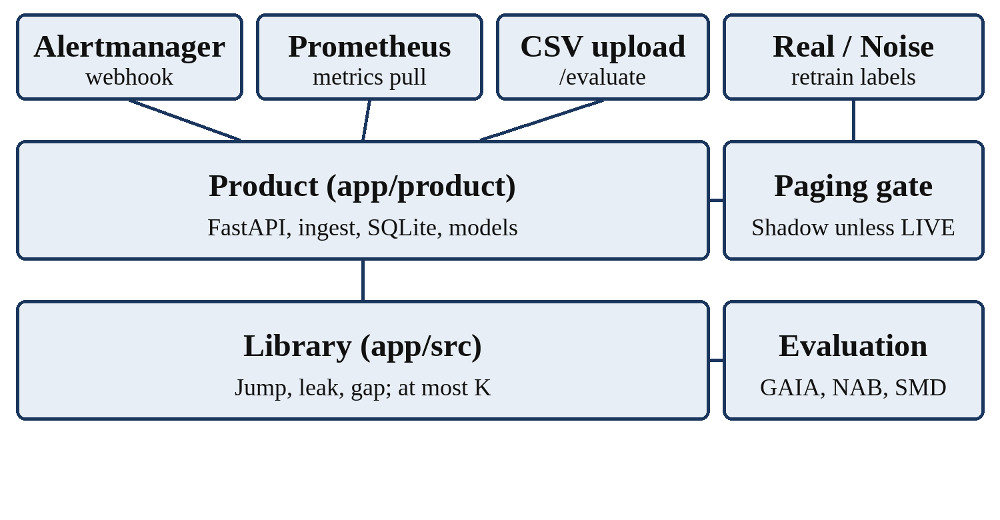

# AI-Assisted On-Call Queue: Budgeted Incident Detection for Cloud Microservices

Aishah Mohamed Alyammahi

## Abstract

On-call engineers can read only a few alerts a day, and 82% of GAIA faults never write a log line. The system shows at most K items a day, in the order they become known, using memory jumps, slow leaks, and monitoring gaps. At K = 20 the jump detector alone catches 72.6% of 1,223 test faults, against 68.9% for a rate rule, and it wins all 8 walk-forward weeks. The shipped queue adds leaks, gaps and severity alerts and catches 71.0% with 1.4 false items a day. The full queue's walk-forward record is 4 wins, 3 losses and 1 tie.

## 1. Motivation and objectives

A platform of many small services raises more alerts than one person can read. Real faults are missed because attention runs out, not because the metrics were silent. The users are the on-call engineer, who needs a short list that still contains the real faults, and the operator who turns Live on, who needs nothing paged by accident and a way to put a model back. The practical value is the daily budget. The queue shows at most K items, in the order a live system learns about them, so the team is not left choosing between a flood of pages and a pager that stays quiet.

Teams already cut repetition. Alertmanager groups alerts that share labels. PagerDuty and Opsgenie merge alerts that look alike or share an alias. None of those tools chooses which incidents fit into K readings a day, and none treats a rise in memory as an incident before a log alert has fired. The engineer reads the day's queue and marks an item Real or Noise. The operator installs the service, leaves shadow mode on until a pilot agrees, and is the only person who can turn Live on.

Each objective below is paired with the measurement this submission reports. The comparison that decides success is the budgeted jump queue against the rules a team already runs.

Table 1. Each objective, the target, and the measurement this submission reports.

| Objective | Target | Measured result |
|---|---|---|
| Beat the rate rule at K = 20 | More faults caught than a Prometheus rate rule, with fewer false items | Detector alone: 72.6% vs 68.9%, 1.0 vs 2.1 false items a day, 8 of 8 weeks. Shipped queue: 71.0%, 1.4 false items a day |
| Decide with no future data | No decision uses a later point, the end of a jump, or its peak | A jump is shown at the second confirming point. `tests/test_causality.py` checks that rule |
| Ship with shadow paging and a versioned model | Record what would have been paged until Live is armed. Models are versioned and can be rolled back | Shadow is the default. Live needs `APP_PASSWORD`, a channel, and the typed word LIVE, and only an ingest job may page. Models load as skops |
| Let another team run the tests | The checks run from the README on the committed results, with no paid API | 361 passed, 1 skipped; line coverage 90.02%; `run_validate.py` matches the printed figures |

## 2. Architecture and implementation

### 2.1 Architecture



Alertmanager posts firing alerts into `app/product`. Prometheus supplies the memory series, and the same series can be uploaded as CSV. The product is a FastAPI service. It checks the caller, drops duplicate webhook rows, runs one scoring job, and writes the queue to SQLite. Detection lives in `app/src`: the jump rule, the slow-leak rule, the monitoring-gap rule, and the daily budget. A page is sent only from an ingest job, and only after Live is armed. The HTTP routes are listed in `docs/report_appendices_full.md`.

The stack is Python, FastAPI, scikit-learn, pandas, SQLite, Docker and GitHub Actions. Dependencies are locked with uv. Each job stores the queue it built and the model version that scored the alerts. A Real or Noise mark is kept as a label. It does not itself send a page.

### 2.2 How the queue decides

The queue is first come, first served, and the day stops at K. A memory reading more than 0.5 GB above the previous 15-minute median is hot. The jump is shown at the second hot point within two minutes, and only when the rise known at that moment meets the threshold learned on the first week (0.62 GB on GAIA). A slow leak uses a three-hour median. A monitoring gap is ten minutes with no point. Log alerts may use at most a quarter of K. An alert that arrives while a jump on the same service is still open rides on that jump and takes no extra slot. No decision uses a later reading, the time the jump eventually ends, or the height it eventually reaches. A saved model is loaded as skops. A pickle file is refused even when its name still ends in `.pkl`. Shadow stays on until the operator sets `APP_PASSWORD`, names a channel, and types the word LIVE.

### 2.3 Change from the proposal

The proposal's 95% detection target was replaced by a walk-forward comparison (`CHANGELOG.md`). GAIA injects about 22 faults a day and 82% never write a log line, so K = 20 cannot pass 84.9%. The submitted system is the budgeted jump queue. The log classifier is trained, and the gate leaves it off on GAIA because it adds no catches there. The learned ranker, the metric TCN, LLM template features and GPU training were built and measured. None beat the jump detector, so version 1.3.0 removes them. The comparisons stay in the git history of the 1.2 releases.

### 2.4 Interfaces

Table 2. Component, responsibility, and interface. Routes are listed in full in `docs/report_appendices_full.md`.

| Component | Responsibility | Interface |
|---|---|---|
| CLI | Score one batch | `product.cli score`: alerts and metrics CSV in, queue CSV out |
| HTTP | Ingest and show the queue | `/health`, `/ingest/alertmanager`, `/queue`, `/feedback` |
| Queue CSV | One shown item per row | `shown_at`, `kind`, `service`, `detail` |
| Model file | Versioned classifier | zip of `meta.json` and `pipe.skops`; pickle is refused |

## 3. Testing, evaluation and results

Training uses the first 7 days only. The test period is the next 55 days and holds 1,223 faults. Days are not shuffled. A fault label scores a queue that has already been built. It is not an input to the decision. A fault counts as caught when a shown jump or leak on its service overlaps the injection, or a shown alert carries its id. A monitoring-gap item does not count as a catch.

Table 3. Method at K = 20 on the GAIA test period (1,223 faults). The detector and the rate rule are in `queue_eval_gaia.csv`. The shipped row is `severity` in `classifier_ablation_gaia.csv`.

| Method at K = 20 | Faults caught | False items a day |
|---|---|---|
| Log severity | 0% | — |
| Prometheus rate rule | 68.9% | 2.1 |
| Jump detector alone | 72.6% | 1.0 |
| Shipped queue (leaks, gaps, severity alerts) | 71.0% | 1.4 |
| Best possible on this data | 84.9% | — |

The 72.6% row is the jump detector alone (`jumps_tuned`): 8 of 8 weeks, median confirmation 0.72 minutes. The 71.0% row is the shipped queue (leaks, gaps and severity alerts; the gate leaves the classifier off). The full queue with the classifier on catches 69.6%, and its walk-forward record is 4 wins, 3 losses and 1 tie (Appendix A). The ceiling at K = 20 is 84.9% because 34 of 55 days have more than 20 faults.

Success criteria, from the §1 table. Beat the rate rule at K = 20: met for the detector alone (888 faults, 1.0 false item a day, against 843 and 2.1, 8 of 8 weeks). No future data: met (`tests/test_causality.py`). Shadow paging and a versioned model: met. Another team can run the tests: met (361 passed, 1 skipped, coverage 90.02%).

`delta_5m_carryover` catches 887 of 1,223 faults at K = 20, with 2.38 false items a day, against the detector's 888 and 1.0. At K = 50 the rate rule catches 1,052 and the detector 1,049 (false items 3.6 against 1.36). The detector's advantage is mainly fewer false items, not more catches, once unused slots carry over or the budget is large.

On this commit, pytest with coverage in `app/` reported 361 passed and 1 skipped. Line coverage is 90.02%. The one skip is the Docker integration test, which runs only when that stack is up. A load test of 50 users recorded p95 0.32 s and no errors (full appendices, Appendix C). `run_validate.py` matched the printed figures (284 checked numbers).

The classifier on GAIA catches fewer faults than the same queue with no log alerts, so the gate leaves it inactive. Results on other fault types are in the full appendices.

## 4. Deliverables, setup and use

The repository is [https://github.com/amamsy90/alert-fatigue-reduction](https://github.com/amamsy90/alert-fatigue-reduction). Version 1.3.0 at the submitted commit below. GPU training, LLM notes, the learned ranker, the homelab and Helm were removed in this version. The jump queue, the web app and the GAIA evaluation remain. Submitted commit: `16e7ad87f9f0d30be1c19fe106ebcd9d59288cf2`. The delivery is the application, the tests, and this report. From a checkout, run the four commands below. Exact steps are in the README. Shadow mode is the default, so a job records what it would have paged, and an evaluation does not page. The tests and `run_validate.py` read the committed files in `app/results/`. GAIA itself is not in git. `tools/fetch_gaia.py` downloads it (about 1.8 GB) and checks each file by SHA-256. No paid API is required. The full appendices are in `docs/report_appendices_full.md`. PagerDuty, Slack and Opsgenie stay unused while shadow mode is on.

```bash
cd app
uv sync --group dev
uv run pytest -q
uv run python run_validate.py
```

## 5. Conclusion

At K = 20 the jump detector alone catches 72.6% of 1,223 GAIA test faults, against 68.9% for a rate rule and 0% for log severity, with 1.0 false item a day against 2.1, and it wins all 8 weeks. That 72.6% is the detector, not the shipped queue. The shipped queue catches 71.0% with 1.4 false items a day. The full queue's walk-forward record is 4 wins, 3 losses and 1 tie. The detector's margin is 3.7 points. The classifier adds no catches on GAIA, so the gate leaves it off. About 22 faults a day sets an 84.9% ceiling at K = 20.

Next is a shadow-mode pilot on a real team's alerts. SMD and RCAEval scores are in `docs/report_appendices_full.md`.

<!-- pagebreak -->

## Appendix A. GAIA headline evidence

The K = 20 comparison, the misses of the full queue, and the walk-forward weeks cited in §3 and §5. The full write-up is in `docs/report_appendices_full.md`.

Table 4. K = 20 comparison on the GAIA test period.

| System (K = 20 items a day) | Caught | Share of best possible | Items / day | False / day | Precision |
|---|---|---|---|---|---|
| Log severity + exact duplicates | 0.0% | 0% | 0.8 | 0.8 | 0% |
| Static rule: memory > week-1 p99 | 57.2% | 67% | 16.0 | 3.0 | 81% |
| Rate rule: `delta(mem[5m]) > 0.5 GB` | 68.9% | 81% | 17.4 | 2.1 | 88% |
| Jump rule, first come | 67.8% | 80% | 17.5 | 2.4 | 86% |
| **Jump rule + learned threshold** (detector alone) | **72.6%** | **86%** | 17.1 | **1.0** | **94%** |
| **Full queue with the classifier** (jumps + leaks + gaps + classifier alerts; refused by the gate on GAIA) | **69.6%** | **82%** | 17.7 | 1.8 | 90% |
| **Shipped configuration** (the gate keeps the classifier out: jumps + leaks + gaps + log alerts by severity) | **71.0%** | **84%** | 17.6 | 1.4 | 92% |
| *Old headline: day's jumps ranked by final peak (not real time)* | *72.9%* | *86%* | *17.5* | *1.3* | *93%* |

Table 5. Why the full queue misses 372 of the 1,223 test faults at K = 20 (`miss_causes_gaia.csv`).

| Cause | Faults | Share of misses |
|---|---|---|
| No metric data during the fault (monitoring outage) | 166 | 45% |
| A qualifying jump existed, but the day's 20 slots were used | 198 | 53% |
| Metric data, but no jump overlapped | 4 | 1% |
| A jump overlapped, but below the confirmation threshold | 4 | 1% |

Table 6. Walk-forward at K = 20. The detector beats the rate rule in 8 of 8 weeks. The full queue has 4 wins, 3 losses and 1 tie.

| Fold | Test week | Faults | With metric data | Rate rule | Detector alone | Full queue |
|---|---|---|---|---|---|---|
| 1 | 8–15 Jul | 161 | 100% | 77.6% | 84.5% | 82.0% |
| 2 | 15–22 Jul | 134 | 91% | 73.9% | 81.3% | 74.6% |
| 3 | 22–29 Jul | 162 | 94% | 72.2% | 77.2% | 71.0% |
| 4 | 29 Jul–5 Aug | 163 | 82% | 67.5% | 69.3% | 67.5% |
| 5 | 5–12 Aug | 162 | 84% | 69.1% | 71.6% | 71.0% |
| 6 | 12–19 Aug | 139 | 92% | 75.5% | 79.1% | 74.1% |
| 7 | 19–26 Aug | 173 | **61%** | 51.4% | 52.0% | 50.9% |
| 8 | 26–31 Aug | 129 | 91% | 78.3% | 83.7% | 79.1% |
| **Mean** | | | | **70.7%** | **74.8%** | **71.3%** (95% CI 64.5–76.7%) |

