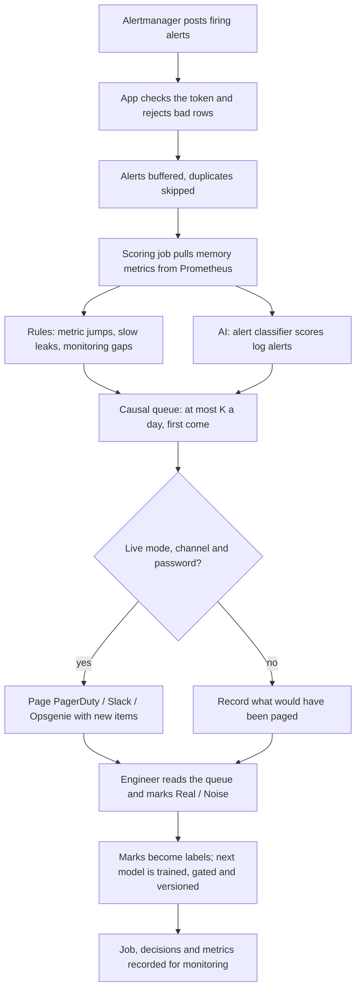

# AI-Assisted On-Call Queue: Budgeted Incident Detection for Cloud Microservices

*(Alert Fatigue Reduction in Cloud Microservice Operations)*

**Final report**
**Author:** Aishah Mohamed Alyammahi
**Course:** Software Engineering and Programming
**Date:** [Date]

Numbers come from scripts under `app/` and are checked by `python run_validate.py` against the *Checked numbers* table at the end. Part A follows the thirteen sections of the course brief; Part B holds the measured results; Part C says how to reproduce them.

| Rubric criterion (weight) | Where it is answered |
|---|---|
| Problem definition and significance (10%) | §2; evidence in Part B §B6 |
| Requirements, users and use cases (10%) | §3, §4; `docs/requirements.md` (20 FR, 11 NFR, 8 user stories, traceability to tests) |
| AI justification and technical approach (10%) | §5, §6 |
| High-level production design (15%) | §6; `docs/architecture.md` (5 diagrams), `docs/adr/` (7 decisions), `docs/threat_model.md` |
| Deployment and scalability (10%) | §7; `docs/deployment.md` |
| Testing strategy (10%) | §8; `docs/test_plan.md`, `.github/workflows/ci.yml` |
| MLOps and lifecycle (20%) | §9; `docs/mlops.md` |
| Monitoring and evaluation (10%) | §10; `docs/monitoring.md` |
| Privacy and responsible AI (5%) | §11; `docs/privacy_responsible_ai.md` |

---

# Part A — The system

## 1. Project title and team

**AI-Assisted On-Call Queue: Budgeted Incident Detection for Cloud Microservices.** Solo project by Aishah Mohamed Alyammahi.

## 2. Problem definition

**What the problem is.** A cloud platform made of many small services raises thousands of alerts a day, but the engineer on call can read only a few. Real faults are missed because attention runs out, not because monitoring was silent.

**Who experiences it.** On-call engineers and small operations teams (primary), and the users of the platform when a fault is found late.

**Why it matters.** A fault that is noticed late lasts longer. Engineers who are paged for noise stop trusting the pager and start ignoring it ("alert fatigue").

**How it is handled today.** Alerts are escalated by log severity, and exact duplicates are deleted (Alertmanager grouping and routing, PagerDuty rules). Metric alerts are fixed thresholds or rate rules, such as `delta(memory[5m]) > 0.5 GB`.

**Limits of the current approach.** Severity rules read only logs. On the public GAIA microservice benchmark, **82% of injected faults never write a log line**; they show up only as a jump in a metric such as memory, so a log-severity rule catches **0%** of them at 20 items a day (§B1). Fixed metric thresholds either miss faults or flood the queue, and none of these rules knows that a person can read only K items a day.

**How often.** GAIA injects about 22 faults a day on ten services, more than a 20-item budget on 34 of 55 days (§B1).

**If nothing changes.** Teams keep choosing between missed faults and ignored pagers. More monitoring makes it worse, because every new signal competes for the same attention.

**Why this is a software engineering project.** The answer is not one model. It is a system: ingest alerts and metrics from existing tools, decide under a budget in real time, page safely, learn from engineers' feedback, and be deployable, testable, monitored and reversible.

> **Problem statement.** On-call engineers can read only a few alerts a day, but the rules that choose those alerts read log severity, which most real faults never trigger, so faults are missed while noise still reaches the pager.

## 3. Objectives and expected outcomes

**Main objective.** Design, build and evaluate an AI-assisted on-call queue that shows each engineer at most K items a day, in real time, and catches more real faults with fewer false items than the rules teams already run.

**Specific objectives (measurable).**

| # | Objective | Target | Result |
|---|---|---|---|
| O1 | Beat the rules a team already runs at a realistic budget | More faults caught at K = 20 than log severity, a static threshold and a Prometheus rate rule, with fewer false items | Detector 72.6% vs 68.9% (rate rule), 1.0 vs 2.1 false items a day; wins 8/8 walk-forward weeks (§B1, §B2) |
| O2 | Decide in real time | No decision uses later data; confirmation within about a minute | Median 0.72 min; `tests/test_causality.py` (§B1) |
| O3 | Engineer it for production | Authentication, safe paging, versioned models with rollback, monitoring endpoints, Docker | Done (§7, §9, §10) |
| O4 | Test it properly | ≥ 90% of tests passing, coverage ≥ 85%, p95 ≤ 1 s at 50 users | 226/226, 90%, 0.32 s (§8) |
| O5 | Let another team check it on its own data before trusting it | Evaluate my data works end to end without code, against a chance line | Done; NAB and SMD results reported, including failures (§B5) |

**Expected final product.** A working web application and REST API (FastAPI) with a queue page, Connectors page and *Evaluate my data* page; a backend scoring service; an AI component (a cost-sensitive alert classifier with a model registry) next to rule-based metric detectors; a SQLite store; connectors for Alertmanager, Prometheus, PagerDuty, Slack and Opsgenie; a command-line tool; 226 automated tests and CI; a Docker deployment with per-environment settings; `/metrics` and `/monitoring`; technical documentation (`docs/`); and this report.

## 4. Target users and use case

**Primary users.** On-call engineers (site reliability or operations) on a team running microservices.

**Secondary users.** The team lead or operator, who installs the tool, decides when it may page and which model is active; platform owners who read the monitoring page; an evaluating team trying it on past data; examiners and researchers reproducing the results.

| User | Needs |
|---|---|
| On-call engineer | A short list, in order, that contains the real faults; a reason for each item; a way to say "this was noise" |
| Operator / team lead | Safe installation; nothing paged by accident; secrets kept safe; a way to undo a bad model; health at a glance |
| Evaluating team | Proof on its own data, with a fair baseline and a chance line, before trusting it |

**System usage.** Alertmanager posts alerts to the app all day; the app pulls memory metrics from Prometheus; a scoring job runs on each webhook batch (or on demand). The engineer opens the queue page during the shift and receives pages in Live mode. They provide nothing but marks: Real or Noise on items. The system produces the day's queue (metric jumps, slow leaks, monitoring gaps and escalated or "ask a person" alerts, at most K), each with a reason. After that, the engineer investigates the item; the mark becomes a label for the next model.

**Use-case flow.**



## 5. Why use AI?

**What needs AI.** Deciding which *log alerts* are worth a slot. Their text, source, severity and timing interact in ways fixed rules do not capture, and the right answer differs per team. A classifier trained on the team's own labels (and later its own Real / Noise marks) learns that, with a miss weighted ten times a false alarm.

**What traditional software handles.** Everything else, deliberately: ingesting webhooks, the metric detectors (a rise above the recent median is a rule, chosen on week 1 only), monitoring-gap detection, the daily budget, paging, storage and security. On GAIA the rules do most of the work: where metric data exists, the jump rule overlaps 99.6% of faults (§B6).

**Why a rule-based approach alone is insufficient for alerts.** Severity is noisy: "high" alerts are often benign and "info" lines appear during real faults. A fixed severity rule cannot use message text or the fact that an alert arrived during a memory jump, and it cannot adapt when engineers mark items as noise.

**AI technology.** Supervised classification: logistic regression on TF-IDF text features, source, severity, recent alert counts and an inside-a-jump flag (scikit-learn). A second learned piece, the confirmation threshold, is a cost-minimising cut on the training window. An experimental jump ranker (logistic regression) was tried and gave no gain (§B4).

**Existing model or API.** An existing, well-understood model family (scikit-learn logistic regression) trained locally; no external AI API or LLM, so no data leaves the server and there is no per-call cost.

**Limitations of AI here.** It needs labels of both classes, so a new team starts in rules-only mode; learned thresholds do not transfer between datasets (one learned on GAIA's 1 GB faults rejects 0.5 GB faults, §B3); and 82% of GAIA faults leave no log, which caps a log-only model near 18% (§B6).

## 6. AI component and technical approach

| Question | Answer |
|---|---|
| AI technology | Cost-sensitive logistic regression for log alerts; rule-based metric detectors beside it |
| Existing model or own? | An existing model family, trained on the team's own labelled data; not a new algorithm |
| Input | Each alert: time, source, severity, type, message; whether it fell inside a confirmed memory jump; recent counts from the same source |
| Output | P(alert is a real fault), turned into an action: escalate, ask a person, or hide, with a reason |
| Data needed | Past alerts with incident windows, or Real / Noise marks; memory series for the detectors |
| How the software talks to it | In-process: `pipeline.score_alerts` calls the classifier; models are loaded from the registry (`product/model_store.py`) |
| If it is wrong | The queue is capped at K; uncertain alerts go to a person; engineers mark Noise; a worse model is not promoted, and the operator can roll back |
| Main limitation | Label-hungry; helps only services that log |

**How the queue decides** (details in §B1 and `design_specification.md`). One queue, at most K items a day, first come, first served:

1. **Metric jumps.** A point is hot when it is more than **0.5 GB** above the median of the previous **15 minutes** on the same service. Two hot points no more than two minutes apart **confirm** a jump. A jump is shown at its confirmation point, and only if its rise at that point is at least a threshold learned on the training window (0.62 GB on week 1).
2. **Slow leaks.** The same rule with a **3-hour** median and 10 minutes of hot points catches memory that climbs over hours. A leak is dropped only when a fast jump on the same series was already shown when the leak was confirmed.
3. **Monitoring gaps.** A service with no metric point for **10 minutes** is shown as a gap item ("we are blind here"), also while the feed is still dead.
4. **Log alerts** may use at most **a quarter** of the slots (5 of 20), first come. An alert on a service whose shown jump is still open rides on that jump and uses no slot.

Nothing uses a later point, the end of a jump, or its peak (ADR 0001). For metrics that are not bytes, a relative mode (a share of the median) and a unit-free robust mode exist.

**Training on GAIA.** GAIA MicroSS (CloudWise), July–August 2021: 34,863 log lines, 1,367 injected faults, each holding **1 GB of extra memory for 600 s** on one service. Train on the first 7 days; test on the next 55 days (**1,223 faults**); days are never shuffled.

| What is learned | How |
|---|---|
| Jump size 0.5 GB | Chosen on week 1 only (`run_memory.py --sweep`) |
| Jump confirmation threshold | Rise at confirmation with the lowest week-1 cost → **0.62 GB** |
| Alert classifier and its threshold | Logistic regression on week-1 alerts; threshold with the lowest week-1 cost (a miss = 10 false alarms) |
| Static-rule baseline | Week-1 99th percentile per service |

**Production design.** Two layers: a library that knows nothing about HTTP (`app/src/`) and a product layer (`app/product/`) with the web app (`product/web/`: security middleware, three route modules), the job pipeline (inputs, labels, paging), storage, connectors, the model registry and monitoring. Diagrams (context, components, ingest-to-page sequence, deployment, data model): `docs/architecture.md`. Decisions: `docs/adr/`. Threats and mitigations: `docs/threat_model.md`.

## 7. Deployment strategy

One Docker container per team, on the team's own server or VM, behind a TLS reverse proxy; SQLite and the model registry on a Docker volume; the model runs in-process; alerts arrive from Alertmanager and metrics are pulled from Prometheus; pages go to PagerDuty, Slack or Opsgenie. The image is built from a hash-pinned lock file.

| | Development | Test | Production |
|---|---|---|---|
| Where | Laptop | GitHub Actions; a shadow instance next to production | Team server |
| Settings | `app/deploy/dev.env` | `app/deploy/test.env` | `app/deploy/prod.env` (from the example; not in git) |
| Paging | Never | Never (records *would have paged*) | Only after a shadow period and a deliberate Live switch |

Measured capacity: 50 concurrent users at 228 requests/s with p95 0.32 s; a 400-alert webhook batch scores in 0.2 s and the full GAIA month in 27 s. The design runs one worker per team; the scaling path is one container per team, or PostgreSQL with shared locks for a shared deployment (ADR 0003).

**AI governance.** The operator is responsible for the AI. It may only order and select items in the queue (escalate, ask a person, hide with a reason); it never acts on infrastructure. Humans review everything in shadow mode, answer "ask a person" items, and mark Real / Noise. Every decision records its reason, score and the model version. New models pass a promotion gate and can be rolled back; the change is audited. No data is sent to an external AI service. Full answers: `docs/deployment.md`.

## 8. Testing strategy

| Level | What | Examples |
|---|---|---|
| Unit | Detectors, queue, policy, scoring, settings | first come beats biggest first; a jump is confirmed at its second point |
| Integration | Frontend routes ↔ backend ↔ database, with outbound calls mocked | webhook → buffer → job → queue; Live fans out to every channel; model rollback through the API |
| System | The whole pipeline on GAIA, NAB and SMD; `experiment.py` on a synthetic run | walk-forward over 8 weeks; later data changes nothing |
| AI-specific | Wrong or poor outputs, unexpected input, edge cases | a malformed webhook row is rejected instead of blocking every later job; one-class labels fall back to rules; a worse model is not activated; hidden alerts stay visible |
| Security | Login, SSRF, CSRF, DNS rebinding, secrets, body limits | loopback tricks refused; forwarded requests need a password |
| Performance | Latency, concurrent users, throughput | `perf/load_test.py`: 20 and 50 users |

Hallucination and prompt injection do not apply (no generative model), but the equivalent risks are tested: untrusted webhook content cannot break or steer the queue, and wrong model outputs are bounded by the budget and the promotion gate.

| Criterion | Target | Result |
|---|---|---|
| Tests passing | 100% | 226 / 226 (Python 3.10 and 3.12) |
| Line coverage | ≥ 85% | 90% |
| Type errors | 0 | 0 |
| p95 latency at 50 users | ≤ 1 s | 0.32 s |
| Error rate under load | ≤ 1% | 0% |
| Report numbers match results | 51 / 51 | 51 / 51 |

CI runs lint, type checks, the tests on two Python versions with coverage, `run_validate.py` and a Docker build with a health check on every push. Details: `docs/test_plan.md`.

## 9. MLOps

- **Versioning.** Code in Git through pull requests; dependencies in `uv.lock` and a hash-pinned `requirements.lock`; configuration in `src/config.py` and per-environment files; data by fingerprint in the experiment log; **models as numbered versions with model cards** in `models/registry.json` (training time, data fingerprint, code version, held-out results, gate decision). No prompts (no LLM).
- **Reproducibility.** `uv sync --group dev`, `uv run pytest`, `uv run python run_validate.py`, `docker compose up`; every environment variable is documented; the public datasets are fetched by scripts.
- **Model updates.** A new model is trained when a batch has labels of both classes. It becomes active only if its held-out cost is no higher than the active model's on the same held-out alerts. A worse model stays a candidate. The operator can roll back to any version (`POST /models/{version}/activate`, hash-checked, audited). Precision from engineers' marks and alert-volume drift are monitored, and a retrain is suggested after 7 days or new Real marks.
- **Testing before release.** CI for code; the promotion gate and shadow mode for models.
- **Experiment tracking.** Every experiment script appends to `app/results/experiments.jsonl`: commit, library versions, configuration, data fingerprint, output hashes, headline metrics and the reason for the run.

Details: `docs/mlops.md`.

## 10. Monitoring and evaluation

`GET /metrics` (Prometheus) and `GET /monitoring` (checked summary) cover:

| Area | Signals | Target |
|---|---|---|
| AI performance | Precision from Real / Noise marks; model used and version per job; promotion decisions | ≥ 0.70 with ≥ 20 marks |
| Software / system | Latency by route, 5xx rate, job duration and outcome, pages sent and failed, `/health` | p95 ≤ 1 s; 5xx ≤ 2%; 0 failed pages |
| Data | Alert-volume drift (last batch vs median), monitoring gaps, rejected and duplicate rows, buffer size | ratio 0.5–2; ≤ 3 gaps |
| AI / model | Output mix per job (escalated / asked / hidden), items by kind | Watch for sudden shifts |

Evaluation criteria with measured values, justification for each target and example alert rules: `docs/monitoring.md`. Offline evaluation is Part B.

## 11. Privacy and responsible AI

**Privacy.** Alert messages may contain host names or user IDs. All data stays on the team's server (SQLite and a volume), behind the login. Messages are cut to 300 characters, and IDs and numbers are normalised before learning. Jobs and evaluations are pruned; marks keep only service and time. No data is sent to an external AI service; only paging summaries go to the team's own paging tools, in Live mode.

**Responsible AI.** Fairness between services: metric rules treat every service the same, and alerts are capped at a quarter of the budget, so services that log a lot cannot crowd out the rest. Every item carries a reason. Humans oversee through shadow mode, "ask a person" and marks. Hidden alerts stay visible. The system never acts on infrastructure. Queue data should not be used to rate engineers. Details: `docs/privacy_responsible_ai.md`.

## 12. Project scope and limitations

**In scope (built):** the causal budgeted queue (jumps, leaks, gaps, alerts); the alert classifier with a model registry, promotion gate and rollback; the web app, API and CLI; Alertmanager, Prometheus, PagerDuty, Slack and Opsgenie connectors; *Evaluate my data*; shadow mode and marks; security hardening; monitoring endpoints; Docker and per-environment settings; CI; the GAIA, NAB and SMD evaluations.

**Out of scope (not built):** automatic remediation; multi-tenant hosting and user roles; LLM summaries of incidents; CPU, disk or network fault detection inside microservices (measured only on SMD servers); a managed cloud deployment; browser UI tests; a live pilot with a real team (the next step).

**Limitations** (say these if asked):

1. **Every GAIA fault is the same 1 GB, 600 s memory program.** The robustness replay (§B3) tests other sizes and shapes; §B5 tests other domains (NAB, a shop, SMD servers), with small test sets and a chance line.
2. **The win over a plain Prometheus rate rule is modest** (+3.7 points for the detector, 8/8 weeks; +0.7 for the full queue, which ties it week by week). The larger gains are fewer false items, a real-time queue, and leak and gap coverage. Carry-over lifts both rules about equally.
3. **K = 20 is below the fault rate** (22 a day), so no method can exceed 84.9%.
4. **Learned thresholds do not transfer.** One learned on GAIA's 1 GB faults rejects 0.5 GB faults. Rules-only mode works without labels; the per-series confirm levels (§B4) are measured but not in the headline.
5. The scripts in `app/experiments/legacy_alerts_only/` are alerts-only milestone experiments. Do not quote them as the system result.

**Future work.** Microservice benchmarks with other fault types (for example RCAEval or TrainTicket-based sets); a pilot with one team in shadow mode, measuring precision from marks; residual risks R1–R8 in `docs/threat_model.md`.

## 13. Success criteria

| Criterion | Measured | Met? |
|---|---|---|
| The main workflow (webhook → queue → page → mark → retrain) completes | Integration tests and the demo | Yes |
| At least 90% of predefined test cases pass | 226 / 226 | Yes |
| The system handles the agreed concurrent users | 50 users, 0 errors | Yes |
| Average response time below the threshold | p50 0.21 s, p95 0.32 s (target 1 s) | Yes |
| AI output meets the predefined quality criteria | Detector beats the rate rule in 8/8 weeks with fewer false items; the full queue ties it | Partly: the detector, yes; the full queue, a tie |
| No critical security vulnerabilities in testing | 0 critical; 8 residual risks documented | Yes |
| Deployable from documented instructions | `docker compose up`, `docs/deployment.md`, CI Docker job | Yes |
| Another person can reproduce the environment | `uv sync`, lock files, `run_validate.py` | Yes |
| The agreed functional requirements are met | 20 FR, each traced to tests (`docs/requirements.md`) | Yes |

---

# Part B — Results

## B1. Test-period results (K items a day, 55 days, 1,223 faults)

**Caught** = a shown jump or leak on the fault's service overlaps the injection window, or a shown alert carries the fault's id. Gap items never count as catches.

**Baselines are the rules a team would already have**, all scored with the same causal queue:

| System (K = 20 items a day) | Caught | Share of best possible | Items / day | False / day | Precision |
|---|---|---|---|---|---|
| Log severity + exact duplicates | 0.0% | 0% | 0.8 | 0.8 | 0% |
| Static rule: memory > week-1 p99 | 57.2% | 67% | 16.0 | 3.0 | 81% |
| Rate rule: `delta(mem[5m]) > 0.5 GB` | 68.9% | 81% | 17.4 | 2.1 | 88% |
| Jump rule, first come | 67.8% | 80% | 17.5 | 2.4 | 86% |
| **Jump rule + learned threshold** (detector alone) | **72.6%** | **86%** | 17.1 | **1.0** | **94%** |
| **Full queue** (jumps + leaks + gaps + alerts) | **69.6%** | **82%** | 17.7 | 1.8 | 90% |
| *Old headline: day's jumps ranked by final peak (not real time)* | *72.9%* | *86%* | *17.5* | *1.3* | *93%* |

**Best possible at K = 20 is 84.9%**: GAIA injects 22 faults a day, more than 20 on 34 of 55 days.

At K = 5 / 10 / 50 the full queue catches 19.5% / 38.8% / 85.8% (rate rule: 19.3% / 38.6% / 86.0%). Its advantage is at the realistic budget K = 20, where slots are scarce, and in false items (1.0–1.8 a day vs 2.1).

**Removing the last look-ahead.** A code review found five places where the queue still used information from later in the day, although the text said it did not. The per-day alert filters kept each day's *most severe* (or highest-scoring) K alerts, which needs the whole day; an overlapping jump that arrived *after* a leak was confirmed could still remove that leak; the robust score used the spread of the whole series; and an alert "rode on" a jump using the jump's final end. All five now use only what is known at the moment of the decision: alerts spend the budget first come, first served; a leak is dropped only by a jump already shown; the robust spread uses earlier points only; and an alert rides on a jump only while the jump's last hot point is within its gap (`Spike.open_at`). `tests/test_causality.py` checks each one. The honest cost is small: the full queue drops from 70.2% to 69.6% at K = 20 and shows 1.8 false items a day instead of 1.6. The detector alone is unchanged (72.6%), because none of the five touched it.

**Why the full queue scores below the detector alone on GAIA.** Every GAIA fault is a 1 GB memory fault, so leak items (0.2 a day), gap items (0.4 a day) and log alerts spend slots that jumps would have used. On a platform with leaks, outages, and CPU, disk or code faults, those are the parts that catch them (§B3). Both rows are reported; the detector comparison is the first claim, the full queue is what the tool runs.

The old ranking needed the whole day in advance. Replacing it with a learned confirmation threshold keeps the score (72.6% vs 72.9%), cuts false items (1.0 vs 1.3 a day), and makes the queue usable live.

**Time to confirm.** Median **0.72 minutes** from fault start to the confirming point (p90 0.93). Metrics are sampled every 30 seconds.

**Chance check.** If each service's jumps are shifted by a random 1–6 hours, only **2.6%** of faults still overlap one.


### Where the misses come from

The full queue misses 372 of the 1,223 test faults at K = 20 (`results/miss_causes_gaia.csv`):

| Cause | Faults | Share of misses |
|---|---|---|
| No metric data during the fault (monitoring outage) | 166 | 45% |
| A qualifying jump existed, but the day's 20 slots were used | 198 | 53% |
| Metric data, but no jump overlapped | 4 | 1% |
| A jump overlapped, but below the confirmation threshold | 4 | 1% |

**Only 2% of misses are the detector's fault.** The rest are data outages (which the queue flags as gap items) and a budget smaller than the fault rate.

---

## B2. Validation (walk-forward)

Before each later week, **everything learned is re-learned from the past only** — the classifier, its threshold, the jump ranker and the jump confirmation threshold (0.62–0.75 GB across folds). That week is then scored once. `run_walkforward.py`, K = 20.

| Fold | Test week | Faults | With metric data | Rate rule | Detector alone | Full queue |
|---|---|---|---|---|---|---|
| 1 | 8–15 Jul | 161 | 100% | 77.6% | 84.5% | 82.0% |
| 2 | 15–22 Jul | 134 | 91% | 73.9% | 81.3% | 74.6% |
| 3 | 22–29 Jul | 162 | 94% | 72.2% | 77.2% | 71.0% |
| 4 | 29 Jul–5 Aug | 163 | 82% | 67.5% | 69.3% | 67.5% |
| 5 | 5–12 Aug | 162 | 84% | 69.1% | 71.6% | 71.0% |
| 6 | 12–19 Aug | 139 | 92% | 75.5% | 79.1% | 74.1% |
| 7 | 19–26 Aug | 173 | **61%** | 51.4% | 52.0% | 50.9% |
| 8 | 26–31 Aug | 129 | 91% | 78.3% | 83.7% | 79.1% |
| **Mean** | | | | **70.7%** | **74.8%** | **71.3%** (95% CI 64.5–76.7%) |

- The **detector** (jump rule + learned threshold) beats the rate rule in **8/8** weeks (sign test p = 0.0039).
- The **full queue** does **not** beat the rate rule week by week: 4 wins, 3 losses, 1 tie (p = 0.5). Before the look-ahead fixes in §B1 it won 6 of 8; part of that margin came from choosing each day's alerts with hindsight. On GAIA its extra item types cost slots; see §B1.
- The comparison is against a real rule. The log-severity rule scores 0% every week, so a test against it would prove nothing.

**Fold 7** is weak because of a **monitoring outage**: every service's metrics stop from 20 Aug 13:18 UTC for 2 days 12 hours, so only 61% of that week's faults have any metric data. The full queue shows this outage as a gap item within 10 minutes. No metric-based method could catch those faults.


---

## B3. Robustness: does it only work because every fault is 1 GB?

`run_robustness.py` adds synthetic faults of other shapes to the **real** GAIA memory series (120 per shape, at least an hour from any real fault) and asks whether each detector fires, with no budget:

| Injected shape | Jump rule 0.5 GB | + learned threshold | Relative +30% | Rate rule | Jump + leak rule |
|---|---|---|---|---|---|
| Step +0.25 GB, 10 min | 1% | 0% | 8% | 1% | 1% |
| Step +0.5 GB, 10 min | 99% | **0%** | 58% | 99% | 99% |
| Step +1 GB, 10 min (GAIA shape) | 100% | 98% | 95% | 100% | 100% |
| Step +2 GB, 10 min | 100% | 100% | 100% | 100% | 100% |
| Spike +1 GB, 1 min | 98% | 98% | 92% | 100% | 98% |
| Ramp +1 GB over 30 min | 1% | 1% | 6% | 0% | **99%** |
| Leak +1 GB over 3 h | 12% | 3% | 6% | 8% | **73%** |
| Nothing injected (control) | 6% | 3% | 6% | 6% | 6% |

What this shows:

- **Faults smaller than the jump size are invisible** (0.25 GB). A team must set the size for its own services.
- **The learned threshold over-fits the benchmark**: trained on 1 GB faults, it rejects every 0.5 GB fault. The tool therefore uses **no** confirmation threshold unless it is trained on the team's own incidents.
- **Leaks and ramps defeat both the jump rule and the Prometheus rate rule.** The leak rule catches 99% of 30-minute ramps and 73% of 3-hour leaks, at a cost of 0.3 extra items a day on real GAIA data (none of them near a fault), and no extra hits on the control windows.

---

## B4. Queue options

| Option (K = 20) | Caught | Items / day | Walk-forward mean | Verdict |
|---|---|---|---|---|
| Full queue (reference) | 69.6% | 17.7 | 71.3% | — |
| **Learned jump ranker** instead of the rise threshold | 69.7% | 17.7 | 71.8% | No gain: the rise threshold already gives 94% precision, so there is little left to learn from service, time of day or nearby logs |
| **Group** metric items within 2 min on other services into one slot | 70.7% | 17.6 | 72.6% | Small gain; one item may then name two services |
| **Confirm level per series** (learned on week 1; off in the headline) | 69.3% | 17.6 | 70.5% | Mixed: the detector alone keeps 72.6% with fewer false items (0.8 vs 1.0 a day), but the levels reject real faults — 26 misses below threshold instead of 4, and 84.1% vs 85.8% at K = 50. The web app uses it; the published tables use the single gate |
| **Carry over** up to 10 unused slots to the next day | **72.6%** | 18.6 | **74.8%** | Largest gain; the average stays under K. But the same carry-over lifts the rate rule to 72.5% (walk-forward 74.3%), and the full queue then wins only 3 of 6 decided weeks (p = 0.66). Before the look-ahead fixes this row read 74.4% and 8/8 weeks; that margin did not survive |

Carry-over and grouping are off by default (`CARRY_OVER_MAX`, `GROUP_MINUTES`): they change what "20 a day" means for the on-call team, so it is their choice.

---

## B5. Beyond microservices: any metric, any team

The engine is not tied to GAIA. `src/generic.py` takes any **metrics** table (time, value, optional series; long or wide; column names detected), optional **events** (alerts, tickets, notifications) and optional **past problems** (start, end, series). For each series it tunes on the first part and scores the rest once, and every system — static threshold, rate rule, a unit-free robust jump rule, the user's own alerts — is tuned with the same cost and scored through the same causal queue. The detector with the lowest training cost becomes the user's queue. A **chance line** (the same items at random times) is reported so wide labels cannot flatter the result.

This runs from the web app (**Evaluate my data**: upload or pick a dataset → read the report → *Use these settings for my live queue* → *Show this data in the queue*) and from the CLI (`evaluate`, `tune`). The guide for end users is `USE_YOUR_DATA.md`.

Results on data that is not microservices (tuned on the first half of each series, K = 2 items a day; `run_nab.py`, `results/nab_eval.csv`):

| Dataset | Domain | Test problems | Queue caught | Chance | Items / day |
|---|---|---|---|---|---|
| Online shop (synthetic; K = 5, 30% tuning) | e-commerce orders + notifications | 11 | 91% | 1% | 1.3 |
| NAB realAWSCloudwatch | cloud servers | 17 | 71% | 58% | 0.3 |
| NAB realAdExchange | online advertising | 6 | 83% | 58% | 1.4 |
| NAB realKnownCause | machine temperature, taxi demand, CPU | 13 | 38% (static rule 54%) | 15% | 0.04 |
| NAB realTraffic | road traffic sensors | 11 | 36% (rate rule 45%) | 12% | 0.3 |
| NAB realTweets | Twitter mention volume | 11 | 36% | 36% | 1.7 |

On the shop data the monitoring view catches 10 of 11 problems where the notification stream by severity catches 3. On NAB the queue is clearly above chance on traffic and machine data, modestly on cloud servers and ads (NAB's anomaly windows are wide, so chance is high), and **no better than chance on Twitter volume**. The test sets are small (6–17 problems), and on one dataset the detector chosen on the tuning part was not the best on the test part. These are exactly the facts a new user needs before relying on it, which is why the app shows them.

**Other fault types: the Server Machine Dataset (SMD).** GAIA has one fault type. SMD (OmniAnomaly, KDD 2019) has 28 real servers, five weeks of one-minute samples, 38 metrics each — CPU, memory, disk, network, TCP — and 196 labelled test incidents, each with the metrics that moved. Each machine is one dataset: tuned on the first half of every series, scored on the second half, K items a day per machine (`run_smd.py`, `results/smd_eval.csv`):

| Budget K per machine | Incidents caught (196) | Metric movements shown (1,536) | Items / day | False / day | Chance (per movement) |
|---|---|---|---|---|---|
| 5 | 60 (30.6%) | 10.1% | 4.2 | 3.5 | 12.4% |
| 10 | 83 (42.3%) | 19.3% | 7.9 | 6.5 | 12.4% |
| 20 | 108 (55.1%) | 33.9% | 13.8 | 11.0 | 12.4% |

An incident counts once and is caught if any metric that moved was shown while it lasted; the movement column counts every flagged metric on its own. Half of the incidents are found at 20 items a day per machine on real mixed-metric faults, well above the 12.4% chance line, but with low precision: SMD labels only some of the 38 metrics per incident, so a correlated movement on an unlabelled metric counts as false. Where a series had three or more tuning incidents the jump rule learned its own size (Section 4 of `USE_YOUR_DATA.md`). This is a harder benchmark than GAIA and it is reported as it is.

---

## B6. What "success" means on this data

`run_stats.py` splits the 1,223 test faults by the signal they left:

| Signal | Count | Share | What can catch it |
|---|---|---|---|
| Jump, no log | 868 | **71.0%** | Metric rule only |
| Log and jump | 185 | 15.1% | Either path |
| Log, no jump | 34 | 2.8% | Alerts only |
| No log, no metric data (monitoring gap) | 132 | 10.8% | Nothing — shown as a gap item |
| No log, data but no jump | 4 | 0.3% | Nothing |

- **Where metric data exists, the jump rule overlaps 99.6% of faults** (1,053 / 1,057).
- 170 test faults start inside a monitoring gap. At K = 20 the gap items shown cover 159 of them (all 170 at K = 50).
- **False jumps are not mislabelled faults.** 24.6% of the 256 false jumps start within 10 minutes of a fault on another service; random times do so 27.2% of the time. There is no sign that GAIA logged faults under the wrong service.
- A log-only classifier is capped near **17.9%** (the faults that leave any log). That is why the early 95% target was wrong.

| Early target | Measured | Verdict |
|---|---|---|
| 95% detection at K=20 | 69.6–72.6% (ceiling 84.9%) | Not possible at K=20: more faults per day than slots. 82–86% of the ceiling |
| Beat the usual rule | Detector +3.7 points over a rate rule, 8/8 weeks; full queue +0.7 points, 4 of 8 weeks; log severity 0% | Met by the detector, against a fair rule; the full queue ties it |
| Fewer false items | 1.0–1.8 vs 2.1 a day (rate rule) | Met |
| Works on every service | Jump overlap 81–91% on all ten | Met |
| Walk-forward not lucky | Means 71.3–74.8%, CI 64.5–76.7% | Met |
| Real-time | Confirmed in 0.72 min; no look-ahead, checked by `tests/test_causality.py` | Met |
| Works beyond 1 GB faults | 0.5–2 GB steps and spikes ≥ 98%; leaks 73–99% with the leak rule; 0.25 GB not | Partly — stated |

Per service (test period):

| Service | Faults | With a log | With a jump |
|---|---|---|---|
| dbservice1 | 129 | 0.8% | 91.5% |
| dbservice2 | 148 | 2.0% | 81.1% |
| logservice1 | 126 | 2.4% | 87.3% |
| logservice2 | 108 | 1.8% | 87.0% |
| mobservice1 | 124 | 84.7% | 83.9% |
| mobservice2 | 116 | 87.1% | 87.1% |
| redisservice1 | 111 | 2.7% | 82.0% |
| redisservice2 | 114 | 0.0% | 86.0% |
| webservice1 | 122 | 0.8% | 85.2% |
| webservice2 | 125 | 0.0% | 90.4% |

---

# Part C — Reproduce and deliverables

## C1. How to reproduce

```powershell
cd app
$env:PYTHONPATH = (Get-Location).Path
python -m pytest -q
python run_memory.py --metrics data/gaia_metrics --gaia-run data/gaia_raw/run/run --sweep
python run_queue_eval.py
python run_walkforward.py
python run_stats.py
python run_robustness.py
python ../tools/fetch_nab.py      # needs internet, ~15 MB
python run_nab.py
python ../tools/fetch_smd.py      # needs internet, ~240 MB
python run_smd.py                # 28 machines, about 15 min; resumes if interrupted
python make_figures.py
python run_validate.py
```

Needs the GAIA files at `app/data/gaia_raw/run/run` and `app/data/gaia_metrics` (not in git; they are large). Without GAIA: `python examples/make_example.py`, then `python -m product.cli score --alerts examples/alerts.csv --metrics examples/metrics.csv`.

A faster check without GAIA: `cd app && uv sync --group dev && uv run pytest -q && uv run python run_validate.py` (the result files are in git). Every experiment run is logged in `app/results/experiments.jsonl` (`docs/mlops.md`).

---

## C2. Deliverables

| Item | Where |
|---|---|
| Design | `design_specification.md` |
| Requirements and traceability | `docs/requirements.md` |
| Architecture diagrams | `docs/architecture.md` |
| Design decisions | `docs/adr/` |
| Threat model | `docs/threat_model.md` |
| Test plan and CI gates | `docs/test_plan.md`, `.github/workflows/ci.yml` |
| Deployment, environments, AI governance | `docs/deployment.md`, `app/deploy/*.env` |
| MLOps: versioning, updates, experiment tracking | `docs/mlops.md`, `app/results/experiments.jsonl` |
| Monitoring and evaluation | `docs/monitoring.md`, `/metrics`, `/monitoring` |
| Privacy and responsible AI | `docs/privacy_responsible_ai.md` |
| Performance results | `app/perf/load_test.py`, `app/results/perf/` |
| Retrospective | `docs/retrospective.md` |
| Change history | `CHANGELOG.md` |
| Plan / roadmap | `project_plan.md`, `ROADMAP.md` |
| Validation record | `VALIDATION.md` |
| Review of the earlier version | `CODE_REVIEW.md` |
| This report | `FINAL_REPORT.md` |
| Code + tests | `app/` |
| Result tables | `app/results/` |
| Figures | `figures/detection_vs_k.svg`, `figures/walkforward.svg` |
| Tool | Web app `docker compose up` (http://127.0.0.1:8080/, **/evaluate** for your own data), CLI `python -m product.cli` |
| End-user guide | `USE_YOUR_DATA.md` |

---

## Checked numbers

`python run_validate.py` (in `app/`) recomputes every value below from `app/results/` and fails if one no longer rounds to what is printed here, if a key is missing, or if a sentence it guards (for example "the detector wins 8/8 weeks") stops being true. Rates are shares of test faults; `false` is false items a day.

| Key | Value | Where in this report |
|---|---|---|
| `queue.K20.logs_severity` | 0.0% | §B1 table |
| `queue.K20.static_p99` | 57.2% | §B1 table |
| `queue.K20.delta_5m` | 68.9% | §B1 table |
| `queue.K20.jumps_online` | 67.8% | §B1 table |
| `queue.K20.jumps_tuned` | 72.6% | §B1 table |
| `queue.K20.proposed` | 69.6% | §B1 table |
| `queue.K20.jumps_hindsight` | 72.9% | §B1 table |
| `queue.K50.proposed` | 85.8% | §B1 text |
| `false.K20.delta_5m` | 2.1 | §B1 table |
| `false.K20.jumps_tuned` | 1.0 | §B1 table |
| `false.K20.proposed` | 1.8 | §B1 table |
| `ceiling.K20` | 84.9% | §B1 |
| `misses.K20.no_metric_data` | 166 | §B1 misses |
| `misses.K20.budget_full` | 198 | §B1 misses |
| `misses.K20.no_jump` | 4 | §B1 misses |
| `misses.K20.below_threshold` | 4 | §B1 misses |
| `walkforward.proposed.mean` | 71.3% | §B2 |
| `walkforward.proposed.ci_low` | 64.5% | §B2 |
| `walkforward.proposed.ci_high` | 76.7% | §B2 |
| `walkforward.proposed.wins` | 4 | §B2 |
| `walkforward.jumps_tuned.mean` | 74.8% | §B2 |
| `walkforward.jumps_tuned.wins` | 8 | §B2 |
| `walkforward.delta_5m.mean` | 70.7% | §B2 |
| `robustness.step_1g.jump_0.5g` | 100% | §B3 |
| `robustness.step_0.25g.jump_0.5g` | 1% | §B3 |
| `robustness.ramp_1g.jump+leak_3h` | 99% | §B3 |
| `robustness.step_0.5g.jump_0.5g+threshold` | 0% | §B3 |
| `queue.K20.p3_ranker` | 69.7% | §B4 |
| `queue.K20.p3_grouped` | 70.7% | §B4 |
| `queue.K20.p3_per_series` | 69.3% | §B4 |
| `queue.K50.p3_per_series` | 84.1% | §B4 |
| `false.K20.p3_per_series_jumps` | 0.8 | §B4 |
| `queue.K20.p3_carryover` | 72.6% | §B4 |
| `queue.K20.delta_5m_carryover` | 72.5% | §B4 |
| `walkforward.carryover.mean` | 74.8% | §B4 |
| `walkforward.delta_carryover.mean` | 74.3% | §B4 |
| `nab.realAWSCloudwatch` | 71% | §B5 |
| `nab.realAdExchange` | 83% | §B5 |
| `nab.realKnownCause` | 38% | §B5 |
| `nab.realTraffic` | 36% | §B5 |
| `nab.realTweets` | 36% | §B5 |
| `smd.K5.incidents` | 30.6% | §B5 |
| `smd.K10.incidents` | 42.3% | §B5 |
| `smd.K20.incidents` | 55.1% | §B5 |
| `smd.K5.movements` | 10.1% | §B5 |
| `smd.K10.movements` | 19.3% | §B5 |
| `smd.K20.movements` | 33.9% | §B5 |
| `stats.jump_rate_with_data` | 99.6% | §B6 |
| `stats.chance_overlap` | 2.6% | §B1 |
| `stats.confirm_minutes_median` | 0.72 | §B1 |
| `stats.false_jumps_near_fault` | 24.6% | §B6 |
