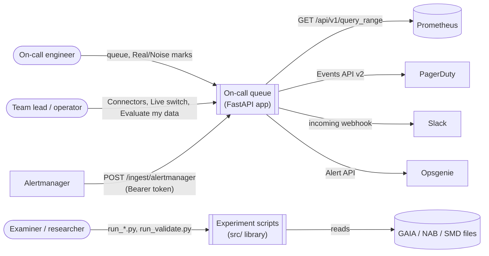
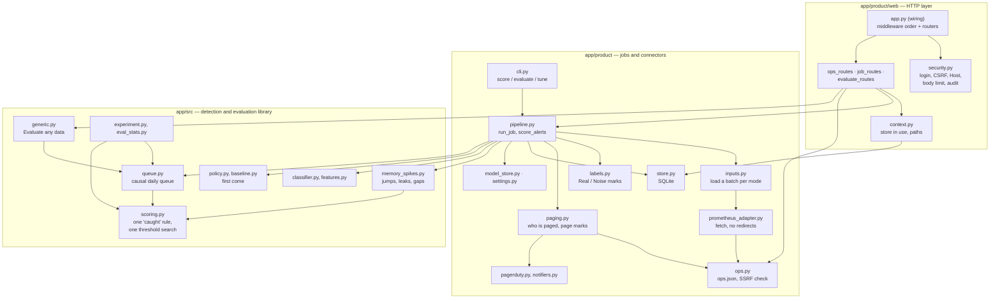
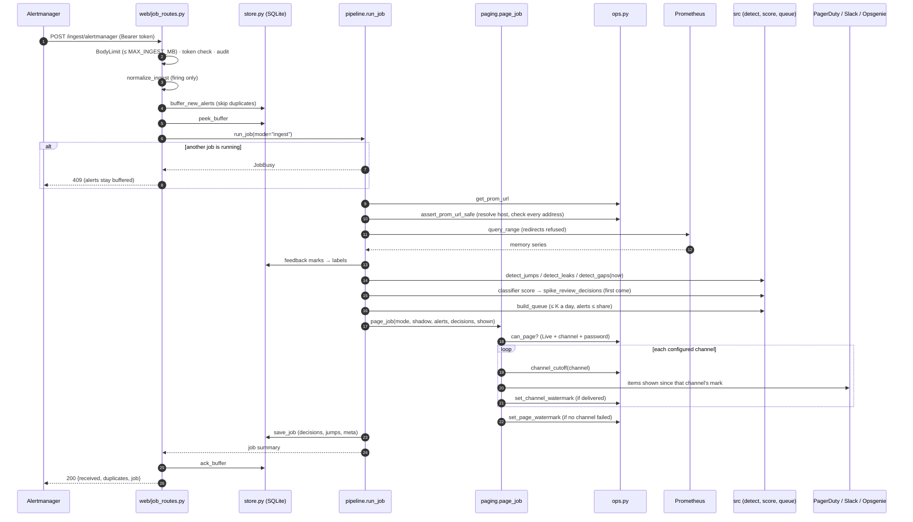
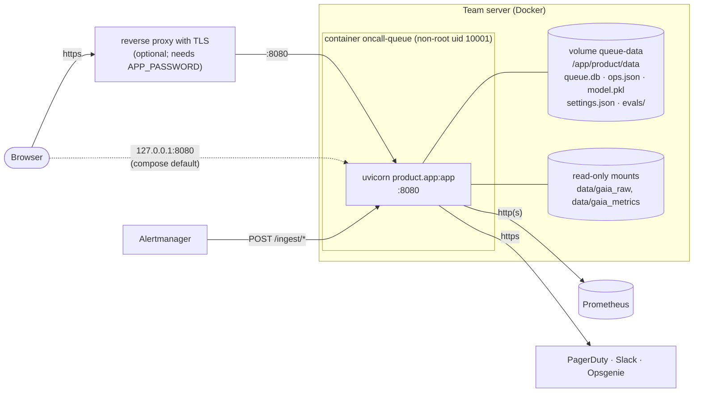
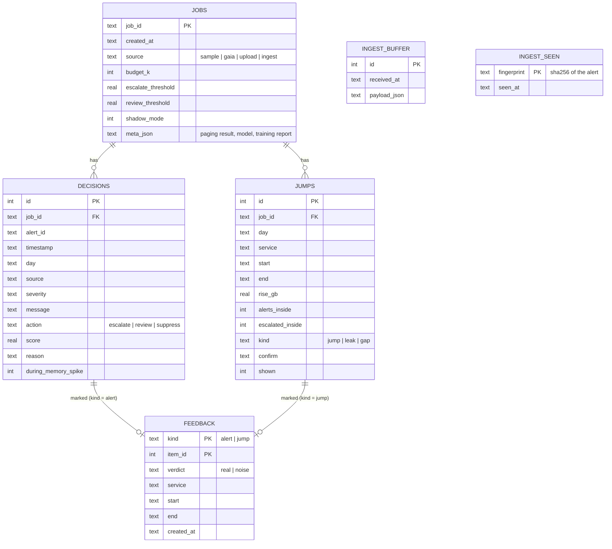

# Architecture

**System:** AI-Assisted On-Call Queue · **Version:** 1.0.4

Diagrams are Mermaid; GitHub renders them in place. Each one is drawn from the code, and file names are given so a reader can check.

---

## 1. Context

Who and what the system talks to.

Only webhook-ingest jobs may page, and only in Live mode (ADR 0002).

---

## 2. Components

The code has two layers: a library that knows nothing about HTTP (`app/src/`) and a product layer that wraps it in an app, storage and connectors (`app/product/`).

| Module | Responsibility | Depends on |
|---|---|---|
| `product/app.py` | Wires the middleware (audit → body limit → login) and the routers; nothing else | web |
| `product/web/security.py` | Login, CSRF and Host checks, request-body limit, audit log | uploads |
| `product/web/*_routes.py` | One module per route group: ops (health, connectors, `/ops/*`), jobs (queue, marks, uploads, ingest, pages), evaluate | context, pipeline, ops, generic |
| `product/web/context.py` | The queue store in use (`use_store`) and file locations | store |
| `product/pipeline.py` | `score_alerts` and the job orchestrator: load → label → score → save model → page → store | inputs, labels, paging, src |
| `product/inputs.py` | Read one batch for a mode (sample, GAIA, upload, ingest with Prometheus) | src, prometheus_adapter |
| `product/paging.py` | Decide whether a job may page, send to each channel, move the page marks | ops, pagerduty, notifiers |
| `product/store.py` | SQLite persistence; one transaction per call | — |
| `product/ops.py` | Operator state in `ops.json` (locked writes); SSRF check for Prometheus | — |
| `src/memory_spikes.py` | Jump, leak and gap detection; `Spike.open_at` | scoring |
| `src/policy.py`, `src/baseline.py` | Alert decisions under a daily budget, first come | config |
| `src/queue.py` | Build the causal queue; score it against faults | scoring |
| `src/scoring.py` | The one definition of a catch (same service, overlapping window) and the one lowest-cost threshold search | config |
| `src/generic.py` | Column detection, per-series tuning and the Evaluate report | memory_spikes, queue |

Design debt left after Phase 2: `src/generic.py` (about 700 lines) still mixes CSV sniffing, tuning and the report, and `policy.tune_threshold` (per-alert labels) is a separate search from `scoring.lowest_cost_threshold` (distinct faults), by design.

---

## 3. Sequence: a webhook batch that is scored and paged

`POST /ingest/alertmanager?score_now=1` in Live mode. File and function names are the ones in the code.

In shadow mode steps 19–21 are replaced by a *would-have-paged* record (every job keeps one). Step 22 still runs, so turning Live on never pages the shadow period.

---

## 4. Deployment

- The compose file publishes the port on `127.0.0.1` only. Sharing it needs `APP_PASSWORD`; a request that arrives through a proxy is refused without one.
- The image installs exact, hash-checked versions from `requirements.lock` (exported from `uv.lock`) and has a health check on `/health`.
- One process, one worker. The job lock, the evaluation lock and the `ops.json` lock are in-process, so running several workers or replicas is not supported (ADR 0003).

---

## 5. Data model (SQLite, `product/store.py`)

`FEEDBACK` keeps the service and time window of the marked item, so marks survive when old jobs are pruned (NFR-9). `INGEST_BUFFER` and `INGEST_SEEN` stand alone: the buffer is acknowledged after a successful job, and fingerprints expire after `INGEST_DEDUP_HOURS`.

Operator state that is not relational lives in `ops.json` (Live override, keys, Prometheus URL, page marks); it is written under a lock through a unique temporary file.
