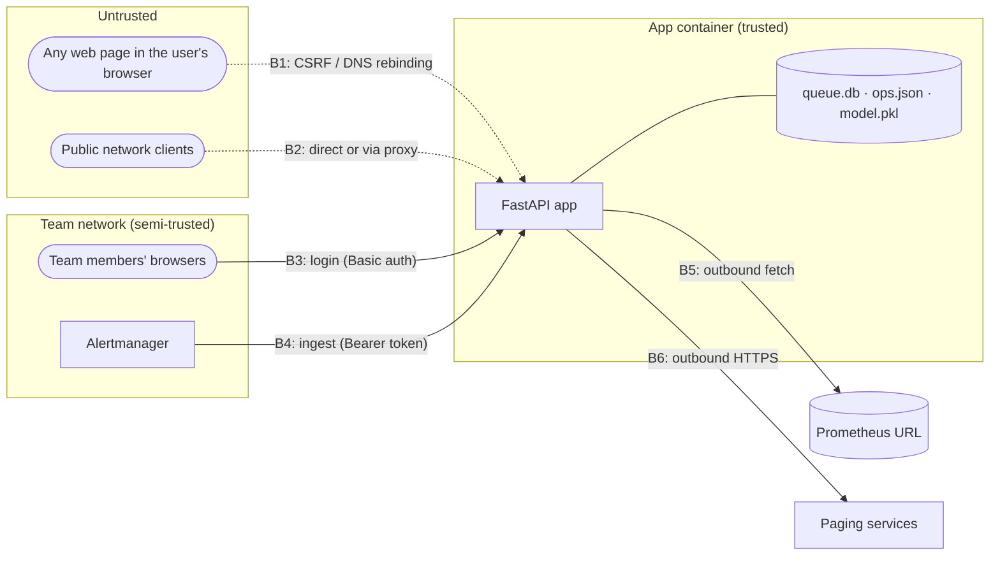

# Threat model

**System:** AI-Assisted On-Call Queue web app (`app/product/`) · **Version:** 1.2.4 · **Method:** STRIDE per trust boundary

The app can wake people up (PagerDuty, Slack, Opsgenie), holds the keys to do so, and can be told to call a URL (Prometheus). Those three facts drive this model.

---

## 1. Assets

| Asset | Why it matters |
|---|---|
| Paging channels (PagerDuty routing key, Slack webhook, Opsgenie key) | Whoever holds them can page the on-call team |
| The Live switch | Turns scoring into real pages |
| Network position of the app | It can reach internal services and cloud metadata that outsiders cannot |
| Alert and metric data, Real / Noise marks | Operational data about the team's systems |
| The saved model and settings | Change what is paged |

## 2. Trust boundaries

## 3. Threats and mitigations

| # | STRIDE | Threat | Mitigation in place | Verified by |
|---|---|---|---|---|
| T1 | Spoofing | A public client uses the app with no password set | Without `APP_PASSWORD` only loopback and private addresses are served; public ones get 403 | `test_no_password_means_private_networks_only` |
| T2 | Spoofing | Behind a reverse proxy every client looks private, so the open-access rule lets the internet in | A request carrying `X-Forwarded-For`, `Forwarded` or `X-Real-IP` needs a password | `test_forwarded_request_needs_a_password` |
| T3 | Spoofing | DNS rebinding: a page on `evil.example` resolves to 127.0.0.1 and drives the local API | A loopback client must send a local `Host` (or one in `ALLOWED_HOSTS`) | `test_loopback_client_needs_a_local_host_name` |
| T4 | Tampering | CSRF: a page the user visits posts to the app, and the browser attaches Basic-auth credentials | State-changing requests with a foreign `Origin` / `Referer` (or `Origin: null`) are refused | `test_cross_site_posts_are_refused` |
| T5 | Elevation | Anyone who reaches the app turns Live on and pages the team | Live needs `APP_PASSWORD`, a channel, typed `LIVE`; `can_page()` re-checks the password, so `SHADOW_MODE=0` cannot bypass it; only ingest jobs page | `test_api_live_requires_a_password`, `test_env_live_without_a_password_never_pages`, `test_sample_never_pages_even_when_live` |
| T6 | Info. disclosure | SSRF: the Prometheus URL points at cloud metadata or an internal service | The host is resolved once and every address is checked (loopback tricks, trailing dot, public names pointing inside, a name that does not resolve); the fetch dials that address and does not resolve the name again; private needs `PROM_ALLOW_PRIVATE=1` (off by default, also in Docker); metadata and link-local always refused; redirects refused | `test_loopback_tricks_are_refused`, `test_public_name_pointing_at_metadata_is_refused`, `test_unresolved_prometheus_host_is_refused`, `test_fetch_dials_the_address_from_the_safety_check`, `test_prometheus_fetch_refuses_redirects` |
| T7 | Info. disclosure | Keys leak through the API, errors or logs | Keys are shown as configured + last 4; errors report the exception type only; URLs are redacted; the audit log never logs bodies; `ops.json` is owner-only where supported | `test_routing_key_never_returned_full_on_get`, `test_failures_never_echo_the_secret`, `test_ops_changes_are_audited_without_secrets` |
| T8 | Info. disclosure | The ingest token ends up in proxy logs | The token is read from the `Authorization` header only; `?token=` is refused | `test_ingest_token_in_query_string_is_refused` |
| T9 | Denial of service | A huge upload or ingest body fills memory or disk | Bodies are counted while they stream and stopped with 413 (`MAX_UPLOAD_MB`, `MAX_INGEST_MB`); a batch over `INGEST_MAX_ALERTS` is 413; too many ingest POSTs are 429 | `test_oversized_ingest_body_is_refused`, `test_upload_above_limit_is_refused`, `test_ingest_alert_count_cap_returns_413`, `test_ingest_batch_cap_returns_429` |
| T10 | Denial of service | Parallel scoring or evaluations exhaust the CPU | One job and one evaluation at a time; others get 409 | `test_jobs_run_one_at_a_time`, `test_busy_job_returns_409` |
| T11 | Tampering | Retries or repeated webhooks page the same alert twice | Alerts are fingerprinted and not buffered twice within `INGEST_DEDUP_HOURS`; page marks are per channel | `test_resent_alerts_are_buffered_once`, `test_channel_mark_only_moves_the_channel_that_delivered` |
| T12 | Tampering | A changed model file changes what is paged | The model file is a zip of JSON and a skops (not pickle) scikit-learn file. A missing or mismatched SHA-256 is refused, a pickle is refused, and skops types outside `numpy.ravel` are refused. A corrupt registry fails closed (503 on `/models`); `POST /models/reset` with `RESET` quarantines the file | `test_tampered_model_file_is_refused`, `test_pickle_bytes_are_refused_even_with_a_matching_hash`, `test_corrupt_registry_is_not_treated_as_empty`, `test_corrupt_registry_returns_503_and_reset_quarantines_the_file` |
| T13 | Repudiation | Nobody can say who turned Live on or changed a key | Audit log (`oncall.audit`): method, path, status, login user, client; refused attempts too | `test_ops_changes_are_audited_without_secrets` |

## 4. Residual risks (accepted or planned)

| # | Risk | Why it remains | Plan |
|---|---|---|---|
| R1 | Closed: the fetch dials the address from the same lookup that passed the SSRF check | | |
| R2 | Closed: `POST /login` sets an HttpOnly session cookie for 12 hours. `COOKIE_SECURE=1`, or `X-Forwarded-Proto: https` from a proxy listed in `TRUSTED_PROXIES`, marks it Secure. Later requests send the cookie. Basic auth remains for scripts | | |
| R3 | Closed: five failed logins from one client lock that client for 60 seconds (`LOGIN_MAX_FAILS`, `LOGIN_LOCK_SECONDS`). `/health` stays open. Behind a reverse proxy set `TRUSTED_PROXIES` so the lock keys on the forwarded client, read from the right of `X-Forwarded-For` (the first hop that is not a trusted proxy), so a client cannot prepend fake addresses to split the lock; without it, `X-Forwarded-For` is ignored. Every `X-Forwarded-For` / `Forwarded` header line is read, so a proxy that adds its own line instead of appending cannot be bypassed either. Fixed after a code review on 10 October, which found the leftmost value, and only the first header line, were used (`test_login_lock_cannot_be_split_by_prepending_xff`, `test_login_lock_holds_when_the_proxy_adds_its_own_xff_line`) | | |
| R4 | Closed: `APP_VIEWER_PASSWORD` (user `APP_VIEWER_USER`, default `viewer`) can read the queue. Any write other than login and logout returns 403. `APP_PASSWORD` is the operator | | |
| R5 | Closed: the audit log is appended to `audit.log` next to the ops file (mode 0600 where the OS allows), and still copied to stdout. `AUDIT_LOG_PATH` moves the file; `off` keeps stdout only | | |
| R6 | Closed: paging keys are stored in `secrets.json` (owner-only), or read from a file in `SECRETS_DIR` (Docker secrets) or from the environment. Saving strips those fields out of `ops.json` | |
| R7 | Closed: paging remembers item keys, so a late point with a new key is still paged | | |
| R8 | Closed: model files are a JSON plus skops archive. `load_model` never calls pickle or joblib | | |
